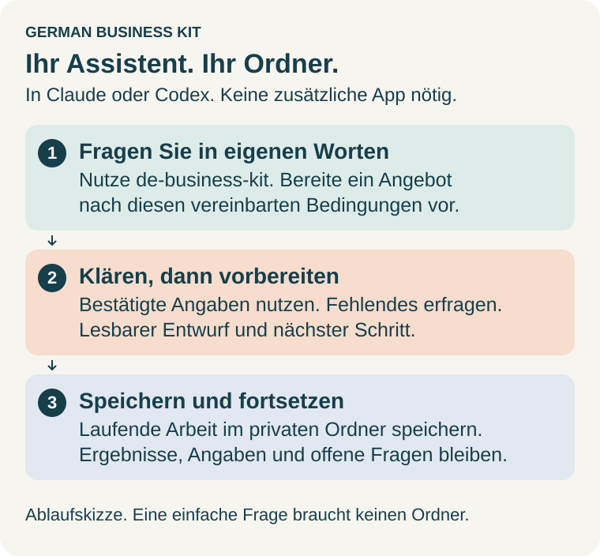
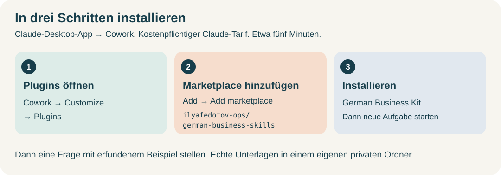

# German Business Kit

[English](README.md) · [Русский](README.ru.md) · **Deutsch**

**Skills für Claude und Codex, die Ihnen helfen, Ihr eigenes kleines Unternehmen in Deutschland zu gründen und zu führen.** Fragen Sie in normalem Deutsch, Englisch oder Russisch: eine freiberufliche oder gewerbliche Tätigkeit aufnehmen, ein Schreiben des Finanzamts verstehen, eine Rechnung vorbereiten, Belege ordnen, eine Steuererklärung vorbereiten oder eine Änderung bzw. Beendigung planen. Programmieren müssen Sie nicht.

Arbeiten Sie in Ihrem gewohnten Assistenten. Für laufende Arbeit speichert er
Dokumente, bestätigte Angaben, offene Fragen und den Arbeitsstand in Ihrem privaten
Unternehmensordner. Sie können Ihre Arbeit selbst erledigen und bei konkreten
Fragen fachliche Hilfe hinzuziehen. Eine eigene Anwendung von German Business Kit
ist nicht nötig.

> **KI-Unterstützung, keine professionelle Steuerberatung.** German Business Kit ist
> Selbsthilfe-Software, kein Steuerberater und keine professionelle Steuerberatung.
> KI kann Fehler machen, auch bei Berechnungen und Fristen. Inhalte, die Codex oder
> Claude lesen, können von OpenAI oder Anthropic verarbeitet werden; ein lokaler
> Ordner bedeutet keine rein lokale KI. [Lesen Sie die Hinweise zu Risiken und Datenverarbeitung](skills/de-business-kit/guides/user-guide.de.md#ki-grenzen-und-ihre-daten), bevor Sie echte Dokumente teilen.



## Hier starten

Öffnen Sie **Claude Code**, die **Claude**-App oder **Codex** und fügen Sie ein:

> Installiere German Business Kit von https://github.com/ilyafedotov-ops/german-business-skills. Folge den Installationsanweisungen des Repositorys für meine App und verwende die veröffentlichte Version, keine Kopie der aktuellen Repository-Dateien. Prüfe, ob alle sieben Skills installiert sind, und sag mir dann, wie ich eine neue Sitzung starte und die Willkommens-Einrichtung beginne.

Ihr Assistent kann die Anweisungen prüfen und die Einrichtung so weit ausführen, wie
seine Werkzeuge es erlauben: Claude Code führt die Plugin-Befehle nach Ihrer
Bestätigung aus, in der Claude-App führt er Sie bis **Install**, und Codex kopiert
die veröffentlichten Skills in Ihr Projekt. **Fertig, wenn:** die sieben Skills in
einer neuen Aufgabe bzw. einem neuen Chat verfügbar sind und Sie das Beispiel unten
ausprobieren können. Eine Chatantwort allein bestätigt keine Installation.
[Ausführliche Einrichtung und Hilfe](skills/de-business-kit/guides/install.de.md).

Neu bei Claude und ChatGPT? Die offline nutzbare [geführte Einrichtungsseite](docs/setup-page.md)
(Beschreibung auf Englisch) auf Deutsch, Englisch und Russisch erklärt Konten,
App-Downloads, Installation des Kits und erste Beispiele mit erfundenen Daten.
Wählen Sie **Code → Download ZIP**, entpacken Sie die Datei und öffnen Sie
`installer/index.html` im Browser.

### Empfohlenes Modell

Für diese Skills, besonders für Recherche, Formulare, Buchhaltung und Steuern,
empfehlen wir **Claude Opus 5.5 mit hohem Denkaufwand (High)** oder **GPT-6 Astra
mit hohem Reasoning-Aufwand (High)**, sofern App und Tarif sie anbieten. Wählen Sie
Modell und Denkaufwand in der App; „denk gründlicher“ in einer Anfrage ändert die
Einstellung nicht. Stärkeres Reasoning kann länger dauern und mehr Kontingent
verbrauchen. Für einfache Erklärungen oder Formatierung genügt ein leichteres
Modell. Die Modellwahl ersetzt nie aktuelle Quellen, vollständige Eingaben oder
Rechenprüfungen.
[Modelleinstellungen und Alternativen](skills/de-business-kit/guides/install.de.md#modell-wählen).

### Optionale Hilfe mit Browser und Computer

Für ein Formular auf einer unterstützten Website, einen ausgewählten Export oder
eine Aufgabe nur in einer App bitten Sie den Assistenten, die verfügbaren
**Browser- und Computer-Werkzeuge samt Hilfs-Skills** zu prüfen und zu empfehlen.
Für viele Recherchefragen genügt die Websuche; für einen normalen Chat oder ein
lokales Dokument ist keine Bildschirmsteuerung nötig. Ein Skill allein gewährt
keinen Zugriff.
[Wann diese Werkzeuge nötig sind, Einrichtung je App und Grenzen](skills/de-business-kit/guides/assisted-services.de.md#wann-browser--oder-computer-werkzeuge-einschalten).

> Nutze de-business-kit. Prüfe, welche Browser- oder Computer-Werkzeuge für diese Aufgabe verfügbar sind. Nutze eine passende vorhandene Verbindung oder erkläre die unterstützte Einrichtung und die Berechtigungen, falls eine Interaktion nötig ist. Anmeldung und die abschließende Übermittlung übernehme ich.

### Erstes Gespräch

Starten Sie nach der Installation eine neue Aufgabe bzw. einen neuen Chat und senden Sie:

> Nutze de-business-kit. Ich habe das Kit gerade installiert. Starte die Willkommens-Einrichtung: Prüfe, ob alles funktioniert, und führe mich Schritt für Schritt.

Der Assistent prüft Kit, Hilfsprogramm und Ordner und führt Sie dann in kurzen Schritten durch Sprache, Ihre Situation, einen privaten Unternehmensordner, den Umgang mit Ihren Daten und eine erste Aufgabe.

In **Codex** können Sie auch **`$de-business-kit`** verwenden. In **Claude** tippen
Sie **/** oder öffnen **+** und wählen **de-business-kit** aus **German Business
Kit**. Diesen allgemeinen Helfer können Sie immer nutzen; die Namen der Fach-Skills
müssen Sie sich nicht merken.
[Wie Sie einen Skill aufrufen](skills/de-business-kit/guides/user-guide.de.md#einen-skill-aufrufen).

Geben Sie dem Assistenten für laufende Arbeit Zugriff auf einen privaten
Unternehmensordner und bitten Sie ihn, bestätigte Angaben, Ergebnisse, offene Fragen
und den nächsten Schritt dort zu speichern. Kehren Sie beim nächsten Mal zu
demselben Ordner zurück. Eine einfache Frage braucht weder Ordner noch vollständige
Einrichtung.

<details>
<summary>Lieber manuell installieren?</summary>

### Claude Code

```bash
claude plugin marketplace add ilyafedotov-ops/german-business-skills
claude plugin install de-business-kit@german-business-kit
```

Starten Sie dann eine neue `claude`-Sitzung in Ihrem privaten Unternehmensordner.

### Claude-App in drei Schritten

Öffnen Sie mit einem passenden Claude-Konto **Cowork → Customize → Plugins** (manche
Versionen fassen Chat und Cowork zusammen) und dann:

1. Wählen Sie **Add → Add marketplace**.
2. Wählen Sie, falls angeboten, **Add from a repository**, geben Sie `ilyafedotov-ops/german-business-skills` ein, wählen Sie es aus und dann **Sync**.
3. Suchen Sie **German Business Kit** und wählen Sie **Install**.



[Einrichtung in Claude und Kontovoraussetzungen](skills/de-business-kit/guides/install.de.md#in-claude-installieren) · [Einrichtung in Claude Code](skills/de-business-kit/guides/install.de.md#in-claude-code-installieren) · [Einrichtung in Codex](skills/de-business-kit/guides/install.de.md#in-codex-installieren)

</details>

## Was Sie fragen können

Kopieren Sie eine Anfrage unten und ersetzen Sie die Angaben durch Ihre eigenen.
Die Beispiele zeigen Wege, um Unterstützung zu bitten; sie versprechen nicht, dass
ein Dienst schon verbunden ist oder dass sich jedes Dokument ohne fehlende Angaben
fertigstellen lässt. Der Assistent soll gespeicherte Informationen wiederverwenden,
gezielt nachfragen und ein konkretes Hindernis erklären.

### Eine Idee prüfen oder anfangen

| Ihre Situation | Beispielanfrage |
| --- | --- |
| Sie haben eine Idee | Nutze de-business-start. Ich möchte neben meinem Job Websites für kleine Firmen bauen. Was sollte ich zuerst klären? Gib mir einen überschaubaren nächsten Schritt. |
| Sie haben eine allgemeine Frage | Nutze de-business-kit. Erkläre den Unterschied zwischen Freiberufler und Gewerbe in einfachen Worten. Welche Angaben zu meiner Arbeit sind wichtig? |
| Sie wollen sich anmelden | Nutze de-business-start. Hilf mir, die Anmeldung dieser Tätigkeit vorzubereiten. Nutze die schon gespeicherten Angaben und frag nach Fehlendem. |
| Sie wählen Dienste | Nutze de-business-services. Ich erwarte Kunden in Deutschland und im Ausland. Hilf mir, Geschäftskonten, Versicherungen und Software für meinen Bedarf und mein Budget zu vergleichen. |
| Sie wollen einen Kauf verstehen | Nutze de-business-tax. Ich habe einen Laptop in Raten gekauft und nutze ihn auch privat. Welche Angaben brauchst du, um seine Behandlung für mein Unternehmen zu erklären? |

### Dokumente ausfüllen und Alltagsarbeit erledigen

| Ihre Situation | Beispielanfrage |
| --- | --- |
| Ein Kunde möchte ein Angebot | Nutze de-business-operations. Mach aus diesen vereinbarten Leistungen, Preisen und Terminen ein deutsches Angebot, mit einer getrennten Erläuterung für mich. |
| Sie haben ein Formular oder eine Tabelle | Nutze de-business-kit. Hilf mir, dieses angehängte Formular oder diese Tabelle aus meinen gespeicherten Geschäftsangaben auszufüllen. Bewahre das Original, markiere fehlende Antworten und zeig den ausgefüllten Entwurf. |
| Sie brauchen eine Rechnung | Nutze de-business-operations. Bereite aus diesen vereinbarten Bedingungen eine Rechnung mit meinem bestehenden Nummernkreis vor. Prüfe fehlende Angaben, bevor sie ausgestellt wird. |
| Ihre Unterlagen sind verstreut | Nutze de-business-accounting. Sieh dir die ausgewählten Belege und den Bankexport für Oktober 2026 an. Zeig, was zusammengehört, was fehlt und was ich prüfen muss. |
| Sie haben ein amtliches Schreiben erhalten | Nutze de-business-tax. Erkläre mir dieses Schreiben des Finanzamts, prüfe die Frist und bereite eine Antwort vor. Halte meine privaten Notizen vom Schreiben getrennt. |
| Sie bereiten Erklärungen vor | Nutze de-business-tax. Hilf mir, meine Erklärungen für 2026 in meinem gewählten System vorzubereiten. Prüfe Voraussetzungen, recherchiere die maßgeblichen Regeln und prüfe jede Berechnung. Zeig, was vor der Übermittlung noch fehlt. |

### Vorhandene Dienste verbinden oder nutzen

| Ihre Situation | Beispielanfrage |
| --- | --- |
| Sie wollen Hilfe mit E-Mail | Nutze de-business-services. Hilf mir, Gmail für Geschäftsdokumente zu nutzen. Prüfe, welche Verbindung verfügbar ist, und führe mich durch fehlende Einrichtung. Liste zuerst die relevanten Nachrichten für den von mir gewählten Zeitraum auf. |
| Sie nutzen bereits Buchhaltungssoftware | Nutze de-business-accounting. Ich nutze sevdesk. Prüfe, ob du mit meinem Konto arbeiten kannst oder einen Export brauchst. Es bleibt mein maßgebliches Buchhaltungssystem; erkläre, was du tun kannst. |
| Sie brauchen eine Bankanbindung | Nutze de-business-services. Hilf mir, mein vorhandenes Geschäftskonto zur Prüfung der Umsätze anzubinden. Prüfe unterstützten Zugang und Berechtigungen; falls nicht verfügbar, hilf mir mit einem Kontoauszug-Export. |
| Sie wollen Hilfe in ELSTER | Nutze de-business-tax. Hilf mir, meinen vorhandenen ELSTER-Entwurf mit bestätigten Angaben auszufüllen. Prüfe den verfügbaren Zugang, zeig, was du eingetragen hast, und überlass mir den Versand. |
| Sie brauchen Dateien aus einem Dienst | Nutze de-business-accounting. Hilf mir, die Dokumente für Oktober aus Lexware Office zu holen. Bestätige den Datumsfilter und dass die tatsächlichen Dateien heruntergeladen wurden; lass vorhandene Buchungen unverändert. |

Verbindungen hängen von Ihrer App, Ihrem Konto und den verfügbaren Werkzeugen ab.
Der Assistent soll diese zuerst prüfen, durch fehlende Einrichtung führen und bei
Bedarf mit ausgewählten Dateien arbeiten. Sie melden sich über die offizielle
Anmeldung des Dienstes an. [Hilfe bei Formularen und Diensten](skills/de-business-kit/guides/assisted-services.de.md).

### Änderungen, Fortsetzung und knifflige Situationen

| Ihre Situation | Beispielanfrage |
| --- | --- |
| Sie kennen den nächsten Schritt nicht | Nutze de-business-kit. Lies meinen gespeicherten Stand und hilf mir, den nächsten sinnvollen Schritt zu wählen. Frag nur nach fehlenden oder geänderten Angaben. |
| Sie stellen eine mehrdeutige Frage | Nutze de-business-tax. Ich habe 60.000 Euro verdient. Wie viel Steuer könnte ich zahlen? Kläre zuerst, was dieser Betrag bedeutet und was für eine Schätzung sonst noch nötig ist. |
| Sie haben mehrere Tätigkeiten | Nutze de-business-changes. Ich möchte eine zweite Tätigkeit aufnehmen. Prüfe, was sich für mich als eine Person ändert und was mit meinem bestehenden Unternehmen gemeinsam bleibt. |
| Ein Kunde hat nur teilweise gezahlt | Nutze de-business-operations. Diese Rechnung wurde teilweise bezahlt und später korrigiert. Vergleiche Rechnung, Korrektur und Zahlungen, bevor du eine Erinnerung vorbereitest. |
| Ein Übermittlungsergebnis ist unklar | Nutze de-business-tax. ELSTER hat eine Zeitüberschreitung gemeldet und ich finde keinen Beleg. Hilf mir zu prüfen, was passiert ist, bevor wir erneut senden. |
| Sie wollen jemanden einstellen | Nutze de-business-changes. Ich denke über meinen ersten Mitarbeiter nach. Hilf mir, die nötigen Entscheidungen, Dokumente und Anmeldungen zu erkennen, bevor ich ein Startdatum wähle. |
| Sie wollen pausieren oder aufhören | Nutze de-business-changes. Hilf mir, eine Pause oder die Aufgabe dieser Tätigkeit zu planen, während meine andere Arbeit weiterläuft. Zeig offene Pflichten und aufzubewahrende Unterlagen. |
| Sie haben Ihre Pläne geändert | Nutze de-business-kit. Mein früherer Plan hat sich ab [Datum] von [alter Plan] zu [neuer Plan] geändert. Aktualisiere die betroffenen gespeicherten Angaben und nächsten Schritte und bewahre die frühere Entscheidung. |

Bei jeder Aufgabe soll der Assistent passende gespeicherte Angaben lesen, fehlende
oder mehrdeutige Details klären und bestätigte Entscheidungen sowie den nächsten
Schritt für später speichern. Weitere Beispiele, Hinweise zu Dateien und Sicherungen
stehen im [Benutzerhandbuch](skills/de-business-kit/guides/user-guide.de.md).

## Ihr Unternehmensordner

Das **installierte Kit** enthält Anweisungen und Vorlagen. Ihr **privater
Unternehmensordner** enthält Ihre Unterlagen. Halten Sie beides getrennt und
außerhalb dieses öffentlichen Repositorys. Für eine einfache Frage ist kein Ordner
nötig. Bitten Sie den Assistenten erst dann, einen Ordner anzulegen, wenn Sie
laufende Arbeit speichern möchten; bauen oder bearbeiten Sie seine internen Dateien
nicht von Hand. Gewählte vorhandene Buchhaltungssoftware bleibt Ihre maßgebliche
Aufzeichnung.

Ein neuer Ordner hat fünf Bereiche für den Alltag. Wählen Sie bei der Einrichtung
deutsche, englische oder russische Ordnernamen. Dieses Beispiel zeigt die deutsche
Struktur:

```text
Mein Unternehmen/
├── HIER-STARTEN.md         Wo Sie beginnen und wie Sie weitermachen
├── ÜBERSICHT.html          Zuletzt gespeicherte Übersicht; der Assistent aktualisiert sie
├── 01 Eingang/             Unsortierte Dateien, die auf den Import warten
│   └── Importiert/2026-10/   Dateien nach ihrem Import
├── 02 Dokumente/           Aufbewahrte Quelldokumente
│   └── 2026/10/
│       ├── Originale/            Nummerierte Kopien, z. B. 2026-00007_Rechnung.pdf
│       └── Ausgangsrechnungen/   Kopien Ihrer ausgestellten Rechnungen
├── 03 Buchhaltung/
│   ├── Bank/2026/          Kontoauszüge, Bankvergleiche und Arbeitsdateien
│   ├── Unterlagen/         Notizen zum Buchhaltungssystem und Vereinbarungen
│   ├── Berichte/           Abgleiche, Berichte und ausgewählte Exporte
│   └── Verfahrensdokumentation/  Entwurf zum Ergänzen
├── 04 Steuern/
│   └── 2026/               Steuerfragen, Schätzungen, Formulare und Übermittlungsnachweise
├── 05 Unternehmen/
│   ├── Anmeldung/          Gründungspläne, Anmeldung und Änderungen der Tätigkeit
│   └── Schriftverkehr/2026/  Kundenfälle, Schreiben und Dienstleistungsvergleiche
├── .business-kit/          Profil, Aufgaben, Fragen, Entscheidungen, Verlauf und Arbeitsdateien
└── .workspace-layout.json  Interne Zuordnung der Ordnersprache
```

Monats- und Aufgabenordner entstehen nur bei Bedarf. Ein Angebot für einen Kunden
gehört in dessen Fall; es ist etwas anderes als ein Buchungsvorschlag aus der
Prüfung von Buchhaltungsdaten. Gespeicherte Antworten und Recherchen bleiben beim
passenden Thema, sodass allgemeine Hilfe, Kundenarbeit, Einrichtung von Diensten und
Beendigung keine eigenen Ordner auf oberster Ebene brauchen.
[Was jeder Ordner enthält](skills/de-business-kit/guides/user-guide.de.md#ihre-ordner) und [wo jede Art von Anfrage gespeichert wird](skills/de-business-kit/guides/user-guide.de.md#wo-ergebnisse-gespeichert-werden).

> Nutze de-business-kit. Zeig die Ordner in meinem gewählten Unternehmensordner, erkläre, was wohin gehört, und verlinke das letzte Ergebnis und den nächsten Schritt. Lass vorhandene Dateien und Ordnernamen unverändert.

Eine Person behält ein gemeinsames Profil über Tätigkeiten und Jahre hinweg. Die
Ordnersprache ist von der Gesprächssprache unabhängig und benennt nie Ordner um.
Ordner aus Vorschauversionen vor 0.12 werden nicht geöffnet; legen Sie einen neuen
Ordner an und importieren Sie die Originale. Ein Ordnername beweist weder Prüfung
noch Zahlung oder Übermittlung. Nehmen Sie versteckte Dateien und `.business-kit` in
eine vollständige, getrennt aufbewahrte Sicherung auf; **Berichte sind keine
Sicherung**. JSON bearbeiten oder diese Pfade kennen müssen Sie nicht.

## Gut zu wissen

- **Es bereitet vor; Sie entscheiden und senden.** Der Assistent entwirft Formulare, Schreiben und Aufzeichnungen. Bei ELSTER, Ihrer Bank oder Ihrer Buchhaltungssoftware melden Sie sich selbst an und klicken selbst zum Abschluss.
- **Erst recherchieren, dann rechnen; erst prüfen, dann verlassen.** Es klärt fehlende Angaben, recherchiert die Regeln für den maßgeblichen Zeitraum und kann begrenzte Schätzungen mit festgehaltenen Prüfungen berechnen. Eine vollständige gesetzliche Steuer-Engine und direkte ELSTER-Übermittlung sind nicht enthalten. Sie können Ihre Erklärungen selbst erledigen und bei konkreten Fragen fachliche Hilfe hinzuziehen.
- **Über Ihre Daten entscheiden Sie.** Inhalte, die Ihr Assistent liest, können an seinen KI-Anbieter gesendet werden; lokale Ablage bedeutet keine rein lokale Verarbeitung. Probieren Sie zuerst ein erfundenes Beispiel, halten Sie echte Unterlagen in einem getrennten privaten Ordner und tippen Sie nie Passwörter oder TANs in den Chat.
- **Dies ist eine Vorschauversion** (0.14.0-preview.1). Siehe [was heute funktioniert und was geplant ist](docs/project-status.md) (Englisch).

## Mehr

- [Installationsanleitung](skills/de-business-kit/guides/install.de.md): Claude Schritt für Schritt, Codex, Updates, Hilfe
- [Benutzerhandbuch](skills/de-business-kit/guides/user-guide.de.md): Aufgaben, Dateien, Fortsetzen, Sicherungen
- [Hilfe in ELSTER und Buchhaltungssoftware](skills/de-business-kit/guides/assisted-services.de.md)
- [Launch-Materialien](presentation/README.md): LinkedIn-Karussells auf Englisch und Deutsch, Videoskripte und echte Beispielantworten
- Für Entwickler (Englisch/Russisch): [technische Dokumentation](docs/index.md), [Mitwirken](CONTRIBUTING.md), [Änderungen](CHANGELOG.md), [Sicherheit](SECURITY.md)

<details>
<summary>Welche Ordner gibt es in diesem Repository?</summary>

| Ordner | Zweck |
| --- | --- |
| `skills/` | Das vollständige Produkt mit sieben Skills. `de-business-kit/` enthält gemeinsame Anleitungen, Referenzen, Vorlagen und Hilfsprogramme; die anderen sechs Ordner sind Einstiege für Fach-Skills. Installieren Sie sie zusammen. |
| `docs/` | Architektur, aktueller Umfang, Recherche und Validierung für Maintainer. Benutzeranleitungen liegen in `skills/de-business-kit/guides/`. |
| `examples/` | Synthetische Beispiele, nie echte Geschäftsunterlagen. |
| `installer/` | Offline nutzbare geführte Einrichtungsseite auf Deutsch, Englisch und Russisch. |
| `presentation/` | Launch-Karussells, Videoskripte und ihre Designquellen; nur erfundene Personen, nie echte Unterlagen. |
| `tools/`, `packaging/` | Werkzeuge für Build, Installation und Release sowie Paketanleitungen. |
| `tests/`, `evals/` | Automatische Prüfungen und Szenarien für Assistenten-Abläufe. |
| `.claude-plugin/`, `.github/` | Metadaten für die Verteilung und Automatisierung des Repositorys. |

Das sind Produkt- und Entwicklungsordner, kein Ort für Ihre Kundendateien.

</details>

MIT-Lizenz. Claude und andere Dienste haben eigene Bedingungen.
