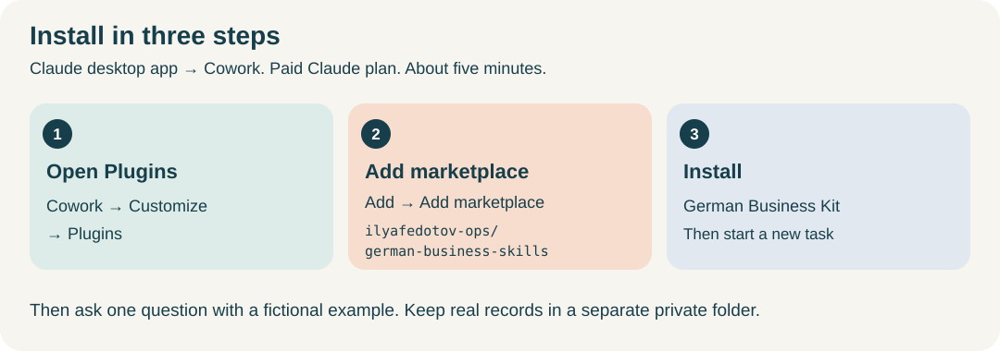

# German Business Kit

**English** · [Русский](README.ru.md) · [Deutsche Startanleitung](skills/de-business-kit/guides/start.de.md)

**An AI assistant skill set for starting and running a business in Germany.** Get help with opening an activity, questions, forms, everyday documents, accounting, reports, changes and closure. Designed for Freiberufler and Einzelunternehmen/Gewerbe.

## Start here

**[First-time setup: from installing your AI app to your first answer →](skills/de-business-kit/guides/install.en.md)**

You do not need to code. The guide explains what Codex and Claude Code are, helps you choose one, and walks through installing the app, adding all seven skills and trying a fictional example. It includes expected results, diagrams and help when a step fails.

1. **Open an AI assistant:** Codex or Claude Code on your computer.
2. **Add German Business Kit:** install the complete seven-skill bundle in your assistant project.
3. **Ask for one result:** “I want to start working as a translator in Germany. Help me choose one small first step.”

## User documentation

1. [Install from the beginning](skills/de-business-kit/guides/install.en.md) — choose Codex or Claude Code, add the bundle and get your first answer.
2. [User guide](skills/de-business-kit/guides/user-guide.en.md) — choose a task, find files, continue work and restore a backup.
3. [Forms and services](skills/de-business-kit/guides/assisted-services.en.md) — check access, fill a draft, retrieve an export and confirm the final action.

The [optional Windows/macOS application](gui/README.md) has separate instructions included in its archive.

## What it helps with

| Your task | Help available |
| --- | --- |
| Start a business | Clarify the activity, research requirements, prepare a registration plan and form drafts |
| Understand a question or letter | Explain the issue, check current sources, identify missing facts and prepare a reply |
| Work with customers | Proposals, invoices, payment follow-up and correspondence |
| Organize accounts and taxes | Document review, reconciliation guidance, supported local cash records and reporting preparation |
| Choose or change services | Compare banking, insurance and software; inspect supplied exports |
| Change, hire, pause or close | Prepare the steps, documents, dependencies and outstanding obligations |

You can ask a simple question before choosing accounting software or creating a records folder. When you choose an existing accounting system, it stays authoritative. The optional local records application supports file operations; it is not needed for the first conversation.

**Preview limits:** no complete tax calculation engine, production service connectors or direct ELSTER transmission. Lexware testing currently uses local examples. Preparing a form does not submit it. See [current capabilities and remaining work](docs/project-status.md).

## Example requests

- “I want to open an activity in Germany. Help me find the next step; ask only for facts you need.”
- “Explain this Finanzamt letter in Russian and help prepare a German reply.”
- “Can a phone bought in installments be a business expense? Check the applicable sources and ask for missing facts before giving concrete accounting treatment.”
- “Continue from my saved workspace. Show what is unfinished and the next action.”

Before using real documents, establish what content the AI service and connected tools may receive. Keep private records in a separate business folder. Enter passwords, TANs and certificates only through official authentication screens.

## Download and technical documentation

The [0.9.0-preview.1 release page](https://github.com/ilyafedotov-ops/german-business-skills/releases/tag/v0.9.0-preview.1) provides `-codex.zip`, `-claude.zip` bundles and separate applications. Install all seven skills together: the router and six domain skills share resources and one profile. The installation guide explains archive selection and verification.

Use the named archives after publication and provenance verification; a source checkout is not a verified release. This version includes the installation guides, assisted-service workflows and consolidated documentation. User guides and report templates cover EN/RU; German navigation does not imply full German reporting. [Current status and P1–P7 roadmap](docs/project-status.md) separate implementation from unfinished acceptance.

For developers and maintainers: **[technical documentation](docs/index.md)** covers architecture, ontology, builds, releases and validation. Start with [CONTRIBUTING](CONTRIBUTING.md); repository rules are in [AGENTS.md](AGENTS.md). Actual tests, limits and history are in the [validation summary](docs/validation.md).

[Changes](CHANGELOG.md) · [Security](SECURITY.md) · [MIT license](LICENSE). AI apps and services have their own terms. Workflow names do not confer licensed Steuerberater status.
