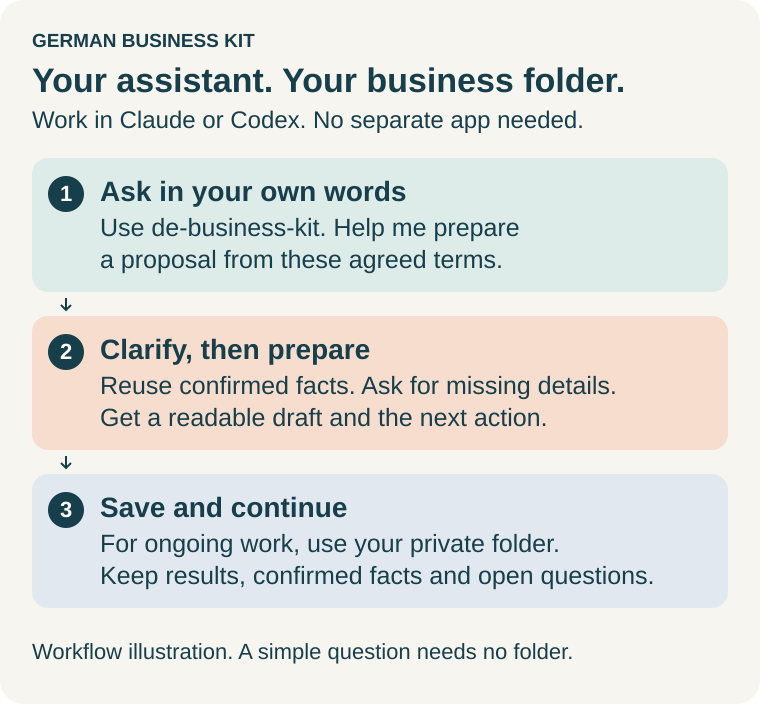

# German Business Kit

**English** · [Русский](README.ru.md) · [Deutsche Startanleitung](skills/de-business-kit/guides/start.de.md)

**Skills for Claude and Codex that help you start and run your own small business in Germany.** Ask in plain English or Russian: open a Freiberufler or Gewerbe activity, understand a Finanzamt letter, prepare an invoice, organize receipts, get ready for a tax return, or plan a change or closure. You do not need to code.

Work in your usual assistant. For ongoing work, it saves documents, confirmed facts,
open questions and progress in your private business folder. You can manage your
own work, with professional help for specific issues when needed. No separate
German Business Kit application is required.

> **AI assistance, not professional tax advice.** German Business Kit is self-help
> software, not a Steuerberater or a professional tax-advisory service. AI can
> make mistakes, including in calculations and deadlines. Content read by Codex
> or Claude can be processed by OpenAI or Anthropic; a local folder does not mean
> local-only AI. [Read the risks and data-processing guidance](skills/de-business-kit/guides/user-guide.en.md#ai-limits-and-your-data) before sharing real documents.



## Start here

Open **Codex** or **Claude** and paste:

> Install German Business Kit from https://github.com/ilyafedotov-ops/german-business-skills and show me how to use it. Follow the repository's installation instructions for my app, check that the complete kit is available, and help me try one small example.

Your assistant can inspect the instructions and perform the setup its tools allow.
If your app needs you to choose a folder or click **Install**, it should guide you
through that step. **Done when:** the seven skills are available in a fresh task
or chat and you can try the example below. A chat response alone does not verify
installation. [Detailed setup and troubleshooting](skills/de-business-kit/guides/install.en.md).

### Recommended model

For these skills, especially research, forms, accounting and tax work, we recommend
**Claude Opus 5.5 with High effort** or **GPT-6 Astra with High reasoning effort**,
where your app and plan offer them. Select the model and effort in the app;
writing “think harder” in a request does not change the selected setting.
Stronger reasoning can take longer and use more of your allowance. A lighter
model is fine for simple explanations or formatting. Model choice never replaces
current sources, complete inputs or calculation checks.
[Model settings and alternatives](skills/de-business-kit/guides/install.en.md#choose-a-model).

### Optional browser and computer help

For a supported website form, selected export or app-only task, ask the assistant
to check and recommend the available **browser/computer-use tools and helper
skills**. Web search is enough for many research questions; screen control is not
needed for an ordinary chat or local document. A skill alone does not grant access.
[When to enable these tools, app setup and limits](skills/de-business-kit/guides/assisted-services.en.md#when-to-enable-browser-or-computer-tools).

> Use de-business-kit. Check which browser or computer tools are available for this task. Use a suitable existing connection, or explain the supported setup and permissions if interaction is needed. I will handle login and the final submission.

### First conversation

After installation, start a new task/chat and send:

> Use de-business-kit. I am new here. Show me how to ask for help and give me three examples relevant to my situation. I am [planning a business / already working / preparing reports / making a change].

In **Codex**, you can also use **`$de-business-kit`**. In **Claude**, type **/** or
open **+** and select **de-business-kit** from **German Business Kit**. You can
always use this general helper; remembering the specialist names is optional.
[How to call a skill](skills/de-business-kit/guides/user-guide.en.md#call-a-skill).

For ongoing work, give the assistant access to a private business folder and ask
it to save confirmed facts, results, open questions and the next step there.
Return to that same folder next time. A simple question needs no folder or full setup.

<details>
<summary>Prefer to install manually?</summary>

### Claude installation in three steps

With an eligible Claude account, open **Cowork → Customize → Plugins** (some
versions combine Chat and Cowork), then:

1. Select **Add → Add marketplace**.
2. Choose **Add from a repository** if offered, enter `ilyafedotov-ops/german-business-skills`, select it and choose **Sync**.
3. Find **German Business Kit** and select **Install**.


[Claude setup and account requirements](skills/de-business-kit/guides/install.en.md#install-in-claude) · [Codex setup](skills/de-business-kit/guides/install.en.md#install-in-codex)

</details>

## What to ask

Copy a request below and replace the details with your own. These examples show
ways to ask for assistance, not a promise that a service is already connected or
that every document can be completed without missing facts. The assistant should
reuse saved information, ask targeted questions and explain any specific blocker.

### Explore an idea or get started

| Your situation | Example request |
| --- | --- |
| You have an idea | Use de-business-start. I want to offer translation services alongside my job. What should I clarify first? Give me one manageable next step. |
| You have a general question | Use de-business-kit. Explain the difference between Freiberufler and Gewerbe in simple English. Which facts about my work matter? |
| You are ready to register | Use de-business-start. Help me prepare registration for this activity. Use the facts already saved and ask for what is missing. |
| You are choosing services | Use de-business-services. I expect clients in Germany and abroad. Help compare bank accounts, insurance and software for my needs and budget. |
| You want to understand a purchase | Use de-business-tax. I bought a laptop in installments and also use it privately. What facts do you need to explain its treatment for my business? |

### Fill documents and handle everyday work

| Your situation | Example request |
| --- | --- |
| A client wants an offer | Use de-business-operations. Turn these agreed services, prices and dates into a German proposal, with a separate English explanation for me. |
| You have a form or spreadsheet | Use de-business-kit. Help fill this attached form or spreadsheet from my saved business information. Preserve the original, mark missing answers and show the completed draft. |
| You need an invoice | Use de-business-operations. Prepare an invoice from these agreed terms using my existing numbering process. Check missing details before it is issued. |
| Your documents are scattered | Use de-business-accounting. Look at the selected receipts and bank export for October 2026. Show what belongs together, what is missing and what needs my review. |
| You received an official letter | Use de-business-tax. Explain this Finanzamt letter, check the deadline and prepare a German reply. Keep my private notes separate from the letter. |
| You are preparing reporting | Use de-business-tax. Help prepare my 2026 reporting in my chosen system. Check prerequisites, research applicable rules and verify any calculations. Show what remains before submission. |

### Connect or work with existing services

| Your situation | Example request |
| --- | --- |
| You want email assistance | Use de-business-services. Help me use Gmail for business documents. Check which connection is available and guide me through missing setup. Start by listing relevant messages for the period I choose. |
| You already use accounting software | Use de-business-accounting. I use sevdesk. Check whether you can work with my account or need an export. Keep it as my main accounting system and explain what you can do. |
| You need a bank integration | Use de-business-services. Help connect my existing business bank account for transaction review. Check supported access and permissions; if unavailable, help me use a statement export. |
| You want help inside ELSTER | Use de-business-tax. Help fill my existing ELSTER draft with confirmed information. Check available access, show what you entered and leave final sending to me. |
| You need files from a service | Use de-business-accounting. Help retrieve October's documents from Lexware Office. Confirm the date filter and that the actual files were downloaded; keep existing postings unchanged. |

Connections depend on your app, account and available tools. The assistant should
inspect those first, guide missing setup, and work from selected files when useful.
You sign in through the service's official login. [Help with forms and services](skills/de-business-kit/guides/assisted-services.en.md).

### Changes, continuation and tricky situations

| Your situation | Example request |
| --- | --- |
| You do not know the next step | Use de-business-kit. Read my saved progress and help choose the next useful action. Ask only about facts that are missing or have changed. |
| You ask an ambiguous question | Use de-business-tax. I made 60,000 euros. How much tax might I owe? First clarify what that amount means and what else is needed for an estimate. |
| You have several activities | Use de-business-changes. I want to add a second activity. Check what changes for me as one entrepreneur and what stays shared with my existing business. |
| A customer paid only part | Use de-business-operations. This invoice was partly paid and later corrected. Compare the invoice, correction and payments before preparing a reminder. |
| A submission result is unclear | Use de-business-tax. ELSTER timed out and I cannot find a receipt. Help check what happened before we try sending again. |
| You want to hire | Use de-business-changes. I am considering my first employee. Help identify the decisions, documents and registrations needed before choosing a start date. |
| You want to pause or close | Use de-business-changes. Help plan pausing or closing this activity while keeping my other work running. Show outstanding obligations and records to retain. |
| You changed your mind | Use de-business-kit. My earlier plan has changed from [old plan] to [new plan] from [date]. Update the relevant saved facts and next steps while preserving the earlier decision. |

For every task, the assistant should read relevant saved facts, clarify missing or
ambiguous details, and save confirmed decisions and the next step for later.
More examples, file guidance and backups are in the [user guide](skills/de-business-kit/guides/user-guide.en.md).

## Your business folder

The **installed kit** holds instructions and templates. Your **private business
folder** holds your records. Keep them separate, outside this public repository.
For a simple question, no folder is needed. Ask the assistant to create a workspace
only when you want to save ongoing work; do not build or edit its internal files
by hand. Existing accounting software remains your main record when chosen.

A new workspace has five everyday folders. English is the default; ask for Russian
or German folder names during setup. This example shows the English layout:

```text
My business/
├── START-HERE.md          Where to begin and how to continue
├── 01 Inbox/             Unsorted files awaiting selected import
├── 02 Documents/         Preserved source documents
│   └── 2026/10/Originals/  Created when October documents are imported
├── 03 Accounts/
│   ├── Bank/             Statements, bank comparisons and working files
│   ├── Records/          Accounting records and accounting-system notes
│   └── Reports/          Reconciliation results, reports and selected exports
├── 04 Taxes/
│   └── 2026/             Tax questions, estimates, forms and filing evidence
├── 05 Business/
│   ├── Registration/     Launch plans, registration and activity changes
│   └── Correspondence/   Customer cases, letters and other service comparisons
├── .business-kit/        Saved profile, tasks, questions, decisions and history
└── .workspace-layout.json  Internal folder-language mapping
```

Months and task subfolders appear only when needed. A proposal for a client belongs
in their business case; it is different from an accounting-data review proposal.
Saved answers and research stay with the relevant topic, so general help, customer
work, service setup and closure do not need separate top-level workspaces.
[Where each type of request is saved](skills/de-business-kit/guides/user-guide.en.md#where-results-are-saved).

> Use de-business-kit. Show the folders in my selected business workspace, explain what belongs where, and link the last result and next action. Keep existing files and folder names unchanged.

One entrepreneur keeps one shared profile across activities and years. Folder
language is separate from conversation language; existing layouts are preserved.
A folder name does not prove review, payment or submission. Include hidden files
and `.business-kit` in a full backup, stored separately; **Reports is not a backup**.
You do not need to edit JSON or remember these paths.

## Good to know

- **It prepares; you decide and send.** The assistant drafts forms, letters and records. You sign in to ELSTER, your bank or your accounting software yourself and make the final click.
- **Research before calculation, checks before reliance.** It clarifies missing facts, researches rules for the relevant period and can calculate bounded estimates with recorded checks. A complete statutory tax engine and direct ELSTER transmission are not included. You can manage your own reporting, with professional help for specific issues.
- **Your data stays your choice.** Content your assistant reads can be sent to its AI provider; local storage does not mean local-only processing. Try a fictional example first, keep real records in a separate private folder, and never type passwords or TANs into the chat.
- **This is a preview** (0.9.0-preview.1). See [what works today and what is planned](docs/project-status.md).

## More

- [Installation guide](skills/de-business-kit/guides/install.en.md): Claude step by step, Codex, updates, troubleshooting
- [User guide](skills/de-business-kit/guides/user-guide.en.md): tasks, files, continuing work, backups
- [Help inside ELSTER and accounting software](skills/de-business-kit/guides/assisted-services.en.md)
- [Optional desktop records app](gui/README.md), not needed to use the kit
- For developers: [technical documentation](docs/index.md), [contributing](CONTRIBUTING.md), [changes](CHANGELOG.md), [security](SECURITY.md)

<details>
<summary>What are the folders in this repository?</summary>

| Folder | Purpose |
| --- | --- |
| `skills/` | The complete seven-skill product. `de-business-kit/` holds shared guides, references, templates and utilities; the other six folders are specialist entry points. Install them together. |
| `docs/` | Architecture, current scope, research and validation for maintainers. User guides live inside `skills/de-business-kit/guides/`. |
| `examples/` | Synthetic examples, never real business records. |
| `gui/` | Optional local records application. |
| `prototype/` | Fictional interactive demonstration, separate from real records. |
| `tools/`, `packaging/` | Build/install/release utilities and package instructions. |
| `tests/`, `evals/` | Automated checks and assistant-workflow scenarios. |
| `.claude-plugin/`, `.github/` | Host distribution metadata and repository automation. |

These are product/development folders, not the place for your customer files.

</details>

MIT license. Claude and other services have their own terms.
