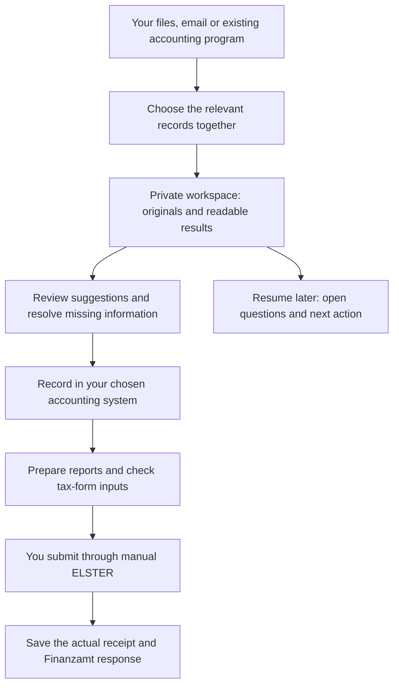

# German Business Kit

**English** · [Русский](README.ru.md) · [Deutsche Startanleitung](skills/de-business-kit/guides/start.de.md)

**Manage your own German business records and prepare your tax reporting in a private local workspace.** German Business Kit combines a local workspace application with optional instructions and tools for Codex and Claude Code. It helps Freiberufler and sole traders with a Gewerbe organize documents, review accounting work, understand tax questions and continue where they stopped.

Keep your records in a separate private folder and use the local interface to import documents, review records and continue your work. An optional AI assistant explains questions and prepares readable results in ordinary language. You do not need to edit JSON or remember commands.

**Version [0.7.0-preview.1](https://github.com/ilyafedotov-ops/german-business-skills/releases/tag/v0.7.0-preview.1).** The [real workspace interface](docs/gui.md) supports document import/review, cash-entry corrections, filing-evidence editing and backup/recovery with EN/RU/DE navigation. Packaged builds include their runtime; users do not install Python. Download availability depends on completed publication and verification of the matching platform archive. Platform checks and first-launch acceptance remain separate gates.

This preview includes a limited cash journal and filing-evidence tracking. It has no complete tax calculation engine or direct ELSTER transmission. The separate interactive prototype uses fictional data.

[Start guide](skills/de-business-kit/guides/start.en.md) · [User guide](skills/de-business-kit/guides/user-guide.en.md) · [All topics](docs/index.md) · [Capabilities and limits](docs/project-status.md)

## Quick start

1. **Download your application.** Open [version 0.7.0-preview.1](https://github.com/ilyafedotov-ops/german-business-skills/releases/tag/v0.7.0-preview.1) and choose the archive ending in `-gui-windows-x64.zip`, `-gui-macos-arm64.tar.gz` (Apple Silicon) or `-gui-macos-x86_64.tar.gz` (Intel), plus `SHA256SUMS`. Use only a published archive that passes the [verification guide](docs/releases.md). If the matching archive is unavailable, its platform release is not ready.
2. **Extract and start.** Extract into a new folder using Explorer or Finder. Keep the extracted application folder together. Open `GermanBusinessKit.exe` on Windows or `GermanBusinessKit` on macOS; your normal browser opens the interface. Keep the launcher running while you work. No Python, Node, Git, WSL, AI account or cloud service is required for this local application. Native OS code signing/notarization is not supplied; follow device policy if launch is blocked and do not disable protection.
3. **Open your private workspace.** Choose English, Russian or German navigation. Open your existing business workspace, or create one in a new/empty private folder outside the application and every Git repository. Navigation language does not rename folders. If you already use accounting software, select it as authoritative.
4. **Start small and save.** Import one document or a small batch, inspect the actual result and save unfinished forms as drafts before closing. Review, cash posting and filing-evidence actions are separate. Use Settings for full backup/verification/restore. See the [application instructions](gui/README.md).

**Optional AI assistance:** download the matching `-codex.zip` or `-claude.zip` from the same release and verify it before connecting it to your existing Codex or Claude Code local session with permitted file access. Extracting a ZIP does not install a skill. [Installation details](#install).

**Copy this for setup:**

> I downloaded German Business Kit. Help me inspect and install it in this app. Explain which files will be installed and where. Use native tools on Windows; do not install Python or change security settings. Then help me choose one first task and a separate private folder. Offer a fictional example if I want to try it first.

Already installed? Select **German Business Kit** from the skills available in your app and use one of the [example requests](#example-requests). Before real personal data is processed, establish which content may reach the AI service or connected tools. Enter passwords, TANs and ELSTER certificates only through the official authentication flow.

## How it works

The assistant helps you move through this process. Some steps use local tools; others require your chosen accounting program, calculation tool or manual ELSTER session.



In words: **collect → review → record → prepare → submit → retain evidence**. Reviewing an invoice, recording an accounting entry and submitting a return are separate steps. The kit does not send a return simply because a report is ready.

The first developed monthly route uses **local cash records plus manual ELSTER**. It still needs a verified calculation tool and actual filing evidence. If you already use Lexware, sevdesk, WISO or another system, tell the assistant before recording entries. Access is checked through the host's available plugins, APIs, browser or computer tools; the kit does not include production connectors. Professional consultation is optional when a particular issue needs it.

## What you can do today

| Your task | What the kit provides | Current boundary |
| --- | --- | --- |
| Organize a mixed folder | Preview, selected intake, preserved originals and integrity checks | Copying a file does not review or post it |
| Review documents and payments | Catalog, proposed fields, reviewed bank mappings and reconciliation | Catalog review is in the bundled GUI; bank mapping/reconciliation use standalone utilities with an existing Python runtime |
| Manage local cash records | Reviewed entries, splits, reversals and period reports | Limited journal, not a complete statutory ledger or tax engine |
| Prepare taxes and letters | Source-based analysis, form worksheets, readable reports and recipient documents | Official forms/calculations must be checked for the actual year; submission is separate |
| Track a filing | Versioned drafts, checks, authorization and observed receipt/response records | GUI uses the bundled protected engine; standalone utilities need their runtime. No direct ELSTER transmission |
| Continue or recover work | Real EN/RU overview, open questions, next action and verified full backup/restore | Overview is a read-only snapshot; no automatic reminders or scheduled backups |
| Compare business services | Needs-based banking, insurance and software research using current sources | No automatic account opening, purchase or policy selection |

**Windows application:** the packaged GUI includes its engine for supported document, cash-entry, filing-evidence and recovery operations. **Standalone PowerShell without Python:** native tools cover installation, start/resume, folder preview, intake, integrity, real overview and full backup/restore. Protected journal/filing writes, catalog updates and full filing preflight are not yet native. The assistant must identify an unavailable operation instead of claiming it succeeded. See [Windows guidance](docs/windows.md).

**macOS:** choose the application archive for your Mac architecture; its engine is bundled. Standalone Python utilities require an existing Python 3.9+ runtime; macOS does not guarantee it is installed. Node and Playwright are developer tools, not onboarding requirements.

**Languages:** application navigation supports English/Russian/German; user guides and report templates are English/Russian. Folder names and the short start guide also support German. Official form labels remain in German; full German report coverage is unfinished.

## Example requests

| What you need | What to say |
| --- | --- |
| Existing folder or email | “My invoices are in this folder and Gmail. First show which sources you can access and what you found. Help me choose what to import; do not change the source or send anything.” |
| This month's work | “Continue October in my existing workspace. Show missing receipts, unmatched payments, accounting work and filing issues. Open a readable overview and suggest the next action.” |
| A tax question | “This invoice is from another country and mentions reverse charge. Check my actual business facts and the applicable period against official sources. Explain what is known and what still needs checking.” |
| A letter or report | “Explain this Finanzamt letter in English. Identify any deadline with its source, prepare a German reply draft if needed, and keep my private notes separate.” |
| Starting an activity | “Help me clarify Freiberufler or Gewerbe for this activity, including my existing activities. Ask only what affects the next step and prepare a registration plan.” |
| Banking or insurance | “Compare suitable services for my activity, countries, currencies and expected payments. Show current costs, exclusions, eligibility and sources before recommending anything.” |
| Resume or back up | “Save where we stopped and the next action. Create and verify a complete backup at the location I choose.” |

**Illustrative result, using fictional records:** two invoices and a bank export are preserved; one payment matches an invoice and another lacks a receipt. The readable result links the originals, explains the missing receipt and leaves the unresolved item open. It does not label the month complete or a return submitted.

[Russian examples](README.ru.md#примеры-запросов) · [Detailed working modes](docs/modes.md) · [Documents and reports](docs/documents.md)

## Your private workspace

New workspaces use five everyday areas. This English example shows the main folders; year/month folders are created when needed.

```text
My business/
├── START-HERE.md
├── 01 Inbox/
├── 02 Documents/
│   └── 2026/10/
│       ├── Originals/
│       ├── Processed/
│       └── Proposals/
├── 03 Accounts/
│   ├── Bank/
│   ├── Records/
│   └── Reports/
├── 04 Taxes/
├── 05 Business/
│   ├── Registration/
│   └── Correspondence/
├── .business-kit/          ← internal records and history
└── .workspace-layout.json  ← folder mapping
```

**Reports have a home:** accounting/reconciliation outputs use the mapped Accounts areas; tax materials use Taxes. Ask the assistant for the actual link to each generated result. The real overview is stored in the internal admin area and can be opened as HTML or Markdown. See [folder names in EN/RU/DE](docs/folder-structure.md) and [report types](docs/documents.md).

Changing the conversation language does not rename folders. Existing workspaces retain their earlier layout. Include internal records and the folder mapping in a full backup; a selected-document archive is not a complete backup. Originals and hashes support traceability, but do not certify GoBD compliance, encrypt files or establish tax correctness.

## Install

The quick start above opens the local application. AI host installation is optional. For detailed steps:

| Situation | Guide |
| --- | --- |
| Local Windows/macOS application | [Application instructions](gui/README.md), [scope and delivery](docs/gui.md) |
| Standalone Windows tools, no Python | [Native Windows setup and limits](docs/windows.md) |
| Downloaded Codex/Claude release package | [Verify the download](docs/releases.md), then [register/install the extracted marketplace](docs/distribution.md#optional-host-installation-after-review) |
| Start from source or maintain the project | [Distribution and build instructions](docs/distribution.md), [Contributing](CONTRIBUTING.md) |
| Understand host differences | [Platform compatibility](skills/de-business-kit/references/platforms.md) |

The application runs from its extracted folder; no desktop installer is supplied. Optional AI skills use the host's permitted local skill/plugin mechanism; there is no public one-click marketplace listing. Avoid enabling both the standalone skill and the same plugin in one session.

**Updating:** preserve the previous skill and any customizations, verify the new package in a separate folder, then replace the installed skill through the documented host route. The standalone installer refuses to overwrite an existing installation. Keep the private business workspace in place; do not initialize it again or rename managed folders as part of an update. See [updates](docs/distribution.md) and [backup/recovery](skills/de-business-kit/references/recovery.md).

## Interface, validation and development

The **[new local GUI](docs/gui.md)** connects those records to controlled actions. The generated **real workspace overview** reads your saved records and shows issues and next steps. The separate **[interactive prototype](docs/prototype.md)** demonstrates onboarding, document review, unmatched payments and resuming work with fictional data in browser storage. It is not connected to your real accounts.

Historical evidence: the [0.6.0-preview.4 release workflow](https://github.com/ilyafedotov-ops/german-business-skills/actions/runs/40288755911) passed Windows/macOS utility checks, native Windows PowerShell 5.1 checks, browser/document checks, security gates and release verification. That run covers the earlier skill baseline, not the 0.7 GUI. It does not establish nontechnical-user usability, live service integration or tax correctness. [Validation records](docs/validation.md) preserve the exact scope and remaining acceptance work.

The named release assets include checksums and signed build provenance. A verified signature establishes origin and integrity; it does not certify accounting results. [Release history](CHANGELOG.md) · [Verification instructions](docs/releases.md).

For contributors:

```bash
python3 -B tools/check_package.py
python3 -B -m unittest discover -s tests -v
```

[Architecture](docs/architecture.md) · [Repository rules](AGENTS.md) · [Contributing](CONTRIBUTING.md) · [Security](SECURITY.md). Use fictional data in public examples and issues. The project is [MIT-licensed](LICENSE); AI apps and third-party services have their own terms. The `tax-consultant` workflow name does not confer licensed Steuerberater status.
