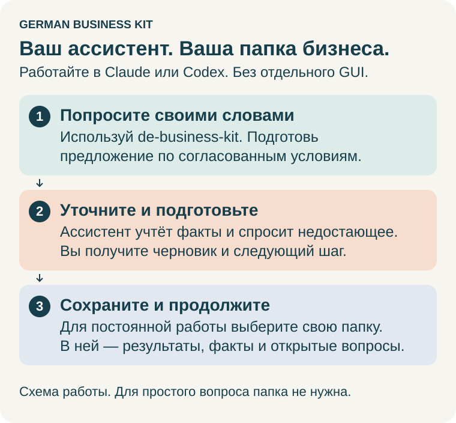

# German Business Kit

[English](README.md) · **Русский** · [Deutsche Startanleitung](skills/de-business-kit/guides/start.de.md)

**Скиллы для Claude и Codex, которые помогают открыть и самостоятельно вести небольшой бизнес в Германии.** Пишите простыми словами по-русски или по-английски: открыть деятельность Freiberufler или Gewerbe, разобраться с письмом из Finanzamt, подготовить счёт, разобрать чеки, подготовиться к налоговой декларации, спланировать изменения или закрытие. Программировать не нужно.

Работайте в привычном ассистенте. Для постоянной работы он сохраняет документы,
подтверждённые сведения, открытые вопросы и ход работы в вашей личной папке бизнеса.
Вы можете вести дела самостоятельно и обращаться за помощью по конкретным вопросам.
Отдельное приложение German Business Kit не требуется.

> **Помощь AI, а не профессиональная налоговая консультация.** German Business Kit —
> инструмент для самостоятельной работы, а не Steuerberater и не сервис
> профессионального налогового консультирования. AI может ошибаться, в том числе
> в расчётах и сроках. Содержимое, которое читает Codex или Claude, может
> обрабатываться OpenAI или Anthropic; локальная папка не означает локальный AI.
> [Риски и обработка данных](skills/de-business-kit/guides/user-guide.ru.md#ограничения-ai-и-ваши-данные) — перед передачей настоящих документов.



## Начните здесь

Откройте **Codex** или **Claude** и вставьте:

> Установи German Business Kit из https://github.com/ilyafedotov-ops/german-business-skills и покажи, как им пользоваться. Следуй инструкции репозитория для моего приложения, проверь доступность полного набора и помоги попробовать один небольшой пример.

Ассистент может прочитать инструкции и выполнить настройку, которую позволяют его
инструменты. Если нужно выбрать папку или нажать **Install** в приложении, он должен
провести вас через этот шаг. **Готово, когда:** семь скиллов доступны в новой задаче
или чате и можно попробовать пример ниже. Одного сообщения об успехе недостаточно
для проверки установки. [Подробная установка и помощь](skills/de-business-kit/guides/install.ru.md).

### Рекомендуемая модель

Для этих скиллов, особенно исследования, форм, учёта и налогов, рекомендуем
**Claude Opus 5.5 с уровнем High** или **GPT-6 Astra с уровнем рассуждения High**,
если они доступны в вашем приложении и тарифе. Выберите модель и уровень в
приложении: просьба «подумай тщательнее» не меняет выбранную настройку.
Более глубокое рассуждение может занять больше времени и расходовать больше
лимита. Для простых объяснений и оформления подойдёт более лёгкая модель.
Выбор модели не заменяет актуальные источники, полные исходные данные и проверки
расчётов. [Настройки и альтернативы](skills/de-business-kit/guides/install.ru.md#выберите-модель).

### Необязательная помощь в браузере и приложениях

Для поддерживаемой веб-формы, выбранной выгрузки или задачи внутри приложения
попросите ассистента проверить и рекомендовать доступные **инструменты управления
браузером/компьютером и вспомогательные скиллы**. Для многих исследований достаточно
web search; обычному вопросу или локальному документу управление экраном не нужно.
Один скилл не даёт доступ. [Когда включать, как настроить и какие есть ограничения](skills/de-business-kit/guides/assisted-services.ru.md#когда-включать-браузер-или-управление-компьютером).

> Используй de-business-kit. Проверь доступные инструменты браузера и компьютера для этой задачи. Используй подходящее существующее подключение или объясни поддерживаемую настройку и права, если нужно взаимодействие. Вход и финальную отправку выполню я.

### Первый разговор

После установки начните новую задачу/чат и отправьте:

> Используй de-business-kit. Я здесь впервые. Покажи, как обращаться за помощью, и дай три примера для моей ситуации. Я [планирую бизнес / уже работаю / готовлю отчётность / хочу внести изменения].

В **Codex** также можно использовать **`$de-business-kit`**. В **Claude** введите
**/** или откройте **+** и выберите **de-business-kit** из **German Business Kit**.
Общий помощник подходит для любого запроса; помнить названия профильных скиллов
необязательно. [Как вызвать скилл](skills/de-business-kit/guides/user-guide.ru.md#как-вызвать-скилл).

Для постоянной работы дайте доступ к личной папке бизнеса и попросите сохранять
подтверждённые сведения, результаты, открытые вопросы и следующий шаг. В следующий
раз вернитесь к той же папке. Для простого вопроса папка и полная настройка не нужны.

<details>
<summary>Предпочитаете установить вручную?</summary>

### Установка в Claude в три шага

С подходящим аккаунтом Claude откройте **Cowork → Customize → Plugins** (некоторые
версии объединяют Chat и Cowork), затем:

1. Выберите **Add → Add marketplace**.
2. Если появится выбор, нажмите **Add from a repository**, введите `ilyafedotov-ops/german-business-skills`, выберите его и нажмите **Sync**.
3. Найдите **German Business Kit** и нажмите **Install**.


[Установка Claude и требования к аккаунту](skills/de-business-kit/guides/install.ru.md#установка-в-claude) · [Установка Codex](skills/de-business-kit/guides/install.ru.md#установка-в-codex)

</details>

## Что спросить

Скопируйте запрос и подставьте свои сведения. Примеры показывают, о какой помощи
можно попросить; они не обещают готового подключения к сервису или заполнения
любого документа без недостающих фактов. Ассистент должен использовать сохранённые
сведения, задавать точечные вопросы и объяснять конкретные препятствия.

### Обдумать идею и начать

| Ваша ситуация | Пример запроса |
| --- | --- |
| Есть идея | Используй de-business-start. Хочу оказывать услуги перевода параллельно работе по найму. Что уточнить сначала? Дай один посильный следующий шаг. |
| Есть общий вопрос | Используй de-business-kit. Объясни разницу между Freiberufler и Gewerbe простыми словами по-русски. Какие факты о моей работе важны? |
| Готовы регистрироваться | Используй de-business-start. Помоги подготовить регистрацию этой деятельности. Используй сохранённые факты и спроси недостающие. |
| Выбираете сервисы | Используй de-business-services. Планирую клиентов в Германии и за рубежом. Помоги сравнить банковские счета, страховки и программы под мои потребности и бюджет. |
| Хотите разобраться с покупкой | Используй de-business-tax. Купил ноутбук в рассрочку и использую его также в личных целях. Какие сведения нужны, чтобы объяснить учёт этой покупки для бизнеса? |

### Заполнить документы и вести текущие дела

| Ваша ситуация | Пример запроса |
| --- | --- |
| Клиент ждёт предложение | Используй de-business-operations. По согласованным услугам, ценам и датам подготовь предложение на немецком с отдельным объяснением для меня по-русски. |
| Есть форма или таблица | Используй de-business-kit. Помоги заполнить приложенную форму или таблицу из сохранённых сведений о бизнесе. Сохрани оригинал, отметь недостающие ответы и покажи заполненный черновик. |
| Нужен счёт | Используй de-business-operations. Подготовь счёт по согласованным условиям с учётом моей существующей нумерации. Проверь недостающие сведения до выставления. |
| Документы разбросаны | Используй de-business-accounting. Посмотри выбранные чеки и банковскую выгрузку за октябрь 2026. Покажи связанные документы, недостающие записи и вопросы для моей проверки. |
| Пришло официальное письмо | Используй de-business-tax. Объясни это письмо из Finanzamt, проверь срок и подготовь ответ на немецком. Храни мои личные заметки отдельно от письма. |
| Готовите отчётность | Используй de-business-tax. Помоги подготовить отчётность за 2026 год в выбранной программе. Проверь предпосылки, найди применимые правила и проверь расчёты. Покажи, что осталось до подачи. |

### Подключить или использовать существующие сервисы

| Ваша ситуация | Пример запроса |
| --- | --- |
| Нужна помощь с почтой | Используй de-business-services. Помоги использовать Gmail для документов бизнеса. Проверь доступное подключение и проведи через недостающую настройку. Начни со списка подходящих писем за выбранный мной период. |
| Уже есть бухгалтерская программа | Используй de-business-accounting. Я использую sevdesk. Проверь, можешь ли работать с аккаунтом или нужна выгрузка. Сохрани программу основным местом учёта и объясни доступные действия. |
| Нужно подключить банк | Используй de-business-services. Помоги подключить существующий бизнес-счёт для просмотра операций. Проверь поддерживаемый доступ и права; если подключения нет, помоги использовать выгрузку выписки. |
| Нужна помощь в ELSTER | Используй de-business-tax. Помоги заполнить существующий черновик ELSTER подтверждёнными сведениями. Проверь доступ, покажи введённое и оставь финальную отправку мне. |
| Нужны файлы из сервиса | Используй de-business-accounting. Помоги получить документы за октябрь из Lexware Office. Проверь фильтр дат и фактическое скачивание файлов; оставь существующие проводки без изменений. |

Подключения зависят от приложения, аккаунта и доступных инструментов. Ассистент
должен сначала проверить их, помочь с недостающей настройкой и при необходимости
работать с выбранными файлами. Вход выполняется в официальном окне сервиса.
[Помощь с формами и сервисами](skills/de-business-kit/guides/assisted-services.ru.md).

### Изменения, продолжение и непростые случаи

| Ваша ситуация | Пример запроса |
| --- | --- |
| Не знаете, что дальше | Используй de-business-kit. Прочитай сохранённый ход работы и помоги выбрать следующее полезное действие. Спрашивай только о недостающих или изменившихся фактах. |
| Вопрос неоднозначен | Используй de-business-tax. Я заработал 60 000 евро. Какой налог может быть? Сначала уточни смысл суммы и что ещё нужно для оценки. |
| Несколько видов деятельности | Используй de-business-changes. Хочу добавить вторую деятельность. Проверь, что меняется для меня как одного предпринимателя, а что остаётся общим с существующим бизнесом. |
| Клиент оплатил часть | Используй de-business-operations. Этот счёт частично оплачен, а затем исправлен. Сравни счёт, исправление и платежи перед подготовкой напоминания. |
| Результат отправки непонятен | Используй de-business-tax. В ELSTER был таймаут, квитанцию найти не могу. Помоги проверить, что произошло, до повторной отправки. |
| Хотите нанять сотрудника | Используй de-business-changes. Думаю о первом сотруднике. Помоги определить решения, документы и регистрации, нужные до выбора даты начала. |
| Хотите приостановить или закрыть | Используй de-business-changes. Помоги спланировать паузу или закрытие этой деятельности, сохранив другую работу. Покажи оставшиеся обязательства и документы для хранения. |
| План изменился | Используй de-business-kit. Мой прежний план изменился с [старого] на [новый] с [даты]. Обнови соответствующие сохранённые факты и следующие шаги, сохранив прежнее решение. |

Для каждой задачи ассистент должен прочитать нужные сохранённые факты, уточнить
недостающие или неоднозначные сведения и сохранить подтверждённые решения и
следующий шаг для продолжения. Другие примеры, файлы и резервные копии —
в [руководстве пользователя](skills/de-business-kit/guides/user-guide.ru.md).

## Ваша папка бизнеса

**Установленный набор** содержит инструкции и шаблоны. **Личная папка бизнеса** —
ваши документы и ход работы. Храните их отдельно друг от друга и от этого публичного
репозитория. Для простого вопроса папка не нужна. Попросите ассистента создать
рабочую папку, когда захотите сохранять работу; не создавайте и не редактируйте
внутренние записи вручную. Выбранная бухгалтерская программа остаётся основной.

В новой рабочей папке пять понятных разделов. По умолчанию названия английские;
при настройке можно попросить русские или немецкие. Ниже пример русской структуры:

```text
Мой бизнес/
├── НАЧНИТЕ-ЗДЕСЬ.md       С чего начать и как продолжить
├── 01 Входящие/          Неразобранные файлы перед выборочным импортом
├── 02 Документы/         Сохранённые исходные документы
│   └── 2026/10/Оригиналы/  Появится при импорте октябрьских документов
├── 03 Учёт/
│   ├── Банк/             Выписки, сравнения банков и рабочие файлы
│   ├── Записи/           Учётные записи и заметки о бухгалтерской системе
│   └── Отчёты/           Сверки, отчёты и выбранные выгрузки
├── 04 Налоги/
│   └── 2026/             Налоговые вопросы, оценки, формы и доказательства подачи
├── 05 Бизнес/
│   ├── Регистрация/      Планы запуска, регистрация и изменения деятельности
│   └── Переписка/        Клиентские дела, письма и сравнения других услуг
├── .business-kit/        Профиль, задачи, вопросы, решения и история
└── .workspace-layout.json  Внутренняя карта названий папок
```

Месяцы и подпапки дел появляются по необходимости. Коммерческое предложение
клиенту сохраняется в его деле; это не то же самое, что предложение данных для
проверки в учёте. Сохранённые ответы и исследования лежат рядом с соответствующей
темой: для общих вопросов, клиентов, подключения услуг и закрытия не нужны
отдельные рабочие пространства верхнего уровня.
[Куда сохраняются разные запросы](skills/de-business-kit/guides/user-guide.ru.md#куда-сохраняются-результаты).

> Используй de-business-kit. Покажи папки выбранного рабочего пространства, объясни, что где хранить, и дай ссылки на последний результат и следующий шаг. Сохрани существующие файлы и названия папок.

У одного предпринимателя один общий профиль для разных деятельностей и лет.
Язык папок не зависит от языка разговора; существующая структура сохраняется.
Название папки не доказывает проверку, оплату или подачу. В полную резервную копию
включайте скрытые файлы и `.business-kit`, а копию храните отдельно:
**«Отчёты» не заменяют резервную копию**. Редактировать JSON и запоминать пути не нужно.

## Важно знать

- **Помощник готовит, решаете и отправляете вы.** Ассистент готовит черновики форм, писем и записей. Входите в ELSTER, банк или бухгалтерскую программу и нажимаете финальную кнопку вы сами.
- **Сначала исследование, затем расчёт и проверка.** Помощник уточняет недостающие факты, находит правила для нужного периода и может выполнять ограниченные расчёты с сохранением проверок. Полного налогового движка и прямой отправки в ELSTER в наборе нет. Отчётность можно вести самостоятельно и обращаться за помощью по конкретным вопросам.
- **Ваши данные — ваш выбор.** Прочитанное ассистентом содержимое может передаваться AI-провайдеру; локальное хранение не означает локальную обработку. Сначала попробуйте вымышленный пример, храните настоящие записи в отдельной приватной папке и никогда не вводите пароли или TAN в чат.
- **Это предварительная версия** (0.9.0-preview.1). См. [что работает сейчас и что запланировано](docs/project-status.ru.md).

## Подробнее

- [Руководство по установке](skills/de-business-kit/guides/install.ru.md): Claude по шагам, Codex, обновления, решение проблем
- [Руководство пользователя](skills/de-business-kit/guides/user-guide.ru.md): задачи, файлы, продолжение работы, резервные копии
- [Помощь внутри ELSTER и бухгалтерских программ](skills/de-business-kit/guides/assisted-services.ru.md)
- [Необязательное настольное приложение для записей](gui/README.ru.md): для работы с набором не требуется
- Для разработчиков: [техническая документация](docs/index.ru.md), [участие в проекте](CONTRIBUTING.ru.md), [изменения](CHANGELOG.ru.md), [безопасность](SECURITY.ru.md)

<details>
<summary>Что находится в папках этого репозитория?</summary>

| Папка | Назначение |
| --- | --- |
| `skills/` | Полный продукт из семи скиллов. В `de-business-kit/` — общие руководства, инструкции, шаблоны и утилиты; остальные шесть папок — профильные скиллы. Устанавливайте вместе. |
| `docs/` | Архитектура, текущие возможности, исследования и проверки для разработчиков. Пользовательские руководства — внутри `skills/de-business-kit/guides/`. |
| `examples/` | Вымышленные примеры, а не настоящие документы бизнеса. |
| `gui/` | Необязательное локальное приложение для записей. |
| `prototype/` | Интерактивная демонстрация на вымышленных данных, отдельно от реальных записей. |
| `tools/`, `packaging/` | Утилиты сборки/установки/выпуска и инструкции пакетов. |
| `tests/`, `evals/` | Автоматические проверки и сценарии работы ассистента. |
| `.claude-plugin/`, `.github/` | Метаданные распространения и автоматизация репозитория. |

Это папки продукта и разработки; клиентские документы сюда не кладут.

</details>

Лицензия MIT. У Claude и других сервисов свои условия.
