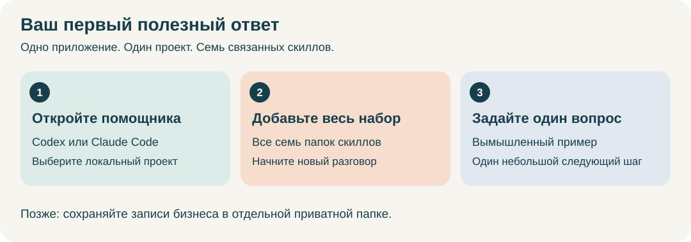

# German Business Kit

[English](README.md) · **Русский** · [Deutsche Startanleitung](skills/de-business-kit/guides/start.de.md)

**Набор скиллов ИИ-помощника для открытия и ведения бизнеса в Германии.** Помощь с открытием деятельности, вопросами, формами, текущими документами, учётом, отчётностью, изменениями и закрытием. Для Freiberufler и Einzelunternehmen/Gewerbe.

## Начните здесь

**[Первый запуск: от установки приложения с ИИ до первого ответа →](skills/de-business-kit/guides/install.ru.md)**

Программировать не нужно. Руководство объясняет, что такое Codex и Claude Code, помогает выбрать одно приложение и по шагам установить его, добавить семь скиллов и попробовать вымышленный пример. В нём есть ожидаемый результат каждого шага, схемы и помощь при затруднениях.

1. **Откройте ИИ-помощника:** Codex или Claude Code на компьютере.
2. **Добавьте German Business Kit:** установите все семь скиллов в проект помощника.
3. **Попросите один результат:** «Хочу начать работать переводчиком в Германии. Помоги выбрать один небольшой первый шаг».

## Документация пользователя

1. [Установка с нуля](skills/de-business-kit/guides/install.ru.md) — выбрать Codex или Claude Code, установить набор и получить первый ответ.
2. [Руководство пользователя](skills/de-business-kit/guides/user-guide.ru.md) — выбрать задачу, найти файлы, продолжить работу и восстановить копию.
3. [Формы и сервисы](skills/de-business-kit/guides/assisted-services.ru.md) — проверить доступ, заполнить черновик, получить выгрузку и подтвердить финальное действие.

[Необязательное приложение Windows/macOS](gui/README.ru.md) имеет отдельную инструкцию из своего архива.

## С чем помогает

| Ваша задача | Доступная помощь |
| --- | --- |
| Открыть бизнес | Уточнить деятельность, изучить требования, подготовить план регистрации и черновики форм |
| Разобраться с вопросом или письмом | Объяснить ситуацию, проверить актуальные источники, выявить недостающие факты и подготовить ответ |
| Работать с клиентами | Предложения, счета, контроль оплаты и переписка |
| Организовать учёт и налоги | Проверка документов, помощь со сверкой, поддерживаемые локальные денежные записи и подготовка отчётности |
| Выбрать или изменить сервисы | Сравнение банков, страхования и программ; изучение предоставленных экспортов |
| Изменить, нанять, приостановить или закрыть | Подготовить шаги, документы, зависимости и незавершённые обязательства |

Простой вопрос можно задать до выбора бухгалтерской программы и создания папки записей. Если выбрана существующая программа учёта, она остаётся основным местом учёта. Необязательное локальное приложение помогает с операциями над файлами; для первого разговора оно не нужно.

**Ограничения preview:** нет полного налогового вычислителя, производственных подключений к сервисам и прямой отправки в ELSTER. Lexware пока проверяется на локальных примерах. Подготовить форму не означает отправить её. См. [возможности и оставшуюся работу](docs/project-status.ru.md).

## Примеры запросов

- «Хочу открыть деятельность в Германии. Помоги определить следующий шаг; спрашивай только нужные факты».
- «Объясни это письмо Finanzamt на русском и помоги подготовить ответ на немецком».
- «Можно ли списать телефон в рассрочку как расход бизнеса? Проверь применимые источники и уточни недостающие факты перед конкретным отражением в учёте».
- «Продолжи из сохранённого рабочего пространства. Покажи незавершённое и следующее действие».

До использования настоящих документов выясните, какое содержимое может получить ИИ-сервис и подключённые инструменты. Храните приватные записи в отдельной папке бизнеса. Пароли, TAN и сертификаты вводите только через официальные экраны авторизации.

## Загрузка и техническая документация

[Preview 0.9.0-preview.1](https://github.com/ilyafedotov-ops/german-business-skills/releases/tag/v0.9.0-preview.1) содержит пакеты `-codex.zip`, `-claude.zip` и отдельные приложения. Устанавливайте все семь скиллов вместе: маршрутизатор и шесть модулей используют общие материалы и один профиль. Руководство установки объясняет выбор и проверку архива.

Используйте именованные архивы после публикации и проверки происхождения; checkout исходников не является проверенным релизом. Эта версия включает руководства установки, помощь в сервисах и объединённую документацию. Руководства и отчётные шаблоны — EN/RU; немецкая навигация не означает полного перевода отчётов. [Текущее состояние и план P1–P7](docs/project-status.ru.md) отделяют реализацию от незавершённой приёмки.

Для разработчиков и сопровождающих: **[техническая документация](docs/index.ru.md)** — архитектура, онтология, сборка, выпуск и проверки. Начните с [CONTRIBUTING](CONTRIBUTING.ru.md); правила репозитория — в [AGENTS.md](AGENTS.md). Фактические тесты, ограничения и история находятся в [сводке проверок](docs/validation.ru.md).

[Изменения](CHANGELOG.ru.md) · [Безопасность](SECURITY.ru.md) · [Лицензия MIT](LICENSE). У приложений ИИ и сервисов собственные условия. Название рабочего режима не означает статус лицензированного Steuerberater.
