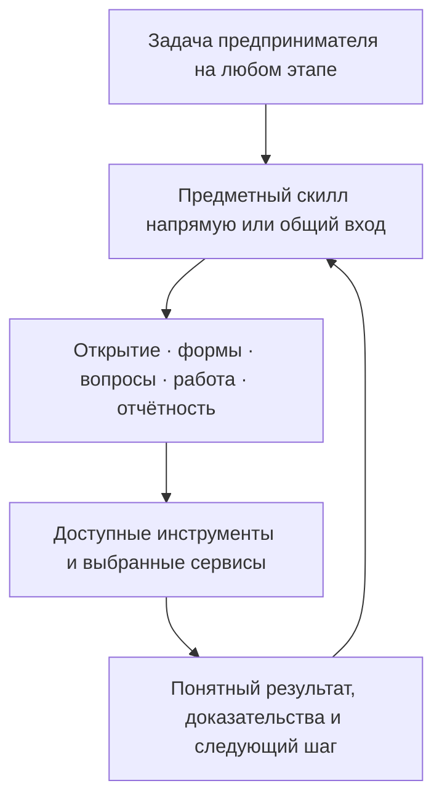

# German Business Kit

[English](README.md) · **Русский** · [Deutsche Startanleitung](skills/de-business-kit/guides/start.de.md)

**Система скиллов для сопровождения предпринимателя в Германии — от подготовки к открытию до текущей работы, отчётности, изменений и закрытия.** German Business Kit помогает Freiberufler и Einzelunternehmen/Gewerbe разбираться в вопросах, готовить формы и документы, выбирать сервисы и продолжать работу с сохранённым контекстом. Покрытие этапов пока неравномерно: [карта жизненного цикла](docs/lifecycle.ru.md) показывает существующие инструкции, инструменты и пробелы.

Начните с задачи обычными словами в Codex или Claude Code с подключённым скиллом. Для простого вопроса не нужны установка локального GUI и полная настройка рабочей папки. Локальное приложение и утилиты помогают выполнять поддерживаемые операции с записями; доступные интеграции и выбранная бухгалтерская программа дополняют этот путь.

**Версия исходников: 0.7.0-preview.1.** Описанные здесь изменения жизненного цикла и семь скиллов находятся в текущих исходниках; прежние архивы выпусков не получают их автоматически. См. [неопубликованные изменения](CHANGELOG.ru.md#неопубликованные-изменения) и [проверку выпуска](docs/releases.ru.md). [Интерфейс настоящего пространства](docs/gui.ru.md) поддерживает импорт/проверку документов, исправления денежных записей, работу с доказательствами подачи и копирование/восстановление с навигацией EN/RU/DE. Готовые сборки включают среду выполнения; пользователь не устанавливает Python. Загрузка доступна после публикации и проверки соответствующего платформенного архива. Проверки платформ и приёмка первого запуска остаются отдельными этапами.

Предварительная версия включает ограниченный денежный журнал и учёт доказательств подачи. Полного налогового расчётного движка и прямой отправки в ELSTER нет. Отдельный интерактивный прототип использует вымышленные данные.

[Быстрый старт](skills/de-business-kit/guides/start.ru.md) · [Руководство пользователя](skills/de-business-kit/guides/user-guide.ru.md) · [Все темы](docs/index.ru.md) · [Возможности и ограничения](docs/project-status.ru.md)

## Скиллы комплекта

| Скилл | Когда использовать |
| --- | --- |
| `de-business-kit` | Начать, продолжить или выбрать следующий шаг |
| `de-business-start` | Подготовить запуск и регистрацию |
| `de-business-operations` | Предложения, счета, оплаты и деловая переписка |
| `de-business-accounting` | Документы, сверка и записи в выбранной системе |
| `de-business-tax` | Налоговые вопросы, отчётность и ответы Finanzamt |
| `de-business-services` | Банки, страхование, ПО и доступ к сервисам |
| `de-business-changes` | Изменения, найм, приостановка и закрытие |

Установите весь комплект вместе: предметные скиллы используют общие ресурсы `de-business-kit`. Можно обращаться к нужному скиллу напрямую. Общий профиль и выбранная бухгалтерская система сохраняются; смена скилла не требует повторной настройки. Эти изменения находятся в исходниках и локальных сборках; прежние опубликованные архивы не меняются.

## Быстрый старт

1. **Подключите скилл к используемому помощнику.** Выберите установленный German Business Kit; для новой установки используйте проверенный `-codex.zip` или `-claude.zip` соответствующего выпуска. Распаковка ZIP не устанавливает skill. [Варианты установки](#установка).
2. **Опишите нужный результат.** Например: «Хочу начать деятельность», «Помоги заполнить форму» или «Объясни это письмо». Помощник уточняет только сведения, влияющие на задачу.
3. **Сохраните контекст, когда это полезно.** Для работы с документами выберите личную папку вне приложения и Git-репозиториев. Если учёт уже ведётся в программе, её записи остаются основными; бухгалтерский маршрут можно выбрать, когда он понадобится.
4. **Используйте подходящие инструменты.** Скилл проверяет фактически доступные файлы, поиск, браузер и подключения. Локальный GUI — дополнительный способ работы с записями: [установка и запуск приложения](gui/README.ru.md), [проверка файлов выпуска](docs/releases.ru.md).

**Скопируйте для настройки:**

> Я скачал German Business Kit. Помоги проверить и установить его в этом приложении. Объясни, какие файлы и куда будут установлены. В Windows используй штатные инструменты; не устанавливай Python и не меняй настройки безопасности. Затем помоги выбрать первую задачу и отдельную личную папку. Предложи вымышленный пример, если я захочу сначала попробовать.

Уже установлено? Выберите **German Business Kit** среди доступных skills приложения и используйте один из [примеров запросов](#примеры-запросов). Перед обработкой реальных персональных данных уточните, какое содержимое может передаваться AI-сервису или подключённым инструментам. Пароли, TAN и сертификаты ELSTER вводите только через официальный процесс авторизации.

## Как это работает



Отдельные скиллы теперь содержат инструкции изменений и закрытия; фактическое внешнее выполнение и полная приёмка проверяются отдельно. [Карта покрытия и план](docs/lifecycle.ru.md) отличают цель от текущей готовности.

Самостоятельный учёт и подача остаются важной частью продукта. Первый разработанный месячный маршрут использует локальный денежный журнал и ручной ELSTER; это один из сценариев. Существующая бухгалтерская программа остаётся основной при её выборе. Готовых производственных коннекторов и прямой передачи ELSTER нет. Подготовка, одобрение, отправка и фактическое подтверждение остаются разными этапами; консультация специалиста доступна по конкретной необходимости.

## Что можно делать сейчас

| Ваша задача | Что даёт комплект | Текущее ограничение |
| --- | --- | --- |
| Подготовить открытие деятельности | Инструкции сбора фактов, классификации, плана регистрации и рабочих листов форм | Актуальные требования проверяются для ситуации; регистрация не выполняется автоматически |
| Получить ответ или заполнить форму | Тематические скиллы, работа с источниками, понятный ответ и проверяемый черновик | Доступ к порталу и фактическая отправка проверяются отдельно |
| Разобрать смешанную папку | Предпросмотр, выборочный импорт, сохранение оригиналов и проверка целостности | Копирование файла не означает его проверку или проводку |
| Проверить документы и платежи | Каталог, предложения полей, проверяемое сопоставление банковских данных и сверка | Проверка каталога — во встроенном GUI; банковские сопоставления/сверка — в отдельных утилитах с уже доступным Python |
| Вести локальные денежные записи | Проверяемые записи, разделение строк, сторно и отчёты периода | Ограниченный журнал, не полный бухгалтерский регистр или налоговый движок |
| Подготовить налоги и письма | Анализ с источниками, рабочие листы форм, читаемые отчёты и документы адресату | Формы и расчёты проверяются для нужного года; подача — отдельный шаг |
| Отслеживать подачу | Версии черновиков, проверки, разрешения и записи фактических квитанций/ответов | GUI использует встроенный защищённый движок; отдельным утилитам нужна среда. Прямой отправки в ELSTER нет |
| Продолжить или восстановить работу | Задачи разных месяцев и без срока, зависимости, состояние подтверждений и полная копия/восстановление | Обзор — снимок; продолжение в GUI готовит запрос для копирования, а не AI-сеанс |
| Проследить исправление счёта | Ограниченное чтение отдельного XML, ссылки на прежний счёт и проверенные связи доказательств | Нет полной валидации электронного счёта, автоматического возврата или исправления учёта |
| Проверить выгрузку сервиса | Способ выгрузки/отбор по датам, оригиналы, проверенный охват и пробелы | Испытания Lexware используют локальные примеры; живого коннектора и автоматического импорта архивов нет |
| Подготовить изменение, первый найм или закрытие | План до/после, зависимости, материалы и открытые обязательства | Нет автоматической регистрации, расчёта зарплаты или расторжения договоров |
| Сравнить услуги для бизнеса | Подбор банков, страхования и программ по потребностям и актуальным источникам | Нет автоматического открытия счетов, покупок или выбора полиса |

**Приложение Windows:** готовый GUI включает движок для поддерживаемых операций с документами, денежными записями, доказательствами подачи и восстановлением. **Отдельный PowerShell без Python:** штатные инструменты покрывают установку, запуск/продолжение, предпросмотр папки, приём документов, целостность, реальный обзор и полное копирование/восстановление. Защищённые изменения журнала/подач, обновление каталога и полная предварительная проверка подачи ещё не перенесены на штатные инструменты. Ассистент должен назвать недоступную операцию, а не объявлять её выполненной. См. [руководство Windows](docs/windows.ru.md).

**macOS:** выберите архив приложения для архитектуры вашего Mac; движок включён в сборку. Отдельным Python-утилитам нужен уже установленный Python 3.9+; macOS не гарантирует его наличие. Node и Playwright — инструменты разработчика, а не условия начала работы.

**Языки:** навигация приложения — русская/английская/немецкая; руководства пользователя и шаблоны отчётов — русские/английские. Имена папок и короткое стартовое руководство также поддерживают немецкий. Официальные названия полей остаются немецкими; полный набор немецких отчётов ещё не готов.

## Примеры запросов

| Что нужно | Что написать |
| --- | --- |
| Существующая папка или почта | «Мои счета в этой папке и Gmail. Сначала покажи, какие источники тебе доступны и что найдено. Помоги выбрать файлы для импорта; не меняй источник и ничего не отправляй». |
| Работа за месяц | «Продолжи октябрь в моей существующей рабочей папке. Покажи недостающие документы, несопоставленные платежи, работу по учёту и замечания к подачам. Открой читаемый обзор и предложи следующий шаг». |
| Налоговый вопрос | «Этот счёт из другой страны, в нём указан reverse charge. Проверь реальные факты моего бизнеса и нужный период по официальным источникам. Объясни, что известно и что ещё нужно уточнить». |
| Письмо или отчёт | «Объясни это письмо Finanzamt по-русски. Найди срок и его источник, при необходимости подготовь немецкий черновик ответа, а мои личные заметки сохрани отдельно». |
| Открытие деятельности | «Помоги разобраться, Freiberufler или Gewerbe подходит для этой деятельности, с учётом уже существующих занятий. Спроси только то, что влияет на следующий шаг, и подготовь план регистрации». |
| Банк или страхование | «Сравни подходящие услуги для моей деятельности, стран, валют и ожидаемых платежей. Покажи актуальные расходы, исключения, требования и источники до рекомендации». |
| Продолжение или копия | «Сохрани место остановки и следующий шаг. Создай и проверь полную резервную копию в месте, которое я выберу». |

**Пример результата на вымышленных данных:** сохранены два счёта и банковская выгрузка; один платёж сопоставлен со счётом, для другого не хватает документа. Читаемый результат ссылается на оригиналы, объясняет, какой документ нужен, и оставляет вопрос открытым. Месяц не объявляется завершённым, а декларация — отправленной.

[Английские примеры](README.md#example-requests) · [Подробнее о режимах](docs/modes.ru.md) · [Документы и отчёты](docs/documents.ru.md)

## Ваша личная рабочая папка

В новых пространствах пять повседневных разделов. Ниже основные папки русского варианта; папки года/месяца создаются по необходимости.

```text
Мой бизнес/
├── НАЧНИТЕ-ЗДЕСЬ.md
├── 01 Входящие/
├── 02 Документы/
│   └── 2026/10/
│       ├── Оригиналы/
│       ├── Обработанные/
│       └── Предложения/
├── 03 Учёт/
│   ├── Банк/
│   ├── Записи/
│   └── Отчёты/
├── 04 Налоги/
├── 05 Бизнес/
│   ├── Регистрация/
│   └── Переписка/
├── .business-kit/          ← внутренние записи и история
└── .workspace-layout.json  ← соответствие папок
```

**У отчётов есть своё место:** результаты учёта/сверки используют соответствующие разделы «Учёт», налоговые материалы — «Налоги». Просите фактическую ссылку на каждый созданный результат. Реальный обзор находится во внутреннем разделе администрирования и открывается как HTML или Markdown. См. [имена папок EN/RU/DE](docs/folder-structure.ru.md) и [виды отчётов](docs/documents.ru.md).

Смена языка общения не переименовывает папки. Существующие пространства сохраняют прежнюю структуру. Полная резервная копия должна включать внутренние записи и файл соответствия папок; выборочный архив документов не заменяет её. Оригиналы и хеши помогают прослеживаемости, но не подтверждают соответствие GoBD, не шифруют файлы и не доказывают правильность налоговых выводов.

## Установка

Быстрый старт использует скиллы в вашем помощнике. Локальное приложение необязательно и запускается по отдельной инструкции. Выберите нужный путь:

| Ситуация | Руководство |
| --- | --- |
| Локальное приложение Windows/macOS | [Инструкция приложения](gui/README.ru.md), [возможности и поставка](docs/gui.ru.md) |
| Отдельные инструменты Windows без Python | [Штатные инструменты и ограничения](docs/windows.ru.md) |
| Скачан пакет выпуска Codex/Claude | [Проверить загрузку](docs/releases.ru.md), затем [подключить и установить распакованный marketplace](docs/distribution.ru.md#необязательная-установка-после-проверки) |
| Работа с исходниками или развитие проекта | [Распространение и сборка](docs/distribution.ru.md), [правила вклада](CONTRIBUTING.ru.md) |
| Различия приложений | [Совместимость платформ](skills/de-business-kit/references/platforms.md) |

Приложение запускается из распакованной папки; отдельного desktop-установщика нет. Комплект скиллов подключается разрешённым приложением механизмом локальных skills/плагинов; публичной установки в один клик из marketplace нет. Не включайте одновременно самостоятельный skill и тот же плагин в одной сессии.

**Обновление:** сохраните предыдущий skill и свои изменения, проверьте новый пакет в отдельной папке, затем замените установленный skill через описанный путь приложения. Установщик самостоятельного skill отказывается перезаписывать существующую установку. Личное рабочее пространство оставьте на месте; не создавайте его заново и не переименовывайте управляемые папки при обновлении. См. [обновления](docs/distribution.ru.md) и [копирование/восстановление](skills/de-business-kit/references/recovery.md).

## Интерфейс, проверки и разработка

**[Локальный GUI](docs/gui.ru.md)** связывает записи с проверяемыми действиями. Создаваемый **реальный обзор рабочего пространства** читает сохранённые записи и показывает вопросы и следующие шаги. Отдельный **[интерактивный прототип](docs/prototype.md)** демонстрирует начало работы, проверку документа, несопоставленные платежи и продолжение с вымышленными данными в хранилище браузера. Он не подключён к вашему реальному учёту.

**Приёмка текущих исходников (26.10.2026):** локальные runtime-тесты и сценарии Chromium/WebKit зафиксированы отдельно от свежих испытаний скиллов. Codex CLI 0.164.0 и Claude Code 2.1.310 обнаружили все семь скиллов на macOS; Claude использовал явно добавленную папку. Проверки текущих исходников на Windows 5.1/других платформах, испытания обычными пользователями и реальные операции сервисов остаются открытыми. Последний smoke пакета macOS arm64 прошёл, а интерактивный первый запуск остановился на настройке браузера. Точные версии и ограничения — в [журнале проверок](docs/validation.ru.md).

Историческое свидетельство: [процесс выпуска 0.6.0-preview.4](https://github.com/ilyafedotov-ops/german-business-skills/actions/runs/40288755911) прошёл проверки утилит Windows/macOS, штатного Windows PowerShell 5.1, браузеров/документов, безопасности и проверки выпуска. Тот запуск охватывает прежнюю базу skill, а не GUI версии 0.7. Он не подтверждает удобство для нетехнических пользователей, живую интеграцию с сервисами или правильность налоговых выводов. В [журнале проверок](docs/validation.ru.md) сохранены точный объём и оставшаяся приёмка.

Именованные файлы выпуска включают контрольные суммы и подписанные сведения о происхождении сборки. Проверенная подпись устанавливает происхождение и целостность, а не правильность учёта. [История выпусков](CHANGELOG.ru.md) · [Инструкция проверки](docs/releases.ru.md).

Для участников разработки:

```bash
python3 -B tools/check_package.py
python3 -B -m unittest discover -s tests -v
```

[Архитектура](docs/architecture.ru.md) · [Правила репозитория](AGENTS.md) · [Участие](CONTRIBUTING.ru.md) · [Безопасность](SECURITY.ru.md). В публичных примерах и issues используйте вымышленные данные. Проект распространяется по [лицензии MIT](LICENSE); AI-приложения и сторонние сервисы имеют свои условия. Название сценария `tax-consultant` не присваивает статус лицензированного Steuerberater.
