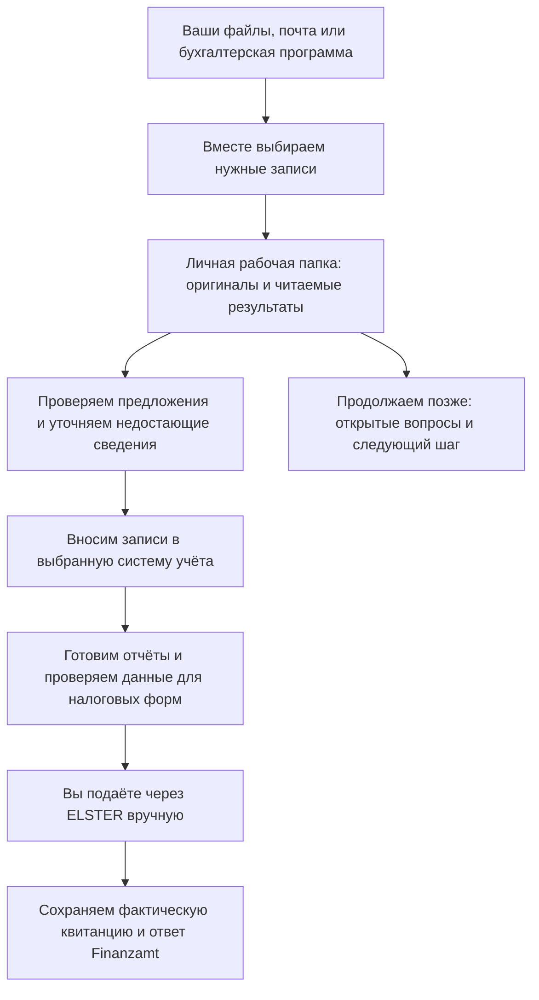

# German Business Kit

[English](README.md) · **Русский** · [Deutsche Startanleitung](skills/de-business-kit/guides/start.de.md)

**Ведите свои деловые записи и готовьте налоговую отчётность в Германии в личном локальном пространстве.** German Business Kit объединяет локальное приложение рабочего пространства и необязательные инструкции и инструменты для Codex и Claude Code. Они помогают Freiberufler и индивидуальным предпринимателям с Gewerbe организовать документы, проверить работу по учёту, разобраться с налоговыми вопросами и продолжить с места остановки.

Храните записи в отдельной личной папке и используйте локальный интерфейс для импорта документов, проверки записей и продолжения работы. Необязательный AI-ассистент объясняет вопросы и готовит читаемые результаты обычным языком. Редактировать JSON и запоминать команды не нужно.

**Версия [0.7.0-preview.1](https://github.com/ilyafedotov-ops/german-business-skills/releases/tag/v0.7.0-preview.1).** [Интерфейс настоящего пространства](docs/gui.ru.md) поддерживает импорт/проверку документов, исправления денежных записей, работу с доказательствами подачи и копирование/восстановление с навигацией EN/RU/DE. Готовые сборки включают среду выполнения; пользователь не устанавливает Python. Загрузка доступна после публикации и проверки соответствующего платформенного архива. Проверки платформ и приёмка первого запуска остаются отдельными этапами.

Предварительная версия включает ограниченный денежный журнал и учёт доказательств подачи. Полного налогового расчётного движка и прямой отправки в ELSTER нет. Отдельный интерактивный прототип использует вымышленные данные.

[Быстрый старт](skills/de-business-kit/guides/start.ru.md) · [Руководство пользователя](skills/de-business-kit/guides/user-guide.ru.md) · [Все темы](docs/index.ru.md) · [Возможности и ограничения](docs/project-status.ru.md)

## Быстрый старт

1. **Скачайте приложение.** Откройте [версию 0.7.0-preview.1](https://github.com/ilyafedotov-ops/german-business-skills/releases/tag/v0.7.0-preview.1) и выберите архив с окончанием `-gui-windows-x64.zip`, `-gui-macos-arm64.tar.gz` (Apple Silicon) или `-gui-macos-x86_64.tar.gz` (Intel), а также `SHA256SUMS`. Используйте опубликованный архив после [проверки](docs/releases.ru.md). Если подходящего архива нет, выпуск для этой платформы ещё не готов.
2. **Распакуйте и запустите.** Распакуйте архив в новую папку через Проводник или Finder. Храните извлечённую папку приложения целиком. Откройте `GermanBusinessKit.exe` в Windows или `GermanBusinessKit` в macOS: интерфейс откроется в обычном браузере. Оставьте программу запуска открытой во время работы. Для локального приложения не нужны Python, Node, Git, WSL, аккаунт AI или облачный сервис. Подпись ОС/нотариальное заверение не предоставлены; если запуск заблокирован, следуйте политике устройства и не отключайте защиту.
3. **Откройте личную рабочую папку.** Выберите русскую, английскую или немецкую навигацию. Откройте существующее пространство бизнеса или создайте его в новой/пустой личной папке вне приложения и любых Git-репозиториев. Язык навигации не переименовывает папки. Если вы уже используете бухгалтерскую программу, выберите её основной.
4. **Начните с малого и сохранитесь.** Импортируйте один документ или небольшую группу, проверьте фактический результат и сохраняйте незаконченные формы как черновики перед закрытием. Проверка, денежная запись и действия с доказательствами подачи — отдельные этапы. Полное копирование/проверка/восстановление доступны в настройках. См. [инструкцию приложения](gui/README.ru.md).

**Необязательная помощь AI:** скачайте соответствующий `-codex.zip` или `-claude.zip` того же выпуска и проверьте его перед подключением к существующей локальной сессии Codex или Claude Code с разрешённым доступом к файлам. Распаковка ZIP не устанавливает skill. [Подробности установки](#установка).

**Скопируйте для настройки:**

> Я скачал German Business Kit. Помоги проверить и установить его в этом приложении. Объясни, какие файлы и куда будут установлены. В Windows используй штатные инструменты; не устанавливай Python и не меняй настройки безопасности. Затем помоги выбрать первую задачу и отдельную личную папку. Предложи вымышленный пример, если я захочу сначала попробовать.

Уже установлено? Выберите **German Business Kit** среди доступных skills приложения и используйте один из [примеров запросов](#примеры-запросов). Перед обработкой реальных персональных данных уточните, какое содержимое может передаваться AI-сервису или подключённым инструментам. Пароли, TAN и сертификаты ELSTER вводите только через официальный процесс авторизации.

## Как это работает

Ассистент помогает пройти следующий процесс. Часть шагов выполняется локальными инструментами; для других нужна выбранная бухгалтерская программа, расчётный инструмент или ручная работа в ELSTER.



Текстом: **собрать → проверить → учесть → подготовить → подать → сохранить подтверждения**. Проверка счёта, внесение бухгалтерской записи и подача декларации — разные шаги. Готовый отчёт не означает, что комплект отправил декларацию.

Первый развиваемый месячный маршрут — **локальный денежный журнал и ручной ELSTER**. Для него по-прежнему нужны проверенный расчётный инструмент и фактические доказательства подачи. Если вы уже используете Lexware, sevdesk, WISO или другую систему, сообщите об этом до внесения записей. Доступ проверяется через доступные в приложении плагины, API, браузер или управление компьютером; готовых производственных коннекторов в комплекте нет. Консультация специалиста необязательна и может потребоваться по конкретному вопросу.

## Что можно делать сейчас

| Ваша задача | Что даёт комплект | Текущее ограничение |
| --- | --- | --- |
| Разобрать смешанную папку | Предпросмотр, выборочный импорт, сохранение оригиналов и проверка целостности | Копирование файла не означает его проверку или проводку |
| Проверить документы и платежи | Каталог, предложения полей, проверяемое сопоставление банковских данных и сверка | Проверка каталога — во встроенном GUI; банковские сопоставления/сверка — в отдельных утилитах с уже доступным Python |
| Вести локальные денежные записи | Проверяемые записи, разделение строк, сторно и отчёты периода | Ограниченный журнал, не полный бухгалтерский регистр или налоговый движок |
| Подготовить налоги и письма | Анализ с источниками, рабочие листы форм, читаемые отчёты и документы адресату | Формы и расчёты проверяются для нужного года; подача — отдельный шаг |
| Отслеживать подачу | Версии черновиков, проверки, разрешения и записи фактических квитанций/ответов | GUI использует встроенный защищённый движок; отдельным утилитам нужна среда. Прямой отправки в ELSTER нет |
| Продолжить или восстановить работу | Реальный обзор EN/RU, открытые вопросы, следующий шаг и полное проверяемое копирование/восстановление | Обзор — снимок только для чтения; автоматических напоминаний и копий по расписанию нет |
| Сравнить услуги для бизнеса | Подбор банков, страхования и программ по потребностям и актуальным источникам | Нет автоматического открытия счетов, покупок или выбора полиса |

**Приложение Windows:** готовый GUI включает движок для поддерживаемых операций с документами, денежными записями, доказательствами подачи и восстановлением. **Отдельный PowerShell без Python:** штатные инструменты покрывают установку, запуск/продолжение, предпросмотр папки, приём документов, целостность, реальный обзор и полное копирование/восстановление. Защищённые изменения журнала/подач, обновление каталога и полная предварительная проверка подачи ещё не перенесены на штатные инструменты. Ассистент должен назвать недоступную операцию, а не объявлять её выполненной. См. [руководство Windows](docs/windows.ru.md).

**macOS:** выберите архив приложения для архитектуры вашего Mac; движок включён в сборку. Отдельным Python-утилитам нужен уже установленный Python 3.9+; macOS не гарантирует его наличие. Node и Playwright — инструменты разработчика, а не условия начала работы.

**Языки:** навигация приложения — русская/английская/немецкая; руководства пользователя и шаблоны отчётов — русские/английские. Имена папок и короткое стартовое руководство также поддерживают немецкий. Официальные названия полей остаются немецкими; полный набор немецких отчётов ещё не готов.

## Примеры запросов

| Что нужно | Что написать |
| --- | --- |
| Существующая папка или почта | «Мои счета в этой папке и Gmail. Сначала покажи, какие источники тебе доступны и что найдено. Помоги выбрать файлы для импорта; не меняй источник и ничего не отправляй». |
| Работа за месяц | «Продолжи октябрь в моей существующей рабочей папке. Покажи недостающие документы, несопоставленные платежи, работу по учёту и замечания к подачам. Открой читаемый обзор и предложи следующий шаг». |
| Налоговый вопрос | «Этот счёт из другой страны, в нём указан reverse charge. Проверь реальные факты моего бизнеса и нужный период по официальным источникам. Объясни, что известно и что ещё нужно уточнить». |
| Письмо или отчёт | «Объясни это письмо Finanzamt по-русски. Найди срок и его источник, при необходимости подготовь немецкий черновик ответа, а мои личные заметки сохрани отдельно». |
| Открытие деятельности | «Помоги разобраться, Freiberufler или Gewerbe подходит для этой деятельности, с учётом уже существующих занятий. Спроси только то, что влияет на следующий шаг, и подготовь план регистрации». |
| Банк или страхование | «Сравни подходящие услуги для моей деятельности, стран, валют и ожидаемых платежей. Покажи актуальные расходы, исключения, требования и источники до рекомендации». |
| Продолжение или копия | «Сохрани место остановки и следующий шаг. Создай и проверь полную резервную копию в месте, которое я выберу». |

**Пример результата на вымышленных данных:** сохранены два счёта и банковская выгрузка; один платёж сопоставлен со счётом, для другого не хватает документа. Читаемый результат ссылается на оригиналы, объясняет, какой документ нужен, и оставляет вопрос открытым. Месяц не объявляется завершённым, а декларация — отправленной.

[Английские примеры](README.md#example-requests) · [Подробнее о режимах](docs/modes.ru.md) · [Документы и отчёты](docs/documents.ru.md)

## Ваша личная рабочая папка

В новых пространствах пять повседневных разделов. Ниже основные папки русского варианта; папки года/месяца создаются по необходимости.

```text
Мой бизнес/
├── НАЧНИТЕ-ЗДЕСЬ.md
├── 01 Входящие/
├── 02 Документы/
│   └── 2026/10/
│       ├── Оригиналы/
│       ├── Обработанные/
│       └── Предложения/
├── 03 Учёт/
│   ├── Банк/
│   ├── Записи/
│   └── Отчёты/
├── 04 Налоги/
├── 05 Бизнес/
│   ├── Регистрация/
│   └── Переписка/
├── .business-kit/          ← внутренние записи и история
└── .workspace-layout.json  ← соответствие папок
```

**У отчётов есть своё место:** результаты учёта/сверки используют соответствующие разделы «Учёт», налоговые материалы — «Налоги». Просите фактическую ссылку на каждый созданный результат. Реальный обзор находится во внутреннем разделе администрирования и открывается как HTML или Markdown. См. [имена папок EN/RU/DE](docs/folder-structure.ru.md) и [виды отчётов](docs/documents.ru.md).

Смена языка общения не переименовывает папки. Существующие пространства сохраняют прежнюю структуру. Полная резервная копия должна включать внутренние записи и файл соответствия папок; выборочный архив документов не заменяет её. Оригиналы и хеши помогают прослеживаемости, но не подтверждают соответствие GoBD, не шифруют файлы и не доказывают правильность налоговых выводов.

## Установка

Рекомендуемый путь с помощью ассистента описан в быстром старте выше. Подробные инструкции:

| Ситуация | Руководство |
| --- | --- |
| Локальное приложение Windows/macOS | [Инструкция приложения](gui/README.ru.md), [возможности и поставка](docs/gui.ru.md) |
| Отдельные инструменты Windows без Python | [Штатные инструменты и ограничения](docs/windows.ru.md) |
| Скачан пакет выпуска Codex/Claude | [Проверить загрузку](docs/releases.ru.md), затем [подключить и установить распакованный marketplace](docs/distribution.ru.md#необязательная-установка-после-проверки) |
| Работа с исходниками или развитие проекта | [Распространение и сборка](docs/distribution.ru.md), [правила вклада](CONTRIBUTING.ru.md) |
| Различия приложений | [Совместимость платформ](skills/de-business-kit/references/platforms.md) |

Приложение запускается из распакованной папки; отдельного desktop-установщика нет. Необязательные AI-skills подключаются разрешённым приложением механизмом локальных skills/плагинов; публичной установки в один клик из marketplace нет. Не включайте одновременно самостоятельный skill и тот же плагин в одной сессии.

**Обновление:** сохраните предыдущий skill и свои изменения, проверьте новый пакет в отдельной папке, затем замените установленный skill через описанный путь приложения. Установщик самостоятельного skill отказывается перезаписывать существующую установку. Личное рабочее пространство оставьте на месте; не создавайте его заново и не переименовывайте управляемые папки при обновлении. См. [обновления](docs/distribution.ru.md) и [копирование/восстановление](skills/de-business-kit/references/recovery.md).

## Интерфейс, проверки и разработка

**[Новый локальный GUI](docs/gui.ru.md)** связывает записи с проверяемыми действиями. Создаваемый **реальный обзор рабочего пространства** читает сохранённые записи и показывает вопросы и следующие шаги. Отдельный **[интерактивный прототип](docs/prototype.md)** демонстрирует начало работы, проверку документа, несопоставленные платежи и продолжение с вымышленными данными в хранилище браузера. Он не подключён к вашему реальному учёту.

Историческое свидетельство: [процесс выпуска 0.6.0-preview.4](https://github.com/ilyafedotov-ops/german-business-skills/actions/runs/40288755911) прошёл проверки утилит Windows/macOS, штатного Windows PowerShell 5.1, браузеров/документов, безопасности и проверки выпуска. Тот запуск охватывает прежнюю базу skill, а не GUI версии 0.7. Он не подтверждает удобство для нетехнических пользователей, живую интеграцию с сервисами или правильность налоговых выводов. В [журнале проверок](docs/validation.ru.md) сохранены точный объём и оставшаяся приёмка.

Именованные файлы выпуска включают контрольные суммы и подписанные сведения о происхождении сборки. Проверенная подпись устанавливает происхождение и целостность, а не правильность учёта. [История выпусков](CHANGELOG.ru.md) · [Инструкция проверки](docs/releases.ru.md).

Для участников разработки:

```bash
python3 -B tools/check_package.py
python3 -B -m unittest discover -s tests -v
```

[Архитектура](docs/architecture.ru.md) · [Правила репозитория](AGENTS.md) · [Участие](CONTRIBUTING.ru.md) · [Безопасность](SECURITY.ru.md). В публичных примерах и issues используйте вымышленные данные. Проект распространяется по [лицензии MIT](LICENSE); AI-приложения и сторонние сервисы имеют свои условия. Название сценария `tax-consultant` не присваивает статус лицензированного Steuerberater.
