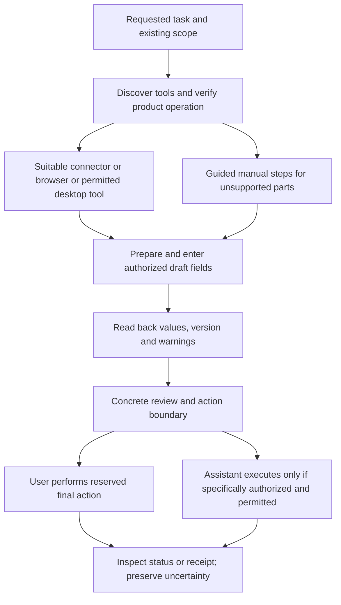
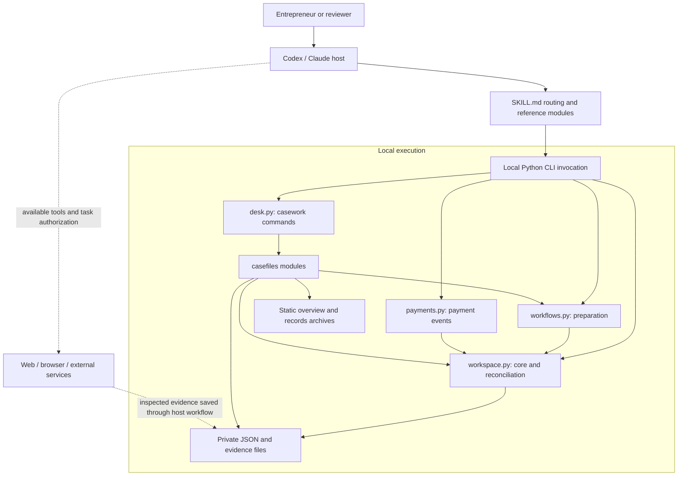

# German Business Kit architecture

[English](architecture.md) · [Русский](architecture.ru.md)

Implementation scope and remaining work: [current status](project-status.md).

Read the [domain ontology](ontology.md) for entities, relationships and state meanings.

The [accounting workflow](../skills/de-business-kit/references/accounting-workflow.md) adds an explicitly selected authoritative system when accounting work needs it, limited local cash journal and filing evidence lifecycle through the existing `desk.py` entry point. `casefiles/accounting.py` stores additive state in `04_accounting/register.json`; it reuses workspace locks, evidence fingerprints and history, and checks register state against its latest audit checkpoint. Cash lines record VAT as stated on their evidence and can link the current approved proposal they settle; the writer fingerprints each link, and reports and filing preflight stop when a linked proposal changes. Local cash reports include source-entry/configuration fingerprints, stated-VAT groups and per-account reconciliation CSVs. Filing versions freeze payload/source files, separate review/authorization from uncertain attempts and manually observed receipts/responses, and block stale local-report preflight. No provider/ERiC transport or complete statutory tax calculator is added.

The primary interaction is the host assistant plus the existing private workspace.
The shared execution contract owns prerequisite checks and reuse/persistence of
confirmed facts for all seven skills. The tax-estimates reference adds researched,
bounded calculations and explicit independent-check evidence; the consultation
template records them without a new register or automated approval transition.
The GUI remains an optional adapter to the same writers and records.

The [prepayment request workflow](../skills/de-business-kit/references/tax-consultant.md#prepare-or-revise-an-income-tax-prepayment-request)
uses versioned recipient drafts and private consultation/continuation notes. It
resolves managed folder paths or uses the selected standalone private folder;
existing protected task writers remain authoritative when present. A corrected
forecast creates a linked revision without changing submission or authority state.
Shared source recovery lives in `german-rules.md`; it adds no retrieval service,
schema, ledger or tax engine.

Receipt-to-period preparation reuses catalog/proposal writers and a versioned
readable review; the proposal period is review scope, not a universal cash/VAT
date. Filing creation expands recognized preparation/cash report dependencies into
the existing frozen `sources` array. `workflows.filing_sources` validates the
preparation envelope, embedded input, evidence fingerprints and readiness;
preflight reuses it before review/authorization/attempt. Graph traversal is bounded
and checks the captured digest against the expected one. Historical outcomes use
frozen copies only. Unknown report kinds remain opaque evidence; no schema migration
or automatic parsing of authored reports is added. Copying can leave preserved
partial evidence on failure; it is not a multi-file transaction.

## Assisted external-service execution

The services skill discovers an operation-specific route; the business-domain
skill owns the values, interpretation and review. The shared
[assisted-service workflow](../skills/de-business-kit/references/assisted-services.md)
connects available host connectors, browser/computer tools and manual steps.
This is an instruction layer over actual host capabilities, not a new connector
runtime or permissions system. It reuses the operation note and existing task,
source-map and filing evidence writers.

Authentication remains user-controlled. Draft autosave is an external write;
requested entry may authorize it, read-only inspection does not. Finalizing,
posting, locking and sending are separate effects. A missing API operation can
use a supported UI route; no capability is inferred from an installed skill.
Confirmed manual submission needs the same evidence discipline as tool execution.
Local synthetic browser trials do not establish real ELSTER/Lexware acceptance.

Invoice payment allocation is a derived projection, not a persisted paid flag: approved proposal amounts are compared with linked cash lines through the report end date, across periods. Reversals cancel their originals; corrected allocations retain history. Different currencies and ambiguous directions have no inferred balance. Reports include a settlement-basis fingerprint checked again by filing preflight. The GUI reuses filing checks only within one locked snapshot; mutations still recheck evidence. Native and Python unlock preserve exact lock bytes in audit history.

XML inspection additionally exposes optional invoice-stated prepaid and rounding
amounts with raw text, exact location and unresolved/absent states. Proposal fields
accept these additive decimal candidates without inferring payment allocation.
The operations skill uses versioned customer worksheets and recipient replies for
continuation; the existing task register remains authoritative. Invoice-time
amount due and current bank evidence are separate, and amount-due profile rules
are not executed by the inspector or proposal arithmetic.

Invoice workflow state is separate from accounting: optional
`00_admin/invoicing.json` uses the shared workspace lock, expected record hashes,
preimage history and an audit checkpoint/checksum. Existing workspace schemas are
unchanged. Draft/source, final issued artifact and event evidence are frozen
separately. Delivery scope binds final bytes, destination, attachments and the
correction family; outcome recording targets an exact attempt. A readable status
is a projection, while follow-up tasks stay in the existing register. The CLI
records evidence; host/manual provider execution is a separate step. No GUI or
native-only writer is implied. Mutable invoice state cannot itself be evidence.

The optional Lexware adapter attaches provider request, attempt, UUID, readback
and artifact evidence to that same invoice row. It commits intent before network
creation, reserves account/object identity across cases, and preserves responses
before parsing. Provider draft creation is distinct from issuance. Requests use a
fixed HTTPS origin and process-held secret; no credentials enter records. Readback
changes invalidate preparation authority; active-attempt scope changes block a
new browser action. Downloads require matching readbacks around retrieval. Browser
handoff carries the object/attempt and frozen delivery scope evidence, including
the reviewed message envelope/text. It executes no browser action by itself.

The optional `casefiles/invoice_payments.py` workflow compares an issued invoice with explicitly selected normalized bank movements. It takes reviewed invoice-stated due/inclusion facts, freezes inputs and source bytes under the workspace lock, and saves new JSON/EN-RU Markdown reports with audit checkpoints. Freshness checks bind the report to working sources and the complete active invoice/correction family. It changes no invoice/payment/ledger state and does not reconcile allocations across different invoices. The [portable workflow](../skills/de-business-kit/references/invoicing-workflow.md#compare-an-issued-invoice-with-customer-receipts) owns commands and limits.

## Intended result

An entrepreneur brings a task at any stage: prepare to start, register an activity, choose a service, fill in a form, answer a question, manage daily work or prepare reporting. Changes and closure have journey instructions; real execution needs separate acceptance. The [lifecycle map](../skills/de-business-kit/references/lifecycle.md) defines coverage and priorities. The router or a directly selected domain skill loads relevant modules and available tools; shared facts and decisions support continuation. Local utilities, the GUI and integrations serve these outcomes. Self-managed accounting and filing use the chosen system; a proprietary complete ledger and ELSTER connector are not prerequisites for every route. Consultation and exports remain optional.

The supported scope is a natural person operating in Germany: Freiberufler, Einzelunternehmen/Gewerbe and multiple activities of the same person. Corporations, partnerships, payroll, complex international structures and cash-register systems are outside the promised automation scope. The skill can collect facts and prepare a specific specialist handoff for those cases.

Export coverage is a readable projection of supplied evidence: the selected route, date basis, inspected pages/originals and missing scope. It reuses operation notes and source maps; it adds no provider registry or automatic export engine.

## Readable files and workspace folders

The physical EN/RU/DE folder map remains unchanged: five visible areas with
internal records in `.business-kit`. The workspace reference owns
[task-based destinations](../skills/de-business-kit/references/workspace.md#route-readable-results-by-task)
for launch plans, customer cases, service comparisons, changes and saved answers.
New insurance/other-service reports use visible correspondence cases; existing
hidden reports retain their location. Case folders are created only when needed,
link canonical evidence/tasks and never establish workflow state. This is an
agent authoring convention, not a migration or automatic organizer. Localized
start guides explain folder roles; an update does not overwrite an existing guide.

## Seven entry points, shared state

The bundle contains seven directly usable skills with one shared profile. `de-business-kit` starts/resumes mixed work; `de-business-start`, `de-business-operations`, `de-business-accounting`, `de-business-tax`, `de-business-services` and `de-business-changes` can be invoked directly. Shared contracts and utilities remain in `skills/de-business-kit`; installers and the builder use `assets/skill-set.json`. Load only relevant modules; a transition passes the task and evidence references without new profiles, shadow registers or automatic subagents. Install the complete set without migrating private data.

| Layer | Responsibility |
|---|---|
| `SKILL.md` | Task routing, language/mode selection, common invariants and result reporting |
| `references/` | Workflows, source maps and rules for the current task |
| `assets/en/`, `assets/ru/` | Equivalent user-facing report templates, indexed by `assets/locales.json` |
| Native PowerShell utilities | Installation, intake/integrity, evidence-inspecting overview and portable recovery without Python |
| Local Python utilities | Repeatable filesystem operations, preference persistence and deterministic reconciliation |
| Private workspace | Facts, originals, proposals, decisions, source checks and operation evidence |
| Host capabilities | Model, file access, web research, browser tools and task permissions |
| Accounting product / authority | Actual postings, transmissions, receipts and official responses |

The skill cannot create browser tools, API access or permissions. Availability depends on the host and current session. Local record utilities operate offline. The opt-in Lexware adapter sends the explicitly reviewed request to its fixed provider API; the host's model can also process selected data remotely.

The lifecycle worksheets and continuation notes reuse existing tasks, decisions and evidence. They add no state schema or autonomous workflow runner; the assistant prepares and verifies each result through available tools.

The overview and GUI home project active lifecycle tasks from the existing `tasks.json` register across months, including undated work. Readiness checks the task evidence and its full dependency ancestry; cancelled dependencies do not satisfy work. Stale evidence blocks the affected chain while unrelated tasks may continue. Invalid records suppress task suggestions. The projection cannot complete a task, grant authorization or create a reminder.

## Languages and modes

The two named working modes are `bookkeeping` and `tax-consultant`; `general` covers startup, organization and routing. Bookkeeping currently prepares evidence, proposals, reconciliation and monthly status for the user’s own review. Tax questions and preparation (`tax-consultant`) produces sourced explanations, comparisons, estimates and proposed decisions. A tax issue encountered during bookkeeping can use the consultation module without abandoning the other work or changing the saved default. See the [mode guide](../skills/de-business-kit/references/language-and-modes.md) for usage rather than a second implementation of those workflows here.

`00_admin/workspace.json` stores the default `language` and `mode`. The `configure` command persists an explicit preference change with history and an audit event; `status` exposes the current values. An explicit one-task request takes priority in the conversation. A request to translate one report does not replace the saved language or rewrite historical records.

User-facing conversations and Markdown reports support **English and Russian**. Agent instructions, JSON keys, enum values, logical path IDs and record IDs remain stable; physical folder names support EN/RU/DE. Exact German terms and form labels are preserved and explained in the chosen language. A translation is a linked rendering of the same evidence and decision, not new verification. German folders and a German start guide are supported; the complete report/template set remains EN/RU. Folder language is pinned at creation and differs from conversation/report language. See [folder mapping](../skills/de-business-kit/references/workspace.md).

The workspace format remains **schema version 1**. A v0.1 workspace without `mode` is read as `general`; it does not need to be recreated. Changing a language or mode never changes profile facts, `vat_current_regime`, bookkeeping method or authority filings. The same profile and evidence history serve both languages and all modes.

## Evidence and state

`01_profile/business.json` is the canonical profile. Each fact records a value, status, source, recording date and effective date. `unknown`, `declared`, `proposed`, `verified` and `needs_review` have distinct meanings. Verification depends on inspected evidence, not model confidence. Prior values remain in history.

`00_admin/documents.json` links originals, hashes and storage periods to subsequent work. Folder periods organize documents; they do not determine invoice, service, payment or tax dates. Activities have separate IDs, while VAT assessment considers the entrepreneur's whole enterprise. See [§2 UStG](https://www.gesetze-im-internet.de/ustg_1980/__2.html).

Document handling preserves the original, extracts facts, prepares a proposal and records review before any authorized external action. Actual external states must be read back and evidenced. A local file is not a posted entry; a transmission receipt is not substantive acceptance. Consultation reports live in `05_tax/YYYY/consultations/` and link relevant questions, proposals or decisions.

The scripts supply initialization, preference changes, evidenced profile updates, byte-preserving import, original integrity checks and explicit-reference CSV reconciliation. Locks coordinate script writers and individual JSON replacements are atomic. Copies, indexes, snapshots and audit events are separate writes, so the package does not promise a transaction across all files or a tamper-proof archive.

## Data and professional boundaries

Source code, templates and synthetic fixtures are public. Entrepreneur files belong in a separate private directory outside Git repositories. `.gitignore` is only an additional safeguard. Originals remain unchanged; OCR, extracted JSON and translations are derivatives. Review the actual AI product, plan, processing route and necessary terms before using real third-party personal data. Local storage alone does not establish local model processing or GDPR compliance; see [privacy](../skills/de-business-kit/references/privacy.md).

Tax mode explains applicable rules, applies them to stated facts and prepares reviewable conclusions. It does not establish licensed Steuerberater status or professional representation. Publishing self-help software and offering individual services to others are different operating models; a free price or disclaimer does not resolve the latter. See current [StBerG §2](https://www.gesetze-im-internet.de/stberg/__2.html), [§6](https://www.gesetze-im-internet.de/stberg/__6.html) and the [German rules reference](../skills/de-business-kit/references/german-rules.md).

Hashes, history and procedures support record organization; compliance of the complete retention and correction process requires separate assessment. The project does not declare an ordinary folder automatically compliant or automatically unlawful. See the [BMF E-Rechnung FAQ](https://www.bundesfinanzministerium.de/Content/DE/FAQ/e-rechnung.html) and the official GoBD sources in the rules reference.

## Guided setup and validated records

Use the [beginner guide](../skills/de-business-kit/guides/install.en.md) and [distribution guide](distribution.md). `start` resumes without changing preferences; `demo` uses a separate synthetic workspace; `doctor` checks local health. Processing assessment is a recorded, scoped review with configuration/evidence hashes, not legal certification. Profile values have field-specific validation. `entry` updates tasks/questions/decisions under the same lock with history, explicit transitions, evidence and an expected prior hash. Legacy malformed records are reported without silent migration. The baseline proposal/operation JSON files are instruction templates. The local extension below adds executable proposal validation; operations still have no external execution engine.

## International preparation records

The current preview includes `workflows.py` for international transactions, activity classification and ELSTER worksheets, and `payments.py` for normalized payment events and strict Stripe activity CSVs. Both reuse private-workspace storage protections and write new JSON/Markdown reports with source fingerprints. Runtime dependencies remain Python standard library. Source checks record the exact applicable period; their content still requires human/agent review. Workspace schema stays version 1; no migration or separate entrepreneur profile is needed. See [workflow guide](../skills/de-business-kit/references/accounting-workflow.md).

The [EU goods guardrails](../skills/de-business-kit/references/international.md#before-ordering-goods-from-another-eu-country)
are shared host instructions reached from operations, accounting and tax skills.
They distinguish pre-order advice from received-invoice review and reuse existing
evidence/draft workflows. No automatic tax election, refund adapter or workspace
schema is introduced.

## Component and deployment architecture

The assistant/CLI route uses the seven-skill bundle and an offline filesystem backend. The host runs the conversation and invokes short-lived Python CLI processes; the utilities can generate a static overview. The optional [real GUI](gui.md) instead runs a session-protected loopback service while its launcher is open, using the same records and protected writers. Neither route adds a database service, queue worker or built-in model API client. The diagram below describes the assistant/CLI route; the GUI adapter is described separately below.

The diagram shows the local execution boundary; the optional Lexware adapter additionally connects to its fixed provider API when explicitly invoked. Public source and the installed skill are separate from the private business workspace. `tools/install.py` copies the complete self-contained skill bundle into host discovery directories; `tools/build_package.py` creates distribution bundles. Standalone CLI use requires an available Python runtime; the GUI application bundles its engine. No production Python dependency beyond the standard library is required.

The host chooses a task module and supplies reviewed inputs. Python validates structures and performs deterministic operations. The host interprets business meaning and inspects external sources. This division keeps arithmetic and file operations reproducible while making semantic and authorization responsibilities explicit.

## Local casework extension

These components describe code present in this source snapshot. `SKILL.md` routes document work to `desk.py` through a focused reference and bilingual task recipes. Utility and behavioral evidence remain separate from native desktop discovery and acceptance.

| Component | Responsibility | Persistent result |
| --- | --- | --- |
| [desk.py](../skills/de-business-kit/scripts/desk.py) | CLI routing for intake, catalog, review, bank mapping, XML inspection, overview and records archives | Delegates to the modules below |
| [storage.py](../skills/de-business-kit/scripts/casefiles/storage.py) | Casework register, record hashes, shared locking, snapshots and evidence fingerprints | `00_admin/casework.json`, history and audit events |
| [documents.py](../skills/de-business-kit/scripts/casefiles/documents.py) | Reuse preserved originals; catalog metadata, typed relations and repeated receipt events | Catalog and receipt collections |
| [reviews.py](../skills/de-business-kit/scripts/casefiles/reviews.py) | Extracted-field checks, proposal arithmetic and review, source checks, provider observations | Proposals, source checks and observations |
| [bank.py](../skills/de-business-kit/scripts/casefiles/bank.py) | Explicit CSV mapping, review preview, normalization and overlapping-ID checks | Preview, normalized CSV and bank-import record |
| [invoice_xml.py](../skills/de-business-kit/scripts/casefiles/invoice_xml.py) | Bounded standalone UBL Invoice / CreditNote / CII header and preceding-reference inspection | Derived report and inspection record |
| [summary.py](../skills/de-business-kit/scripts/casefiles/summary.py) | Read-only projection of documents, open reviews, deadlines and reconciliation evidence | In-memory snapshot consumed by overview/archive |
| [overview.py](../skills/de-business-kit/scripts/casefiles/overview.py) | English/Russian static HTML, Markdown and JSON generation | `00_admin/overview.*`, initial `START-HERE.md` |
| [archive.py](../skills/de-business-kit/scripts/casefiles/archive.py) | Select linked records/evidence, build a manifest, verify directory and ZIP | Unique `07_exports/YYYY-MM/archive-*` artifacts |
| [accounting.py](../skills/de-business-kit/scripts/casefiles/accounting.py) | Accounting choice, reviewed cash movements with stated line VAT and proposal links, filing-evidence lifecycle/preflight | `04_accounting/register.json`, frozen files and history |
| [windows-overview.ps1](../skills/de-business-kit/scripts/windows-overview.ps1) | Native saved-state and local-evidence inspection under the workspace lock | Separate `00_admin/native-overview.*` projections |
| [recovery.py](../skills/de-business-kit/scripts/recovery.py) / [recovery.ps1](../skills/de-business-kit/scripts/recovery.ps1) | Full portable backup/verify/restore, safe paths and coordinated copying | External manifest plus complete workspace tree; fresh restored location |

The casework register has schema version 1 while proposals have schema version 2. The accounting register stays version 1 while new cash entries have version 2; entries recorded before line VAT have no entry version, remain readable and are reported as lacking VAT. These versions are independent of workspace schema version 1. Unsupported casework schemas and old proposal contracts require explicit handling; no silent migration is supplied.

## Main execution paths

**Receive and review a document.** `desk.py receive` calls the core importer, preserving bytes and deduplicating exact content. It then records catalog metadata and a receipt event. These are separate writes: an interruption can leave an imported original without the later receipt/catalog update. A default catalog view can be derived from the original index. Intake can report success for some files and errors for others; batch success must be inspected per file.

**Extract and propose.** XML inspection writes a derived report with source hash, field locations and unresolved issues. It does not automatically save a proposal or promote extracted fields to reviewed. The assistant/reviewer prepares a proposal, saves an initial draft and reviews its fields, arithmetic and source checks. Core invoice fields must be reviewed before approval. Approved/rejected outcomes are preserved; corrections use a new linked proposal. PDF embedded XML and OCR require separate tooling. XML schema, semantic business-rule and tax validation are explicitly outside this inspector.

**Normalize and reconcile.** Bank mapping first creates a preview. Approval requires the expected preview hash, re-derivation from the original, a reviewer and preserved review evidence. The normalized output can then feed `workspace.py reconcile` alongside a ledger CSV with explicit bank references. `payments.py` separately handles payment-provider events and payout relationships. Neither route infers tax treatment from matching amounts or guarantees that all accounts and periods were supplied.

**Prepare a records archive.** The builder selects non-excluded documents for the month, expands document/component/correspondence relationships, collects linked register entries and associated evidence, then writes record snapshots and a manifest. It checks evidence fingerprints and verifies both the directory and ZIP. The `generic-records-archive` manifest records exclusions, unresolved issues and readiness: `prepared_with_open_items` or `prepared_for_self_review`. Neither status means monthly closing or filing completion. Entire profile/runtime records and unrelated exports are not copied wholesale. The generic package is not a DATEV export or accounting ledger. `desk.py archive` builds it and `verify-archive` verifies integrity for the user’s review and retention. Sharing with an accountant is optional, separately authorized, and evidenced only when delivery actually occurs.

**Observe an external result.** An observation records a provider, external record ID, status text, date, reviewer and evidence. The utility does not query the provider or authenticate that reviewer. It captures a supplied observation and its evidence fingerprint. Preparation, user approval, actual posting/submission evidence and the Finanzamt response remain separate; neither an approved proposal nor a transmission receipt establishes acceptance of tax treatment. Operation authorization and actual execution remain in the host workflow; no scheduler or provider connector is introduced.

## Persistence, concurrency and recovery

Canonical state is the profile, registers, original index and preserved evidence. The overview is a generated projection; reports and archives are snapshots of selected inputs. The design is a file-backed record system with history, not an event-sourced database: current state is not rebuilt by replaying `events.json`.

Writers share `.workspace.lock` and wait up to five seconds for a cooperating writer. The lock records process, computer and time; `doctor` classifies a remaining lock as active, stale or unverifiable, and `unlock` removes only a lock whose writer has ended (or an unverifiable one after explicit confirmation), preserving it in history. Updates to editable register/casework records use expected hashes where their commands require them, rejecting stale or missing versions. JSON replacement is atomic per file. Casework writes save a history snapshot, replace the register and append an audit event; derived artifacts can also be written during an operation. These writes are not one crash-atomic transaction. Locks coordinate participating scripts, not arbitrary filesystem editors.

Recovery starts by inspecting failed-command outputs, current register hashes, originals and history. Preserve unexplained files. Both overview generators hold the workspace lock while reading and writing their projections and refuse to overwrite unmarked user files. Their separate output writes are not a crash-atomic transaction and the view can become stale after generation. The selected-record archive is distinct from full recovery. `recovery.py` and `recovery.ps1` preserve the complete workspace in a shared directory/manifest format, exclude only the active root lock, and verify copied bytes and paths. They restore only into a new private directory, hold its lock through copy verification, and use the same captured verified manifest for identity and content. Existing files, linked/unsafe paths, collisions or modified members stop the operation; partial output is preserved for inspection. Hashes do not authenticate the backup or establish tax correctness. See [recovery](../skills/de-business-kit/references/recovery.md).

## Trust boundaries and guarantees

| Boundary | Implemented mechanism or workflow rule | Limit |
| --- | --- | --- |
| Public package → private files | Separate workspace, path/symlink/Git-boundary checks | Local filesystem access is not encryption or complete OS access control |
| Received content → records | Original hashes, size/type checks, explicit validators; content treated as evidence | File authenticity and business truth still require review |
| Candidate → reviewed proposal | Field states, source fingerprints, arithmetic and reviewer metadata | Reviewer names are supplied text; no authenticated multi-user approval service |
| Local files → model context | Host capability and processing assessment workflow | Offline utilities do not make host model inference local |
| Local approval → provider state | Protected attempts, exact scope, Lexware draft/readback adapter and browser handoff | No bank/ELSTER transport; no Lexware API finalize/send; operator authorization remains an attestation |
| Records → overview | Escaped static HTML, restrictive CSP, no application JavaScript | Saved view can become stale; no live synchronization |
| Workspace → records archive | Explicit selection, manifest, file hashes and verification | Integrity does not prove completeness, delivery or recipient acceptance |

## Design choices and validation scope

One portable seven-skill bundle and one shared profile avoid divergent state across modes and hosts. Standard-library CLI processes reduce installation dependencies. JSON and ordinary files make evidence inspectable and portable, at the cost of multi-file recovery and coarse write locking. The casework register is rewritten as a whole and has a 50 MiB limit; this is not designed as a concurrent, high-volume accounting platform. Shared helpers reduce duplication, but casework imports internal helpers from `workspace.py` and `workflows.py`, so their contracts are coupled.

Automated checks are `python3 -B -m unittest discover -s tests -v` and `python3 -B tools/check_package.py`. Tests cover local contracts; package checks cover structure, translations, JSON and local links. The [validation record](validation.md) separates historical runs, behavioral trials and integration gaps. A passing test run does not establish tax correctness, production connector support or desktop usability. This architecture describes the current source, not a certification or a release declaration.

The [core capability plan](project-status.md#accounting-acceptance) defines the unfinished ledger and ELSTER work and its acceptance evidence.

## Existing sources and folder inventory

[Existing-data onboarding](../skills/de-business-kit/references/existing-data.md) discovers actual host plugins/API/browser/computer tools and records bounded access observations in a localized, human-maintained source map. It introduces no network adapter or automatic connection registry. `casefiles/folders.py`, exposed by `desk.py scan-folder`, writes a bounded metadata-only preview before selected intake. It leaves source contents unchanged, excludes detected links/reparse points, hidden entries, key files and nested workspaces, and reports omissions and traversal limits. Cloud residency is not independently verified. A source map or inventory is not import completeness or permission to write to a service.

## Readable document authoring

[Document authoring](../skills/de-business-kit/references/document-authoring.md) and the shared [readable-output contract](../skills/de-business-kit/references/readable-output.md) route all substantial skill results to user-readable views. EN/RU report/review Markdown, a German recipient-letter template and one static printable HTML asset are packaged with the skill. Rendering/export uses available host/browser tools; no new document runtime or transmission adapter is bundled. Canonical records remain authoritative; readable copies and recipient artifacts do not advance filing states.

## Real view and prototype

`casefiles/overview.py` collects accounting status and filing issues from the existing accounting checks under the shared lock, together with casework and open questions. Uncertain submissions and dated responses remain visible across months. `windows-overview.ps1` produces separate `native-overview.*` projections with local hash/history inspection; it does not implement full filing preflight. The English interactive `prototype/` still uses synthetic browser storage and does not mutate either workspace. [Runtime matrix](project-status.md).

## Real GUI adapter and native delivery

The local application uses `gui/server.py` and the EN/RU/DE browser interface, separately
from the synthetic prototype. A session-protected loopback API delegates to the
existing document, accounting and recovery writers. Workspace selection identities
reject stale tabs, and separate GUI drafts use expected hashes and completed audit
checkpoints. The browser is not another accounting database. Platform bundles embed
the engine so end users do not install Python; standalone PowerShell remains its
existing narrower route. See [GUI scope, trust boundaries and delivery](gui.md).

## Developer evaluation evidence

`tools/run_evals.py` retains its ten bounded no-web cases. The separate opt-in
`tools/run_research_evals.py` freezes observer inputs, runs public-source FAQ
sessions with a read-only shell, indexes raw tool evidence and emits independently
reviewed assessments bound to captured bytes. Follow-ups replay recorded context;
they do not exercise workspace persistence. Evaluation artifacts live outside the
checkout and private business workspaces; no business schema or installed runtime
changes. See [evaluation procedure](../evals/README.md#faq-coverage-and-public-source-pilot)
for permissions, failure states, integrity limits and reviewer ownership.
