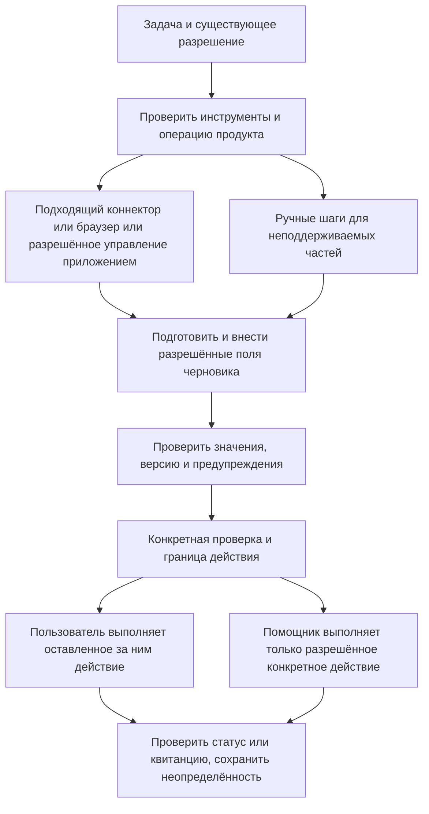
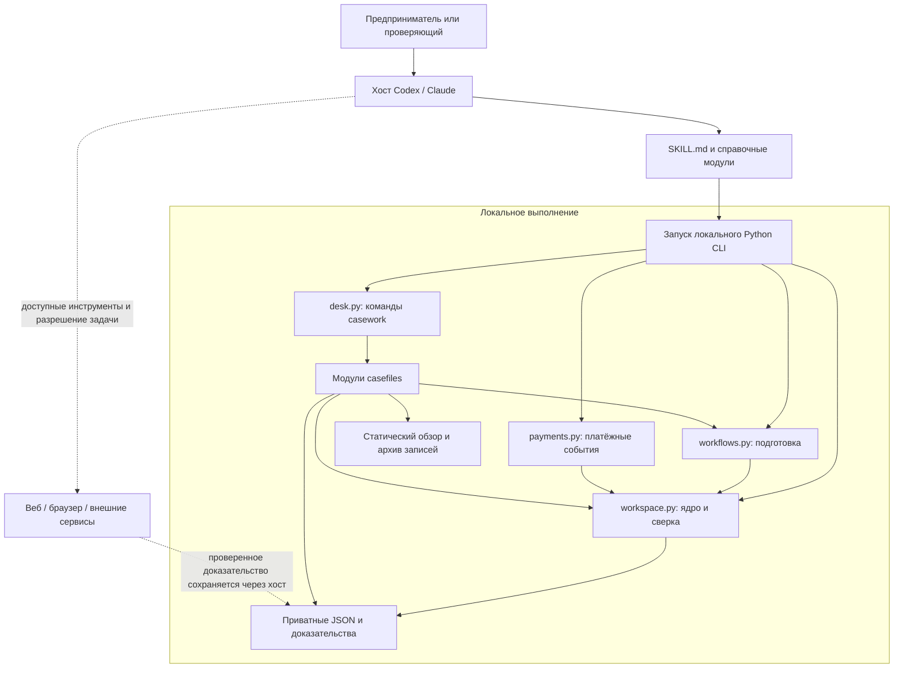

# Архитектура German Business Kit

[English](architecture.md) · [Русский](architecture.ru.md)

Реализованные возможности и оставшаяся работа: [текущее состояние](project-status.ru.md).

Сущности, связи и значения состояний описаны в [онтологии](ontology.ru.md).

[Рабочий процесс учёта](../skills/de-business-kit/references/accounting-workflow.md) добавляет основную систему, явно выбранную для необходимой задачи учёта, ограниченный локальный денежный журнал и отслеживание доказательств подачи через существующий `desk.py`. Модуль `casefiles/accounting.py` хранит дополнительные данные в `04_accounting/register.json`, использует блокировки, отпечатки доказательств и историю и сверяет реестр с последней контрольной записью аудита. Денежные строки фиксируют НДС так, как он указан в доказательстве, и могут ссылаться на действующее одобренное предложение, которое они оплачивают; модуль сохраняет отпечаток каждой ссылки, а отчёты и проверка подачи останавливаются, если связанное предложение изменилось. Отчёты содержат отпечатки операций/настроек, группы указанного НДС и CSV каждого счёта для сверки. Версии подачи фиксируют файлы данных/источников, разделяют проверку/разрешение, неопределённые попытки и наблюдавшиеся квитанции/ответы; устаревший локальный отчёт блокирует дальнейшую подготовку. Коннектор провайдера/ERiC и полный налоговый калькулятор не добавляются.

## Помощь в выполнении операций внешнего сервиса

Скилл сервисов находит способ конкретной операции; профильный скилл отвечает за
значения, интерпретацию и проверку. Общий
[процесс помощи в сервисах](../skills/de-business-kit/references/assisted-services.md)
соединяет доступные коннекторы хоста, браузер/управление компьютером и ручные шаги.
Это слой инструкций над реальными возможностями хоста, а не новый runtime
коннекторов или система прав. Используются существующие заметка операции,
задачи, карта источников и writers доказательств подачи.

Авторизация остаётся под контролем пользователя. Автосохранение черновика —
внешняя запись: запрос на ввод может её разрешать, просмотр без изменений — нет.
Окончательное оформление, проводка, фиксация и отправка имеют отдельные эффекты.
Недоступную операцию API может заменить поддерживаемый интерфейс; наличие скилла
не доказывает возможность. Ручная отправка требует той же дисциплины доказательств.
Локальные синтетические испытания браузера не означают приёмку ELSTER/Lexware.

## Пользовательский результат

Предприниматель приходит с задачей на любом этапе: подготовиться к открытию, зарегистрировать деятельность, выбрать сервис, заполнить форму, разобраться с вопросом, вести текущую работу или отчётность. Изменения и закрытие входят в целевой охват, но инструкции маршрутов добавлены, а реальное выполнение проверяется отдельно. [Карта жизненного цикла](../skills/de-business-kit/references/lifecycle.md) определяет покрытие и приоритеты. Общий вход или выбранный предметный скилл подключает нужные модули и доступные инструменты; общие факты и решения позволяют продолжить работу. Локальные утилиты, GUI и интеграции служат этим результатам. Самостоятельный учёт и подача поддерживаются через выбранную систему; собственный полный регистр и коннектор ELSTER не являются обязательным условием каждого маршрута. Консультация и экспорт остаются дополнительными вариантами.

Поддерживаемая область — физическое лицо, ведущее деятельность в Германии: Freiberufler, Einzelunternehmen/Gewerbe и несколько видов деятельности одного человека. Корпорации, партнёрства, payroll, сложные международные структуры и кассовые системы не включены в обещанную область автоматизации. Для таких случаев skill может собрать факты и подготовить предметный запрос специалисту.

Охват выгрузки — читаемое представление предоставленных подтверждений: способ выгрузки, основание отбора по датам, проверенные страницы/оригиналы и пробелы. Используются существующие записи операций и карты источников; новый реестр провайдеров или автоматический экспорт не добавляются.

## Семь входов и общее состояние

Комплект содержит семь самостоятельных скиллов с общим профилем. `de-business-kit` помогает начать или продолжить смешанную задачу; `de-business-start`, `de-business-operations`, `de-business-accounting`, `de-business-tax`, `de-business-services` и `de-business-changes` доступны напрямую. Общий контракт и инструменты остаются в `skills/de-business-kit`; каталогу `assets/skill-set.json` следуют установщики и сборка. Загружается только нужный модуль; переход передаёт задачу и ссылки на доказательства без новых профилей, теневых реестров или автоматических субагентов. Комплект устанавливается целиком, без миграции рабочих данных.

| Уровень | Ответственность |
|---|---|
| `SKILL.md` | Выбор сценария, языка и режима, общие правила и сообщение результата |
| `references/` | Рабочие процессы, карта источников и правила для текущей задачи |
| `assets/en/`, `assets/ru/` | Равнозначные пользовательские шаблоны отчётов, перечисленные в `assets/locales.json` |
| Нативные PowerShell-утилиты | Установка, приём/целостность, обзор доказательств и переносимое восстановление без Python |
| Локальные Python-утилиты | Повторяемые операции с файлами, сохранение настроек и детерминированная сверка |
| Личный workspace | Факты, оригиналы, предложения, решения, проверки источников и подтверждения операций |
| Возможности хоста | Модель, доступ к файлам, веб-поиск, браузер и разрешения для задачи |
| Бухгалтерская система / ведомство | Реальные проводки, отправки, квитанции и официальные ответы |

Skill не создаёт инструменты браузера, API-доступ и разрешения. Возможности зависят от хоста и текущего сеанса. Комплектные скрипты работают без сети; модель хоста при этом может обрабатывать выбранные данные удалённо.

Рабочие листы жизненного цикла и заметки для продолжения используют существующие задачи, решения и подтверждения. Они не добавляют схему состояния или автономный исполнитель; ассистент готовит и проверяет каждый результат доступными инструментами.

Обзор и главная страница GUI показывают текущие задачи жизненного цикла из существующего `tasks.json` независимо от выбранного месяца, включая задачи без срока. Готовность учитывает подтверждения задачи и всю цепочку зависимостей; отмена зависимости не означает её выполнения. Изменённое подтверждение блокирует связанную цепочку, но позволяет продолжать независимые задачи. Некорректные записи скрывают предложения продолжения. Проекция не завершает задачи, не выдаёт разрешений и не создаёт напоминаний.

## Языки и режимы

Два именованных рабочих режима — `bookkeeping` и `tax-consultant`; `general` предназначен для открытия бизнеса, организации и выбора сценария. Бухгалтерский режим сейчас готовит документы, предложения, сверку и статус месяца для собственной проверки пользователя. Режим налогового консультанта создаёт объяснения с источниками, сравнения, расчёты и предложения решений. Налоговый вопрос, возникший во время учёта, может использовать консультационный модуль без остановки остальных задач и изменения сохранённого режима. Примеры использования находятся в [руководстве по режимам](../skills/de-business-kit/references/language-and-modes.md); здесь эти сценарии повторно не реализуются.

`00_admin/workspace.json` хранит язык `language` и режим `mode` по умолчанию. Команда `configure` сохраняет явно запрошенное изменение с историей и записью в журнале; `status` показывает текущие значения. Явное указание для отдельной задачи имеет приоритет в разговоре. Просьба перевести один отчёт не заменяет сохранённый язык и не переписывает прежние записи.

Пользовательские диалоги и Markdown-отчёты поддерживают **английский и русский**. Инструкции для агента, JSON-ключи, значения перечислений, логические идентификаторы путей и ID записей остаются стабильными; реальные имена папок поддерживают EN/RU/DE. Точные немецкие термины и поля форм сохраняются с пояснениями на выбранном языке. Перевод — связанное представление тех же доказательств и решения, а не новая проверка. Немецкие папки и стартовое руководство поддерживаются; полный комплект отчётов/шаблонов остаётся EN/RU. Язык папок закрепляется при создании и отличается от языка разговора/отчёта. См. [карту папок](../skills/de-business-kit/references/workspace.md).

Формат workspace сохраняет **версию схемы 1**. Workspace версии v0.1 без поля `mode` читается как `general`; пересоздавать его не требуется. Смена языка или режима не меняет факты профиля, `vat_current_regime`, метод учёта и поданные документы. Оба языка и все режимы используют один профиль и историю подтверждений.

## Подтверждения и состояние

Канонический профиль — `01_profile/business.json`. Каждый факт хранит значение, статус, источник, дату фиксации и дату начала действия. `unknown`, `declared`, `proposed`, `verified` и `needs_review` имеют разные значения. Проверенность опирается на изученные подтверждения, а не уверенность модели. Предыдущие значения сохраняются в истории.

`00_admin/documents.json` связывает оригиналы, хеши и периоды хранения с дальнейшей работой. Период папки организует документы; он не определяет дату счёта, услуги, оплаты или налоговый период. Виды деятельности имеют отдельные ID, при этом оценка НДС учитывает всё предприятие одного предпринимателя. См. [§2 UStG](https://www.gesetze-im-internet.de/ustg_1980/__2.html).

Работа с документом сохраняет оригинал, извлекает факты, готовит предложение и фиксирует проверку до разрешённого внешнего действия. Фактическое состояние внешней системы нужно прочитать и подтвердить. Локальный файл не означает проводку; квитанция отправки не означает принятие по существу. Консультационные отчёты находятся в `05_tax/YYYY/consultations/` и связаны с соответствующими вопросами, предложениями или решениями.

Скрипты обеспечивают инициализацию, изменение настроек, обновление профиля с подтверждениями, импорт без изменения байтов, проверку целостности оригиналов и CSV-сверку по явным ссылкам. Блокировки согласуют работу записывающих скриптов, а замена отдельного JSON-файла атомарна. Копии, индексы, снимки и события журнала записываются отдельно, поэтому пакет не обещает единой транзакции для всех файлов или защищённого от подделки архива.

## Работа с данными и профессиональные границы

Код, шаблоны и синтетические примеры публичны. Файлы предпринимателя должны находиться в отдельном личном каталоге вне Git-репозиториев. `.gitignore` служит только дополнительной защитой. Оригиналы не меняются; OCR, извлечённый JSON и переводы считаются производными. До использования реальных персональных данных третьих лиц проверяются конкретный AI-продукт, план, маршрут обработки и необходимые условия. Локальное хранение само по себе не означает локальную работу модели или соответствие GDPR; см. [privacy](../skills/de-business-kit/references/privacy.md).

Налоговый режим объясняет применимые правила, сопоставляет их с указанными фактами и готовит проверяемые выводы. Он не устанавливает статус лицензированного Steuerberater или профессиональное представительство. Публикация инструмента для собственных дел и оказание индивидуальных услуг другим людям — разные модели работы; бесплатность или disclaimer не решают вопрос допустимости второй модели. См. действующие [§2 StBerG](https://www.gesetze-im-internet.de/stberg/__2.html), [§6](https://www.gesetze-im-internet.de/stberg/__6.html) и [справку по немецким правилам](../skills/de-business-kit/references/german-rules.md).

Хеши, история и процедуры помогают организовать записи; соответствие полного процесса хранения и исправлений требует отдельной оценки. Проект не объявляет обычную папку ни автоматически соответствующей требованиям, ни автоматически незаконной. См. [BMF E-Rechnung FAQ](https://www.bundesfinanzministerium.de/Content/DE/FAQ/e-rechnung.html) и официальные источники GoBD в справке.

## Настройка и проверяемые записи

См. [руководство для начинающих](../skills/de-business-kit/guides/install.ru.md) и [распространение](distribution.ru.md). `start` продолжает работу без смены настроек; `demo` создаёт отдельную учебную папку; `doctor` проверяет локальное состояние. Запись оценки обработки с хешами конфигурации и подтверждения не является юридической сертификацией. Значения профиля проверяются по типам. `entry` обновляет задачи, вопросы и решения под блокировкой, сохраняя историю, подтверждения, допустимые состояния и ожидаемый хеш прежней записи. Старые несовместимые записи помечаются для проверки без автоматической миграции. В базовой версии JSON предложений и операций служит шаблоном инструкций. Локальное расширение ниже добавляет программную проверку предложений; механизма внешнего исполнения операций по-прежнему нет.

## Подготовка международных операций

Текущая предварительная версия включает `workflows.py` для международных операций, классификации и таблиц ELSTER, а также `payments.py` для нормализованных платёжных событий и ограниченного формата Stripe activity CSV. Они используют защиту личной папки и создают новые JSON/Markdown-отчёты с контрольными суммами источников. Зависимости — стандартная библиотека Python. Проверки источников фиксируют точный применимый период; содержание требует проверки человеком/агентом. Схема папки остаётся версии 1: миграция и отдельный профиль предпринимателя не нужны. См. [руководство](../skills/de-business-kit/references/accounting-workflow.md).

## Компоненты и развёртывание

Маршрут ассистента/CLI использует комплект из семи скиллов и локальное файловое хранилище. Хост ведёт диалог и запускает короткоживущие процессы Python CLI; утилиты создают статический обзор. Необязательный [настоящий GUI](gui.ru.md) запускает защищённую сессией службу на loopback, пока открыт launcher, и использует те же записи и защищённые writers. Ни один маршрут не добавляет службу БД, обработчик очереди или встроенный клиент API модели. Следующая схема описывает маршрут ассистента/CLI; адаптер GUI описан отдельно ниже.

Диаграмма показывает выполнение и зависимости, а не сетевые возможности Python-утилит. Публичный исходный код и установленный skill отделены от приватного пространства бизнеса. `tools/install.py` копирует полный самодостаточный комплект скиллов в каталоги обнаружения хоста; `tools/build_package.py` создаёт дистрибутивы. Отдельному CLI нужна доступная среда Python; приложение GUI включает свой движок. Производственные зависимости ограничены стандартной библиотекой.

Хост выбирает модуль задачи и передаёт проверенные входные данные. Python проверяет структуры и выполняет детерминированные операции. Хост интерпретирует деловой смысл и изучает внешние источники. Такое разделение обеспечивает воспроизводимость арифметики и файловых операций, явно оставляя смысловую проверку и разрешения в процессе работы хоста.

## Локальное расширение casework

`SKILL.md` направляет работу с документами в `desk.py` через отдельную инструкцию и двуязычные сценарии. Проверки утилит и поведения не заменяют приёмку обнаружения skill в desktop-приложениях.

| Компонент | Ответственность | Сохраняемый результат |
| --- | --- | --- |
| [desk.py](../skills/de-business-kit/scripts/desk.py) | Команды приёма, каталога, проверки, банковского сопоставления, XML, обзора и архива записей | Делегирование модулям ниже |
| [storage.py](../skills/de-business-kit/scripts/casefiles/storage.py) | Реестр casework, хеши записей, общая блокировка, снимки и отпечатки доказательств | `00_admin/casework.json`, история и аудит |
| [documents.py](../skills/de-business-kit/scripts/casefiles/documents.py) | Использование оригиналов, карточки, типизированные связи и повторные получения | Коллекции карточек и получений |
| [reviews.py](../skills/de-business-kit/scripts/casefiles/reviews.py) | Проверки полей, арифметика и проверка предложений, источники, наблюдения провайдера | Предложения, проверки источников и наблюдения |
| [bank.py](../skills/de-business-kit/scripts/casefiles/bank.py) | Явное сопоставление CSV, предпросмотр, нормализация и проверка пересечения ID | Предпросмотр, CSV и запись импорта |
| [invoice_xml.py](../skills/de-business-kit/scripts/casefiles/invoice_xml.py) | Ограниченная инспекция заголовков и ссылок на исходные счета в UBL Invoice / CreditNote / CII XML | Производный отчёт и запись инспекции |
| [summary.py](../skills/de-business-kit/scripts/casefiles/summary.py) | Читаемая без изменения записей проекция документов, проверок, сроков и сверок | Снимок в памяти для обзора/архива |
| [overview.py](../skills/de-business-kit/scripts/casefiles/overview.py) | Статические HTML, Markdown и JSON на английском/русском | `00_admin/overview.*`, первоначальный `START-HERE.md` |
| [archive.py](../skills/de-business-kit/scripts/casefiles/archive.py) | Выбор связанных записей, манифест, проверка каталога и ZIP | Уникальные артефакты `07_exports/YYYY-MM/archive-*` |
| [accounting.py](../skills/de-business-kit/scripts/casefiles/accounting.py) | Выбор учёта, проверенные движения денег с указанным НДС строк и ссылками на предложения, жизненный цикл доказательств и проверка подачи | `04_accounting/register.json`, сохранённые файлы и история |
| [windows-overview.ps1](../skills/de-business-kit/scripts/windows-overview.ps1) | Нативная проверка состояния и локальных доказательств под блокировкой | Отдельные представления `00_admin/native-overview.*` |
| [recovery.py](../skills/de-business-kit/scripts/recovery.py) / [recovery.ps1](../skills/de-business-kit/scripts/recovery.ps1) | Полное переносимое копирование/проверка/восстановление, безопасные пути и блокировка | Внешний манифест и всё дерево; новая папка восстановления |

Реестр casework имеет схему версии 1, предложения — версии 2. Реестр учёта остаётся версии 1, новые денежные записи имеют версию 2; записи, сделанные до учёта НДС в строках, не имеют версии записи, остаются читаемыми и отмечаются в отчётах как записи без НДС. Эти версии независимы от версии 1 схемы пространства. Неподдерживаемые схемы casework и старые контракты предложений требуют явной обработки; скрытой миграции нет.

## Основные пути выполнения

**Приём и проверка документа.** `desk.py receive` вызывает базовый импорт, сохраняющий байты и устраняющий точные дубликаты. Затем записывает карточку и событие получения. Это отдельные записи: прерывание может оставить импортированный оригинал без последующего обновления карточки/получения. Базовое представление карточки можно получить из индекса оригиналов. Пакетный приём может успешно обработать часть файлов и вернуть ошибки для остальных; результат проверяется по каждому файлу.

**Извлечение и предложение.** Инспекция XML создаёт производный отчёт с хешем источника, расположением полей и проблемами. Она не сохраняет предложение автоматически и не делает извлечённые поля проверенными. Ассистент/проверяющий готовит предложение, сохраняет первый черновик и проверяет поля, арифметику и источники. Основные поля счёта должны быть проверены до одобрения. Одобренные/отклонённые результаты сохраняются; исправления используют новое связанное предложение. Встроенный XML в PDF и OCR требуют отдельных инструментов. Проверка схемы XML, семантических правил и налоговой корректности не входит в эту инспекцию.

**Нормализация и сверка.** Сопоставление банка сначала создаёт предпросмотр. Одобрение требует ожидаемого хеша, повторного вычисления по оригиналу, проверяющего и сохранённого доказательства проверки. Нормализованный результат можно передать `workspace.py reconcile` вместе с учётным CSV с явными банковскими ссылками. `payments.py` отдельно обрабатывает события платёжного провайдера и связи выплат. Ни один путь не выводит налоговую обработку из совпадения сумм и не гарантирует охват всех счетов и периодов.

**Подготовка архива записей.** Сборщик выбирает не исключённые документы месяца, расширяет выборку по связям документов/компонентов/переписки, собирает связанные записи реестров и доказательства, создаёт снимки и манифест. Затем проверяет отпечатки доказательств, каталог и ZIP. Манифест `generic-records-archive` фиксирует исключения, открытые вопросы и готовность: `prepared_with_open_items` или `prepared_for_self_review`. Ни одно состояние не означает закрытие месяца или завершённую подачу. Профиль/среда целиком и несвязанные экспорты не копируются. Универсальный пакет не является экспортом DATEV или учётным регистром. `desk.py archive` собирает его, а `verify-archive` проверяет целостность для собственной проверки и хранения. Передача бухгалтеру — дополнительное действие с отдельным разрешением; доставка фиксируется только по её подтверждению.

**Наблюдение внешнего результата.** Запись наблюдения содержит провайдера, ID внешней записи, текст статуса, дату, проверяющего и доказательство. Утилита не опрашивает провайдера и не аутентифицирует проверяющего. Она сохраняет переданное наблюдение и отпечаток доказательства. Подготовка, одобрение пользователя, подтверждение фактической проводки/отправки и ответ Finanzamt остаются отдельными этапами; ни одобренное предложение, ни квитанция передачи не подтверждают принятие налоговой позиции. Разрешение и исполнение операции остаются в процессе хоста; планировщик и коннектор не добавляются.

## Хранение, конкурентная запись и восстановление

Каноническое состояние составляют профиль, реестры, индекс оригиналов и сохранённые доказательства. Обзор — производное представление; отчёты и пакеты — снимки выбранных входных данных. Это файловая система записей с историей, а не event-sourced база: текущее состояние не восстанавливается проигрыванием `events.json`.

Записывающие утилиты используют `.workspace.lock`. Обновления редактируемых записей реестров/casework используют ожидаемые хеши там, где этого требует команда, и отвергают устаревшую или отсутствующую версию. Замена JSON атомарна для отдельного файла. Запись casework сохраняет снимок истории, заменяет реестр и добавляет событие аудита; внутри операции могут создаваться производные артефакты. Единой транзакции, атомарной при сбое, нет. Блокировка координирует участвующие скрипты, но не произвольные файловые редакторы.

Восстановление начинается с проверки результатов неудачной команды, хешей, оригиналов и истории; необъяснённые файлы сохраняются. Оба генератора обзора удерживают блокировку при чтении и записи представлений и не перезаписывают пользовательские файлы без метки. Отдельные выходные файлы не образуют транзакцию при сбое, а готовый обзор может устареть. Архив выбранных записей отличается от полной копии. `recovery.py` и `recovery.ps1` сохраняют всё пространство в общем формате папки/манифеста, исключая только активную корневую блокировку, и проверяют байты и пути. Восстановление выполняется только в новую личную папку под блокировкой до проверки копирования, с одним проверенным манифестом для идентификатора и содержимого. Существующие файлы, ссылки/небезопасные пути, коллизии и изменённые файлы останавливают операцию; частичный результат сохраняется для разбора. Хеши не удостоверяют подлинность копии или налоговую корректность. См. [восстановление](../skills/de-business-kit/references/recovery.md).

## Границы доверия и гарантии

| Граница | Механизм или правило процесса | Ограничение |
| --- | --- | --- |
| Публичный пакет → приватные файлы | Отдельное пространство, проверки путей, симлинков и границы Git | Файловый доступ не означает шифрование или полный контроль прав ОС |
| Полученное содержимое → записи | Хеши, проверки размера/типа, валидаторы; содержание считается доказательством | Подлинность файла и достоверность содержания требуют проверки |
| Кандидат → проверенное предложение | Состояния полей, отпечатки источников, арифметика, сведения о проверяющем | Имя проверяющего — переданный текст; службы аутентифицированного согласования нет |
| Локальные файлы → контекст модели | Оценка возможностей хоста и обработки данных | Локальные утилиты не делают работу модели хоста локальной |
| Локальное одобрение → состояние провайдера | Раздельные предложения, шаблон операции и наблюдения | Адаптера записи/повторного чтения банка, Lexware или ELSTER нет |
| Записи → обзор | Экранированный статический HTML, ограничивающая CSP, без JavaScript приложения | Срез устаревает; живой синхронизации нет |
| Пространство → архив записей | Явная выборка, манифест, хеши и проверка | Целостность не доказывает полноту, доставку или принятие получателем |

## Решения и область проверки

Один переносимый комплект из семи скиллов и общий профиль предотвращают расхождение данных между режимами и хостами. CLI на стандартной библиотеке уменьшает зависимости установки. JSON и обычные файлы обеспечивают обозримость и переносимость доказательств ценой восстановления нескольких файлов и общей блокировки записи. Реестр casework переписывается целиком и ограничен 50 MiB; решение не предназначено для высоконагруженной многопользовательской бухгалтерской платформы. Общие функции уменьшают дублирование, но casework импортирует внутренние функции `workspace.py` и `workflows.py`, поэтому их контракты связаны.

Автоматические команды: `python3 -B -m unittest discover -s tests -v` и `python3 -B tools/check_package.py`. Тесты проверяют локальные контракты; проверка пакета — структуру, переводы, JSON и локальные ссылки. [Отчёт о проверках](validation.ru.md) разделяет исторические запуски, поведенческие испытания и пробелы интеграции. Успешные тесты не подтверждают налоговую корректность, производственные коннекторы или удобство настольной работы. Архитектура описывает исходники, не сертификацию или объявление выпуска.

[План основных возможностей](project-status.ru.md#приёмка-учёта-и-отчётности) задаёт незавершённую работу по регистру и ELSTER и критерии готовности.

## Существующие источники и обзор папки

[Подключение существующих данных](../skills/de-business-kit/references/existing-data.md) определяет фактические инструменты плагинов/API/браузера/управления компьютером и сохраняет наблюдения об ограниченном доступе в локализованной карте источников, которую ведёт ассистент/пользователь. Сетевого адаптера и автоматического реестра подключений не добавлено. `casefiles/folders.py` через `desk.py scan-folder` создаёт ограниченный предпросмотр метаданных до выбранного импорта. Содержимое источника не меняется; обнаруженные ссылки/reparse points, скрытые элементы, ключи и вложенные рабочие папки исключаются, пропуски и пределы обхода видны. Наличие локальной копии облачных данных отдельно не проверяется. Карта источников или инвентаризация не подтверждают полноту импорта и право записи в сервис.

## Подготовка читаемых документов

[Модуль подготовки документов](../skills/de-business-kit/references/document-authoring.md) и [общие правила читаемого результата](../skills/de-business-kit/references/readable-output.md) применяются к существенным результатам всех направлений skill. В пакет включены Markdown-шаблоны отчёта и проверки EN/RU, немецкого письма и один статический HTML-шаблон для чтения и печати. Экспорт выполняется доступными средствами хоста/браузера; новый исполняемый компонент или адаптер отправки не добавлен. Основные записи остаются источником состояния: читаемые копии не меняют состояние подачи.

## Реальный обзор и прототип

`casefiles/overview.py` под общей блокировкой получает сведения учёта и замечания из существующих проверок подачи вместе с документами и вопросами. Неопределённые отправки и датированные ответы видны при смене месяца. `windows-overview.ps1` создаёт отдельные `native-overview.*` с проверкой локальных хешей/истории, но без полной проверки подачи. Английский интерактивный `prototype/` по-прежнему хранит вымышленные данные в браузере и не меняет реальные папки. [Матрица возможностей](project-status.ru.md).

## Адаптер настоящего GUI и платформенная поставка

Локальное приложение использует `gui/server.py` и браузерный интерфейс EN/RU/DE отдельно от
вымышленного прототипа. Защищённый сессией loopback API передаёт действия существующим
операциям документов, учёта и восстановления. Идентичность выбранного пространства
блокирует старые вкладки; отдельные черновики GUI проверяют хеши и завершённые
контрольные записи аудита. Браузер не становится второй базой учёта. Платформенные
пакеты включают движок, чтобы пользователь не устанавливал Python; самостоятельный
PowerShell сохраняет прежний более узкий маршрут. См. [объём GUI, границы доверия и поставку](gui.ru.md).
