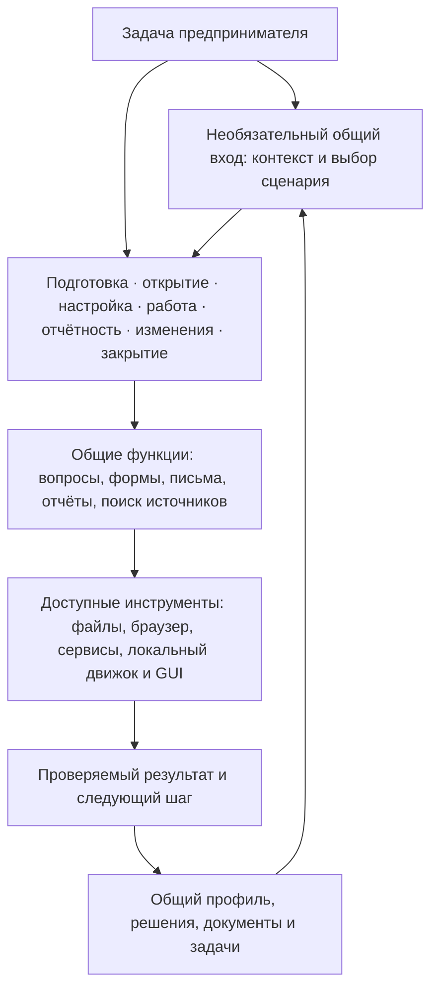

> Историческая запись, перенесённая 2026-10-26. Даты, результаты и формулировки этапов сохранены; старые «следующие шаги» не являются текущей очередью. См. [текущее состояние](../project-status.ru.md) и [сводку проверок](../validation.ru.md).

# План возвращения к системе скиллов предпринимателя

[English](lifecycle-plan-2026-10-26.md) · [Русский](lifecycle-plan-2026-10-26.ru.md) · [Текущее состояние](../project-status.ru.md)

План принят к подготовке **26.10.2026** после уточнения назначения продукта. Это план исправления продукта, инструкций и порядка разработки; перечисленные ниже этапы не объявлены реализованными. Состояние основано на просмотре исходных модулей, а не на новой проверке юридических норм или внешних сервисов.

## 1. Целевой продукт и границы

German Business Kit — система скиллов, сопровождающая предпринимателя в Германии от подготовки к открытию до текущей работы, отчётности, изменений и закрытия. Пользователь получает ответ, решение, документ или выполненное с проверенным результатом действие, а затем может продолжить с сохранённым контекстом.

Первый полный охват строится для Freiberufler и Einzelunternehmen/Gewerbe, включая несколько деятельностей одного человека. Сотрудники, смена организационной формы и сложные случаи должны иметь маршрут помощи: сбор фактов, исследование требований, подготовка и проверяемый переход к подходящему сервису или специалисту. Это не обещание собственной реализации payroll, учёта корпораций или всех отраслевых процедур.

Принципы исправления:

- Семь скиллов в одном версионируемом комплекте: необязательный общий вход и шесть предметных скиллов с прямым запуском, общим контекстом и ресурсами. Выбор скилла не создаёт отдельных агентов, сервисов или хранилищ.
- Начинать с задачи. Простой вопрос не требует GUI, рабочей папки, выбора бухгалтерской программы или полного опроса.
- Самостоятельный учёт и отчётность остаются обязательными пользовательскими сценариями; их можно выполнять с помощью выбранной программы, официального инструмента, браузера или ручного сопровождения.
- Формулы налогов не встраиваются в код и шаблоны. Скиллы находят применимые источники, готовят входные данные, помогают использовать подходящий инструмент и проверяют фактический результат.
- Существующая бухгалтерская система остаётся основной при её выборе. Локальный журнал — ограниченный вариант, без параллельного дублирования внешних книг.
- GUI, локальные утилиты и интеграции развиваются под конкретные сценарии. Уже работающие функции, история и защита записей сохраняются.

## 2. Целевая структура

Этап жизненного цикла — способ выбрать сценарий, а не новый обязательный enum в данных. Один человек может одновременно вести деятельность и готовить другую к открытию. Изменение схем требуется только при доказанной нехватке текущих фактов, задач, решений и доказательств.

## 2.1. Состав комплекта и ответственность

| Скилл | Владелец результата |
| --- | --- |
| `de-business-kit` | Общий вход, смешанная задача, продолжение и выбор следующего шага |
| `de-business-start` | Подготовка запуска, классификация, регистрация и её формы |
| `de-business-operations` | Предложения, счета, оплаты/уточнения и обычная деловая переписка |
| `de-business-accounting` | Первичные документы, сверка, записи в основной системе и подготовка периода |
| `de-business-tax` | Налоговые вопросы, оценки через инструменты, отчётность и ответы Finanzamt |
| `de-business-services` | Выбор банков/страхования/ПО и проверяемый доступ к сервисам |
| `de-business-changes` | Изменения, найм, переходы, приостановка и закрытие |

Пользователь может обращаться к предметному скиллу напрямую. Общий контракт находится в `de-business-kit/references/shared-context.md`; ресурсы и защищённые инструменты остаются в существующем core-каталоге. При переходе передаются задача, подтверждённые факты, источники, версии, нерешённые вопросы и существующее разрешение. Новые профили и теневые реестры не создаются. Каждый комплект устанавливается целиком; отдельная установка зависимого скилла не поддерживается.

### S0. Разделение и доставка — перед P1

1. Создать шесть предметных `SKILL.md` с различимыми описаниями, прямым входом и границами ответственности; сократить общий вход.
2. Сохранить общие правила и ресурсы в одном месте без переноса пользовательских данных и смены схем.
3. Обновить Python/PowerShell-установку и Codex/Claude-сборку по явному каталогу комплекта. Проверять весь комплект и конфликты до записи; не перезаписывать установленные скиллы.
4. Проверить копии без исходного checkout, сохранность ссылок, отказ при отсутствующих зависимостях/опасных путях и установку всех скиллов.
5. Проверить прямое использование и передачу задач в свежих сессиях EN/RU. Отдельно проверить нативные платформы и обнаружение в хостах; локальные тесты не заменяют их.

## 3. Исходная карта покрытия и необходимые исправления

«Есть инструкции» означает наличие тематического маршрута, но не подтверждение исполнения через реальный портал. «Есть инструмент» означает локальную реализацию в заявленных границах. Готовность сценария подтверждается отдельной приёмкой.

| Этап / результат | Основа в проекте | Что нужно исправить или добавить |
| --- | --- | --- |
| Подготовиться к открытию | `intake`, `classification`, `formation`, `providers`, `tax-estimates` | Связать идею, факты, варианты, необходимые исследования и первый практический шаг; подготовить план запуска и обоснованные входные данные для финансовой оценки |
| Открыть деятельность | `formation`, `forms`, рабочие листы подготовки | Провести маршрут от исходных фактов до конкретной формы, проверки черновика, доступного способа подачи и наблюдаемого результата; учитывать незавершённые вопросы и существующую деятельность |
| Настроить работу | `onboarding`, `existing-data`, `providers`, `insurance`, `accounting-workflow` | Сделать настройку зависимой от задачи; подключать банк, учёт, документы и сервисы по необходимости; проверять права и реальные возможности доступа |
| Вести повседневную деятельность | `bookkeeping`, `payments`, `document-workflow`, `document-authoring` | Добавить цельные сценарии от предложения клиенту и подготовки счёта до оплаты, уточнений, исправления и задолженности; связать закупки, расходы и документы |
| Получить ответ, заполнить форму, написать письмо | `german-rules`, `tax-consultant`, `forms`, `legal-boundaries`, `document-authoring` | Общий понятный маршрут вне месячного учёта: вопрос → факты/источники → ответ или черновик → конкретное действие → подтверждение результата |
| Завершить период и подготовить отчётность | `monthly-workflow`, `accounting-workflow`, `tax-estimates`; журнал и доказательства подачи | Проверить пользовательский путь для внешней и локальной систем; отдельно годовой цикл, корректировки и ответы ведомства; использовать фактический результат расчётного инструмента |
| Изменить или развить деятельность | Части `formation`, `classification`, `international`, `providers` | Отдельные маршруты для изменения деятельности/адреса, новых стран/каналов, сотрудников, смены сервисов и перехода организационной формы; выявлять затронутые решения и обязательства |
| Приостановить или закрыть деятельность | Общие формы, документы, задачи и recovery; отдельного полного маршрута нет | Разработать подготовку закрытия, зависимые действия с ведомствами и сервисами, завершение расчётов/отчётности, сохранение документов и последующее сопровождение |
| Продолжить работу позже | Общий профиль, задачи/вопросы/решения, обзор, backup/restore | Показывать следующую задачу любого этапа, а не только месяца; сроки отделять от реально работающих напоминаний |

## 4. Пакеты исправлений и порядок реализации

### P0. Исправить назначение и план — текущая работа

**Изменения:** согласовать README EN/RU, `AGENTS.md`, `SKILL.md`, текущий статус, архитектуру, онтологию, навигацию и стартовые инструкции. Ограничить `core-capabilities` областью учёта; убрать из него роль общего roadmap. Сохранить инструкции запуска GUI в документах приложения.

**Результат:** вход в проект объясняет систему скиллов, карта выше охватывает весь цикл, следующий приоритет не определяется готовностью GUI.

**Приёмка:** нет противоречий «скиллы — основной продукт / AI — необязательное дополнение», новые ссылки разрешаются внутри устанавливаемого пакета, EN/RU совпадают по смыслу. Изменение текста не считается реализацией сценариев P1–P7.

### P1. Исправить входной диалог и выбор сценария

**Зависимость:** P0 и S0.

**Изменения:** переработать `references/onboarding.md`, `intake.md`, основной роутинг, стартовые руководства и сценарии evals. Уточнять желаемый результат и только влияющие на него факты; переиспользовать известный контекст. Не требовать рабочую папку для вопроса, выбор учёта для регистрации или прохождение бухгалтерского месяца для ответа на письмо. Создание workspace и конфигурацию учёта предлагать в нужной точке.

**Результат:** новый и возвращающийся пользователь могут начать с любой задачи. Формат результата: что известно, что сделано, что требует решения, следующий шаг.

**Приёмка:** свежие сессии EN/RU для старта без папки, одного вопроса, формы без браузера, письма ведомства и продолжения в существующей программе. Нет повторного onboarding, выдуманного доступа, изменения налоговых фактов или локальных проводок поверх внешних книг.

### P2. Завершить подготовку и открытие

**Зависимость:** P1.

**Изменения:** связать `formation`, `classification`, `forms`, `providers` и подготовку документов в один маршрут. Для каждого шага определить нужные факты, первичный источник, зависимости, проверяемый документ и признак завершения. Сначала проверять актуальные источники для конкретного случая; не хранить универсальный список сроков или полей как вечную истину. Добавить подготовку плана запуска и исходных предположений для оценки расходов/доходов через подходящие инструменты.

**Результат:** пользователь проходит от описания деятельности к плану, заполненному рабочему листу/доступному черновику и следующему действию; результат регистрации фиксируется только по факту.

**Приёмка:** синтетические сценарии первой и дополнительной деятельности, неясной классификации, неполных данных, доступного и недоступного портала. Сохраняется работа по независимым шагам, неизвестные значения не подставляются. Реальный путь проверяется отдельно при наличии разрешённого доступа.

### P3. Завершить ежедневную работу и универсальную помощь

**Зависимость:** P1; использует результат P2, если бизнес новый.

**Изменения:** добавить сценарии подготовки предложения/счёта, проверки исходящих документов, связи оплаты с документом, корректировок, просрочки и переписки. Для договорных вопросов — исследование, фактические материалы и проект документа в пределах подтверждённых возможностей. Объединить ответы, формы, письма и отчёты общими правилами результата; не дублировать их во всех модулях. Использовать существующие каталог, платежи и document-authoring.

**Результат:** повседневные задачи решаются через скиллы и выбранные инструменты, документы доступны в читаемом виде.

**Приёмка:** один цикл «запрос клиента → документ → оплата → исправление/вопрос», одно письмо ведомства и один ответ без workspace. Проверяются реальные артефакты, язык адресата, сохранение оригиналов и отсутствие неразрешённой отправки. Соответствие конкретного формата проверяется отдельно от его отображения.

### P4. Довести учёт и отчётность как часть общего цикла

**Зависимость:** P1 и соответствующие документы P3.

**Изменения:** сохранить существующие защищённые операции; провести путь с внешней системой и ограниченным локальным журналом. Добавить годовое продолжение, подготовку корректировок и ответа ведомству. Для расчёта использовать поддерживаемые форму/год и выбранный инструмент с доказательствами входных данных и результата. Собственный полный бухгалтерский движок не является условием завершения внешнего маршрута.

**Результат:** предприниматель самостоятельно готовит и выполняет поддерживаемый отчётный процесс; передача бухгалтеру не подменяет отсутствующий шаг.

**Приёмка:** синтетический месяц и годовая подготовка, устаревшие данные, неопределённая попытка отправки, квитанция и отдельный ответ. Реальная подача оценивается только по разрешённому фактическому выполнению и проверенному результату. Ручной путь обозначается как ручной; локальные тесты не доказывают налоговую правильность.

### P5. Добавить изменения, развитие и завершение деятельности

**Зависимость:** P1–P4 для переиспользуемых результатов.

**Изменения:** создать тематические модули изменений и закрытия. Для каждого события исследовать затронутые регистрации, данные, документы, сервисы и периоды; построить порядок действий с зависимостями. Отдельно описать подготовку найма и перехода формы с проверяемым переходом в подходящую систему. При закрытии сохранять возможность последующей отчётности, ответов ведомств и доступа к документам; не удалять историю.

**Результат:** план изменения или закрытия содержит конкретные действия, результаты, нерешённые вопросы и условия завершения, а не общий совет обратиться к специалисту.

**Приёмка:** новая деятельность при существующей, первый сотрудник, смена учётной системы, приостановка, закрытие с незавершёнными вопросами. История прежних решений сохраняется; ни договор, ни регистрация не считаются прекращёнными по одному локальному статусу. Точные правовые шаги проверяются по актуальным первичным источникам при реализации модуля.

### P6. Подключать инструменты по потребности сценариев

**Зависимость:** конкретный сценарий P2–P5 уже определён; пакет может выполняться вместе с ним.

**Изменения:** для каждого нужного действия выбрать существующий инструмент хоста, браузер, официальный API, импорт/экспорт или сопровождаемое ручное выполнение. Собственный коннектор делать только после выявления конкретного повторяющегося пробела. Описать поддерживаемые операции, права, авторизацию, предварительный просмотр, защиту от повторов, чтение результата и восстановление после сбоя. Отдельно определить настоящий scheduler для напоминаний, если он нужен.

**Результат:** проверяемая возможность выполнить конкретное действие, например получить выбранные документы или сохранить подтверждённый результат в основной системе.

**Приёмка:** отсутствие доступа, истёкшая авторизация, частичный результат, timeout, повторная попытка и read-back. Для внешних изменений — независимая проверка безопасности и фактический тест в разрешённой среде. Наличие API-инструкции не считается готовым подключением; запись срока не считается доставленным напоминанием.

### P7. Согласовать интерфейс, выпуск и пользовательскую приёмку

**Зависимость:** принятые сценарии P1–P5; интеграции только там, где нужны.

**Изменения:** проверить, какие задачи выигрывают от GUI, и отразить их в навигации/обзоре. Сохранить доступ к уже работающему приложению, не превращая его установку в обязательное начало. Согласовать руководства, описания пакетов и выпуска с покрытием. Новые экраны добавлять после проверки сценария скилла.

**Результат:** один продукт с несколькими способами выполнения задач, без конкурирующих профилей и реестров.

**Приёмка:** свежие сессии помощника и тесты с нетехническими пользователями; отдельные проверки нативных платформ и GUI для заявленных операций. Проверка конкретного опубликованного пакета не заменяется локальными тестами исходников.

## 5. Общая готовность каждого сценария

Каждый пакет поставляется отдельным проверяемым изменением. Перед реализацией у него должны быть:

1. Конкретная задача и ожидаемый пользовательский результат, поддерживаемые случаи и границы.
2. Входные факты с происхождением, недостающие сведения и только необходимые вопросы.
3. Применимые первичные источники с датой проверки и периодом; отсутствие проверенных правил явно влияет на результат.
4. Существующий модуль или обоснованное новое место; доступные инструменты и полезный путь при их отсутствии.
5. Проверяемый документ/результат, условия разрешения внешнего действия и доказательства фактического исполнения.
6. Сохранение контекста, незавершённого состояния, исправлений и следующего шага.
7. Приёмочный сценарий EN/RU в свежей сессии; для кода — подходящие регрессионные проверки, для документов — просмотр артефактов, для интеграции — фактическая проверка операции.

## 5.1. Состояние внедрения в исходниках

- P0 и S0: позиционирование согласовано; семь входов, общий контракт, каталог, установка и сборка реализованы. Проверки конкретного хоста и Windows 5.1 остаются отдельными.
- P1: настройка отложена до нужной задачи; предметные скиллы доступны напрямую, общий контекст сохраняется.
- P2–P5: добавлены инструкции плана запуска, ежедневной работы, годовой подготовки, изменений/найма/закрытия и карта первичных источников. Это реализация агентских сценариев, а не новые бухгалтерские, payroll или портальные движки.
- P6: добавлен процесс проверки конкретного подключения, прав, результата и восстановления после неопределённой попытки. Собственные производственные коннекторы и scheduler не добавлены: нужен выбранный сервис и разрешённая проверка реальной операции.
- P7: документация и описания комплекта согласуются с семью скиллами. GUI сохраняется; новые экраны и опубликованный выпуск не заявлены.

Фактически выполненные проверки и свежие сценарии — в [журнале](validation-2026-10-26.ru.md). Невыполненная приёмка ниже сохраняется в плане, даже если инструкции уже написаны.

## 5.2. Практическое внедрение P1–P7 (26.10.2026)

Следующий блок добавляет к инструкциям повторно используемые результаты. Таблица
разделяет локальную реализацию и приёмку; она не означает завершения всех реальных
операций жизненного цикла.

| Пакет | Добавленная возможность комплекта скиллов | Что ещё требуется сверх локальных испытаний |
| --- | --- | --- |
| P1 | Начало с нужного результата и продолжение по сохранённым подтверждениям; вопрос/ответ не требует папки | Обнаружение скиллов конкретным хостом и возвращение обычного пользователя между сессиями |
| P2 | EN/RU план запуска, связанный с фактическими полями форм, допущениями и зависимостями | Реальный выбранный путь регистрации и наблюдаемый результат ведомства |
| P3 | EN/RU рабочий лист клиента; сценарий вопроса/письма; документ получателю отдельно от личной проверки; без незапрошенных обязательств | Полный цикл выставленного счёта → оплаты → исправления в выбранной системе; проверка конкретного формата |
| P4 | EN/RU годовая готовность; изменённый ввод делает старый результат неактуальным; неопределённые попытки и чужие квитанции разделены | Фактический результат выбранного инструмента/формы/года и разрешённая подача с совпадающей квитанцией |
| P5 | EN/RU план изменений; подготовка первого найма по источникам; проверка фактов паузы; сохранение доступа и открытых вопросов | Реальные действия работодателя/сервисов/ведомств; сверка миграции и применимые действия после закрытия |
| P6 | EN/RU запись операции и обработка отсутствующего/истёкшего доступа, частичных результатов, неопределённых записей и расхождений при проверке | Конкретная операция в реальном сервисе, права и проверка результата; реальный планировщик только по запросу |
| P7 | EN/RU путеводитель и навигация по задачам; границы GUI явно сохранены | Нативные платформы, испытания обычными пользователями и проверка точного опубликованного комплекта |

Все пять новых ролей рабочих листов объявлены для обоих языков в `locales.json`.
Это читаемые материалы для подготовки, а не новые основные реестры или официальные
формы. Не добавлены налоговые формулы, production-зависимости, автономные сервисы,
расчёт зарплаты, экраны GUI или живые каналы подачи. Фактические испытания и
исправленные при приёмке дефекты перечислены в [проверках](validation-2026-10-26.ru.md).

## 5.3. Цикл подтверждений исправления документов (26.10.2026)

P3/P6 дополнены ограниченным чтением отдельного UBL CreditNote и связанных
кандидатов ссылок на исходные счета UBL/CII. Локальный CLI-сценарий сохраняет
счёт, частичную оплату и credit note; явно записывает проверенные связи; оставляет
внешний учёт основным и задачу продолжения открытой. Он выполняется на EN/RU без
нового реестра задач и без расчёта налогов/сумм возврата.
Это локальная работа с подтверждениями. Выставление, проводка исправления,
окончательный расчёт и проверка результата в реальной выбранной системе пока
не подтверждены; полная приёмка P3/P6 открыта. См. [проверки](validation-2026-10-26.ru.md).

## 5.4. Проверка предоставленной выгрузки (2026-10-26)

В P6 добавлены ограниченная проверка охвата выгрузки и поля EN/RU в записи операции. Маршрут Lexware сначала различает выгрузку документов/PDF и DATEV, затем применяет правила периода/статуса, сохраняя самостоятельный учёт без обязательной передачи бухгалтеру. Сервис по-прежнему выбирается для конкретного пользователя; этот пример не задаёт вариант по умолчанию при onboarding. Коннектор, ZIP-импорт, чтение реального аккаунта и закрытие периода не добавлены. В [проверках](validation-2026-10-26.ru.md) описаны воспроизведённая ошибка выбора правил и свежие сценарные прогоны.

Первый выбранный сценарий живой проверки P6 — **чтение документов Lexware Office**: указанный пользователем тестовый аккаунт с синтетическими данными, ограниченный период, один документ и доступный оригинал. Выбор примера для разработки не меняет onboarding конкретного пользователя. Живая проверка остаётся открытой до фактического доступа и наблюдаемых результатов.

## 5.5. Приёмка обнаружения CLI (2026-10-26)

Для P7 получены фактические подтверждения обнаружения скиллов проекта Codex CLI 0.164.0 на macOS arm64: семь установленных скиллов включены и найдены в двух новых процессах хоста. Файлы и внутренние ресурсы соответствуют комплекту. Автоматический выбор в диалоге, desktop UI, обнаружение Claude и Windows этим не подтверждены. Нестабильность времени native-установщика сохраняется, несмотря на успешные отдельные и диагностические запуски; этот барьер остаётся. См. [проверки](validation-2026-10-26.ru.md).

## 5.6. Продолжение задач в существующих представлениях (26.10.2026)

P1/P7 связывает существующий реестр задач с Python/native-обзором и главной страницей GUI: текущие задачи без срока и из других месяцев, зависимости, актуальность подтверждений и предлагаемый следующий шаг. Пустая папка без выбора учёта начинается с желаемой задачи бизнеса. Ошибки, черновики и неподтверждённые отправки сохраняют приоритет. Диалог запроса ассистенту позволяет продолжить без нового хранилища задач, автоматического исполнения или учёта по умолчанию. Локальная синтетическая приёмка записана в [проверках](validation-2026-10-26.ru.md); Windows, опубликованные пакеты и испытания обычными пользователями остаются отдельными.

## 5.7. Обнаружение в хосте и проверка консультации (26.10.2026)

P7 дополнен двумя новыми процессами Claude Code 2.1.310 на macOS: control-initialize обнаружил все семь установленных скиллов через явно добавленный каталог проекта. Байты и внутренние ссылки проверены. Это не подтверждает автоматическое обнаружение в обычном режиме, выбор моделью или работу Windows. Задания Windows 5.1 в CI уже есть, но последний hosted-запуск относится к старому ref; текущим изменениям нужен новый разрешённый запуск ветки/PR.

Инструкция консультаций P4 теперь ограничивает первый ответ сутью вопроса и запрашивает год/месяц приобретения/передачи и метод учёта перед конкретными записями или суммами. Свежий вопрос о смартфоне в рассрочку привёл к проверке официальных источников и этим уточнениям без создания аккаунтов или записей. Руководства GUI-пакета теперь начинаются с задачи пользователя; импорт документов и настройка учёта применяются по необходимости. Источники, точный маршрут хоста, успешная локальная пакетная проверка и незавершённый запуск через desktop описаны в [журнале проверок](validation-2026-10-26.ru.md).

## 5.8. Приёмка платформ опубликованного выпуска (26.10.2026)

P7 получил автоматическую приёмку неизменяемого выпуска 0.8.0-preview.1: утилиты Windows/macOS, нативный Windows PowerShell 5.1, Chromium/WebKit и все три GUI-пакета прошли на исходниках тега. Все восемь опубликованных файлов отдельно скачаны и проверены по ожидаемым репозиторию/workflow/тегу/коммиту. Точные refs и границы доказательств — в [журнале](validation-2026-10-26.ru.md). Первый запуск обычными пользователями, дополнительные маршруты обнаружения AI-хостов и реальные операции сервисов остаются открытыми; этап не завершает весь план P1–P7.

## 6. Очередь и контроль дрифта

**После локальных материалов P1–P7 и синтетических испытаний подготовки следующая очередь — реальное исполнение цикла документов, конкретная операция выбранного сервиса и приёмка поддерживаемых хостов.** P6 подключается внутри конкретной потребности; P7 следует за принятыми сценариями. Поддержание безопасности и исправление дефектов существующих функций продолжаются по мере необходимости.

В каждую задачу разработки включать ссылку на этап, пользовательский результат и приёмку. Новая инфраструктура, собственный расчётный движок, расширение журнала или GUI не получают приоритет только потому, что их проще измерить тестами. При изменении scope сначала обновлять этот план и связанные обещания продукта.

Сроки в днях не назначены: объём P2–P6 зависит от исследования источников, доступа к инструментам и результатов приёмки. Порядок и критерии выше позволяют выполнять план последовательно без обещаний неподтверждённых сроков. Коммиты, публикации и внешние действия остаются в рамках отдельного разрешения пользователя.

### P7: установка для новичка и первый разговор (26.10.2026)

[Новое руководство с иллюстрациями](../../skills/de-business-kit/guides/install.ru.md) начинается с выбора/установки хоста ИИ и заканчивается первой задачей и последующим продолжением. Свежие испытания Codex EN/RU и ограниченного обычного режима Claude EN проверяют загрузку установленных скиллов и разговор. Расширение первого ответа Claude исправлено в общей инструкции onboarding и перепроверено. Иллюстрации входят в пакет; первая установка desktop, обычные пользователи и реальные операции сервисов остаются открытыми. Точные доказательства и ограничения — в [журнале](validation-2026-10-26.ru.md).

### P2/P3/P6: помощь с формами, черновиками и сервисами (26.10.2026)

Скилл сервисов теперь находит и подготавливает способ конкретной операции: коннектор, браузер, интерфейс приложения или ручные шаги. Профильный скилл заполняет разрешённые поля и проверяет фактическое состояние; вход и выбранное окончательное подтверждение остаются за пользователем. Общие инструкции, заметки передачи управления и руководства EN/RU охватывают ELSTER/муниципальный путь, ограничения черновиков/API Lexware и эффекты экспорта; локальные браузерные примеры обеспечивают воспроизводимые испытания. Это не встроенный производственный адаптер, живая приёмка сервиса или новая схема состояний. См. [журнал](validation-2026-10-26.ru.md).
