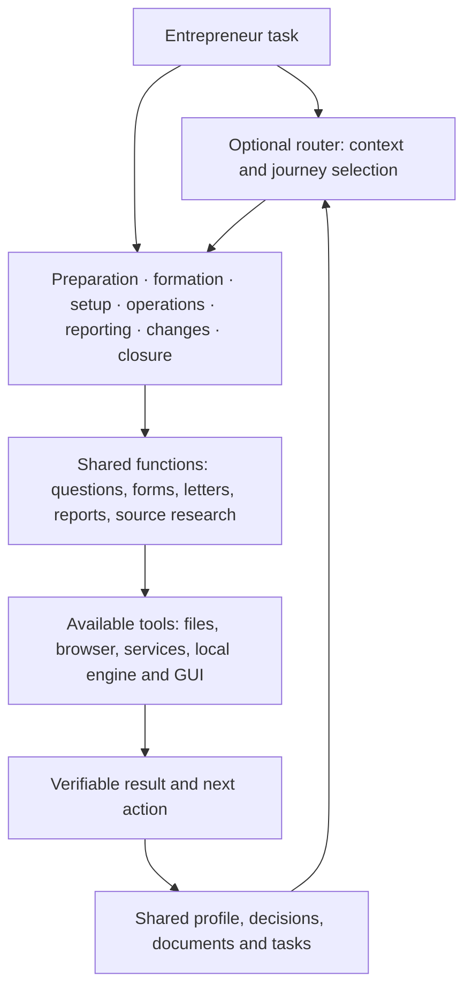

# Plan to restore the entrepreneur skill system

[English](lifecycle.md) · [Русский](lifecycle.ru.md) · [Current status](project-status.md)

Plan preparation agreed on **2026-10-26** after clarifying the product purpose. This is a correction plan for the product, instructions and development order; the stages below are not declared implemented. The baseline comes from inspecting source modules, not a new verification of legal rules or external services.

## 1. Target product and scope

German Business Kit is a system of skills supporting an entrepreneur in Germany from preparing to start through daily work, reporting, changes and closure. The user receives an answer, decision, document or action with a verified outcome, and can resume with saved context.

The first complete scope covers Freiberufler and Einzelunternehmen/Gewerbe, including several activities of one person. Employees, changes of legal form and complex cases need an assistance route: fact collection, requirements research, preparation and a verifiable transition to a suitable service or professional. This does not promise proprietary payroll, corporate accounting or every industry procedure.

Correction principles:

- Seven skills in one versioned bundle: one optional router and six directly usable domain skills, with shared context and resources. Skill selection does not create separate agents, services or stores.
- Start with the task. An ordinary question requires neither a GUI, workspace, accounting-system selection nor full questionnaire.
- Self-managed accounting and reporting remain required user journeys; they can use chosen software, official tools, browser assistance or guided manual execution.
- Do not embed tax formulas in code or templates. Skills find applicable sources, prepare inputs, guide suitable tools and inspect actual results.
- Existing accounting software stays authoritative when selected. The local journal is a limited option, without shadow books for external accounting.
- Develop the GUI, utilities and integrations for specific journeys. Preserve existing working capabilities, history and record protections.

## 2. Target structure

A lifecycle stage selects a journey; it is not a new mandatory data enum. One person can operate an activity while preparing another. Change schemas only when existing facts, tasks, decisions and evidence demonstrably cannot represent the need.

## 2.1. Bundle and result ownership

| Skill | Owns the outcome |
| --- | --- |
| `de-business-kit` | General entry, mixed requests, continuation and next-action selection |
| `de-business-start` | Launch preparation, classification, registration and its forms |
| `de-business-operations` | Proposals, invoices, payment follow-up and ordinary correspondence |
| `de-business-accounting` | Source documents, reconciliation, authoritative entries and period preparation |
| `de-business-tax` | Tax questions, tool-based estimates, reporting and Finanzamt replies |
| `de-business-services` | Banking/insurance/software selection and verified service access |
| `de-business-changes` | Changes, hiring, transitions, pause and closure |

Users can invoke a domain skill directly. The shared contract lives in `de-business-kit/references/shared-context.md`; resources and protected utilities remain in the existing core directory. Pass the task, confirmed facts, sources, versions, unanswered questions and existing authorization when changing skills. Do not create new profiles or shadow registers. Install each bundle together; independent installation of dependent skills is unsupported.

### S0. Split and delivery — before P1

1. Create six domain `SKILL.md` entries with discriminating descriptions, direct entry and ownership boundaries; shorten the general router.
2. Keep shared rules/resources in one place without moving user data or changing schemas.
3. Update Python/PowerShell installation and Codex/Claude packaging against an explicit bundle catalog. Preflight all resources and collisions before writing; do not overwrite installed skills.
4. Verify detached copies, intact links, refusal on missing dependencies/unsafe paths and installation of every skill.
5. Verify direct usage and related-task transitions in fresh EN/RU sessions. Native platforms and host discovery need separate acceptance; local tests do not replace them.

## 3. Baseline coverage and required corrections

“Guidance exists” means a topic route exists, not verified execution through a real portal. “Tool exists” means local implementation within its stated limits. Journey readiness requires separate acceptance.

| Stage / outcome | Existing foundation | Required correction or addition |
| --- | --- | --- |
| Prepare to start | `intake`, `classification`, `formation`, `providers`, `tax-estimates` | Connect the idea, facts, choices, required research and first practical action; prepare a launch plan and justified inputs for financial estimates |
| Start an activity | `formation`, `forms`, preparation worksheets | Connect initial facts to the actual form, draft review, available submission route and observed outcome; account for unresolved questions and existing activities |
| Set up operations | `onboarding`, `existing-data`, `providers`, `insurance`, `accounting-workflow` | Make setup task-dependent; introduce banking, accounting, documents and services as needed; verify permissions and actual access |
| Run daily operations | `bookkeeping`, `payments`, `document-workflow`, `document-authoring` | Add complete journeys from customer proposals and invoice preparation through payment, queries, corrections and overdue amounts; connect purchasing, expenses and documents |
| Answer a question, complete a form, write a letter | `german-rules`, `tax-consultant`, `forms`, `legal-boundaries`, `document-authoring` | A clear shared route independent of month-end: question → facts/sources → answer or draft → concrete action → verified result |
| Finish a period and prepare reporting | `monthly-workflow`, `accounting-workflow`, `tax-estimates`; journal and filing evidence | Verify user journeys for external and local accounting; cover annual continuation, corrections and authority responses separately; use actual calculation-tool output |
| Change or develop the business | Parts of `formation`, `classification`, `international`, `providers` | Dedicated routes for activity/address changes, new countries/channels, employees, service migration and legal-form transition; identify affected decisions and obligations |
| Pause or close an activity | General forms, documents, tasks and recovery; no complete dedicated route | Develop closure preparation, dependent authority/service actions, outstanding payments/reporting, document preservation and subsequent follow-up |
| Resume later | Shared profile, tasks/questions/decisions, overview, backup/restore | Show the next task at any stage, beyond the current month; distinguish deadlines from functioning reminders |

## 4. Correction packages and implementation order

### P0. Correct purpose and plan — current work

**Changes:** align README EN/RU, `AGENTS.md`, `SKILL.md`, current status, architecture, ontology, navigation and start instructions. Scope `core-capabilities` to accounting instead of the whole roadmap. Keep GUI launch instructions in application documentation.

**Outcome:** the project entry explains the skill system, the map above covers the whole lifecycle, and GUI readiness no longer determines the next priority.

**Acceptance:** no conflicting “skills are the product / AI is an optional add-on” positioning; new portable links resolve inside the installed package; EN/RU meanings match. Text changes do not implement P1–P7.

### P1. Correct the welcome conversation and journey selection

**Dependency:** P0 and S0.

**Changes:** revise `references/onboarding.md`, `intake.md`, entry routing, start guides and eval scenarios. Establish the desired outcome and only facts that affect it; reuse known context. Do not require a workspace for a question, accounting selection for registration or month-end completion for answering a letter. Introduce workspace creation and accounting configuration when needed.

**Outcome:** new and returning users can start with any task. Results explain what is known, what was done, what needs a decision and the next action.

**Acceptance:** fresh EN/RU sessions for starting without a folder, a single question, a form without browser access, an authority letter and continuation in existing software. No repeated onboarding, invented access, tax-fact changes or local postings over external books.

### P2. Complete preparation and formation

**Dependency:** P1.

**Changes:** connect `formation`, `classification`, `forms`, `providers` and document preparation into one journey. Define facts, primary sources, dependencies, reviewable documents and completion evidence for each step. Check current sources for the actual case first; do not freeze universal deadlines or fields as permanent truth. Add launch-plan preparation and reasoned expense/income assumptions for suitable estimation tools.

**Outcome:** the user moves from an activity description to a plan, populated worksheet/available draft and next action; registration outcomes are recorded only when observed.

**Acceptance:** synthetic first/additional activities, uncertain classification, incomplete facts and available/unavailable portals. Independent work continues; missing values are not invented. Verify the real route separately when authorized access exists.

### P3. Complete daily work and general assistance

**Dependency:** P1; uses P2 outcomes for a new business.

**Changes:** add proposal/invoice preparation, outgoing-document review, payment links, corrections, overdue amounts and correspondence journeys. For contract questions, provide research, factual materials and drafts within verified capabilities. Share result rules across answers, forms, letters and reports instead of duplicating them in every module. Reuse the catalog, payments and document-authoring foundation.

**Outcome:** daily tasks use skills and chosen tools, with readable documents.

**Acceptance:** one “customer request → document → payment → correction/query” cycle, one authority letter and one answer without a workspace. Inspect actual artifacts, recipient language, original preservation and absence of unauthorized sending. Verify format compliance separately from rendering.

### P4. Complete accounting and reporting within the wider lifecycle

**Dependency:** P1 and relevant P3 documents.

**Changes:** preserve protected writers; exercise external-software and limited local-journal routes. Add annual continuation, correction preparation and authority replies. Use supported form/year combinations and chosen calculation tools with input/output evidence. A proprietary complete accounting engine is not a prerequisite for the external route.

**Outcome:** the entrepreneur prepares and performs a supported reporting workflow independently; an accountant handoff does not replace a missing step.

**Acceptance:** synthetic month and annual preparation, stale inputs, uncertain submission, receipt and separate response. Accept real submission only after authorized execution and verified outcome. Label manual routes as manual; local tests do not establish tax correctness.

### P5. Add changes, development and closure

**Dependency:** P1–P4 for reusable outcomes.

**Changes:** create changes and closure modules. Research affected registrations, facts, documents, services and periods for each event; sequence actions and dependencies. Cover hiring and legal-form transition preparation with verified handoff into the appropriate system. Closure must retain subsequent reporting, authority follow-up and document access; never delete history.

**Outcome:** a change/closure plan contains concrete actions, outputs, unresolved questions and completion conditions, beyond a general suggestion to consult someone.

**Acceptance:** an additional activity, first employee, accounting-system migration, pause and closure with unresolved matters. Preserve earlier decisions; a local status does not terminate a contract or registration. Verify exact legal steps against current primary sources when implementing the module.

### P6. Connect tools where journeys need them

**Dependency:** a concrete P2–P5 journey is defined; this package can accompany it.

**Changes:** select existing host tools, browser, official API, import/export or guided manual execution per required action. Build a connector only for a demonstrated recurring gap. Define operations, permissions, authorization, preview, duplicate prevention, readback and recovery. Specify a real scheduler separately if reminders are needed.

**Outcome:** a verifiable ability to perform a particular action, such as retrieving selected documents or saving a confirmed result in the authoritative system.

**Acceptance:** missing access, expired authorization, partial results, timeout, retry and readback. External mutations require independent security review and actual tests in an authorized environment. API guidance is not a working connection; saving a deadline is not a delivered reminder.

### P7. Align interface, release and user acceptance

**Dependency:** accepted P1–P5 journeys; integrations only as needed.

**Changes:** identify tasks that benefit from the GUI and reflect them in navigation/overview. Retain access to the existing application without making its installation the mandatory start. Align guides, package descriptions and release claims with coverage. Add screens after validating the skill journey.

**Outcome:** one product with several execution routes, without competing profiles or registers.

**Acceptance:** fresh assistant sessions and trials with nontechnical users; separate native-platform and GUI checks for claimed operations. Local source tests do not replace verification of the exact published package.

## 5. Shared journey acceptance

Deliver each package as a separately reviewable change. Before implementation it needs:

1. A concrete task and expected user outcome, supported cases and boundaries.
2. Provenanced inputs, missing information and only necessary questions.
3. Applicable primary sources with check dates and effective periods; unverified rules must affect the result explicitly.
4. An existing module or justified new location; available tools and a useful route when tools are absent.
5. A reviewable artifact/result, external-action authorization conditions and evidence of actual execution.
6. Preserved context, unfinished state, corrections and next action.
7. Fresh-session EN/RU acceptance; suitable code regressions, artifact inspection for documents and actual operation checks for integrations.

## 5.1. Implementation state in source

- P0 and S0: positioning aligned; seven entries, shared contract, catalog, installation and packaging implemented. Exact-host and Windows 5.1 acceptance remain separate.
- P1: setup is deferred until needed by the task; domain skills are directly usable with shared context.
- P2–P5: launch planning, daily operations, annual preparation, changes/hiring/closure guidance and a primary-source map are added. These implement agent workflows, not new accounting, payroll or portal engines.
- P6: a workflow verifies a specific connection, permissions, outcome and uncertain attempts. No proprietary production connector or scheduler was added: acceptance needs a chosen service and an authorized real operation.
- P7: documentation and bundle descriptions align with seven skills. The GUI is retained; new screens and a published release are not claimed.

See [validation](validation.md) for actual checks and fresh trials. Unperformed acceptance remains in the plan even where instructions have been written.

## 5.2. Practical P1–P7 delivery (2026-10-26)

The next implementation adds reusable outcomes to the instructions. This table
tracks local delivery separately from acceptance; it is not a declaration that
all real-world lifecycle operations are complete.

| Package | Added capability in the skill bundle | Acceptance still needed beyond local trials |
| --- | --- | --- |
| P1 | Task-first outcome menu and continuation from saved evidence; no folder required for a question/reply | Exact host discovery and nontechnical users returning across sessions |
| P2 | EN/RU launch-plan worksheet linked to factual forms, assumptions and dependencies | Actual chosen registration route and observed authority outcomes |
| P3 | EN/RU customer-case worksheet; question/letter route; recipient draft separated from private review; no unsolicited commitments | Complete issued invoice → payment → correction cycle in the chosen system; exact format validation |
| P4 | EN/RU annual-readiness worksheet; changed inputs invalidate prior results; uncertain attempts and unrelated receipts remain distinct | Actual chosen form/year calculation output and authorized submission with matching receipt |
| P5 | EN/RU change plan; sourced first-hire preparation; pause fact check; retained access and open matters | Actual employer/service/authority execution; migration reconciliation and applicable closure follow-up |
| P6 | EN/RU operation note and failure handling for unavailable/expired access, partial results, uncertain writes and conflicting readback | Chosen real service operation, permissions and readback; actual scheduler only if requested |
| P7 | EN/RU task guide and task-oriented documentation navigation; GUI scope remains explicit | Native platforms, nontechnical-user acceptance and exact published-package verification |

All five new worksheet roles are declared for both languages in `locales.json`.
They are readable authoring aids, not new canonical registers or official forms.
No tax formulas, new production dependencies, autonomous services, payroll engine,
GUI screens or live transports are introduced. See [validation](validation.md)
for observed trial results and defects corrected during acceptance.

## 5.3. Correction-document evidence cycle (2026-10-26)

P3/P6 now includes bounded standalone UBL CreditNote inspection and grouped
preceding-invoice candidates for UBL/CII. The local CLI journey preserves an
invoice, partial payment and credit note; explicitly records reviewed links;
keeps external books authoritative and an unresolved continuation task. It runs
in EN/RU without adding a task register or calculating tax/refund amounts.
This is local evidence handling. Issuance, correction posting, settlement and
provider readback in an actual chosen system remain unverified; the broader P3/P6
acceptance is still open. See [validation](validation.md).

## 5.4. Supplied-export inspection (2026-10-26)

P6 now includes a bounded export-coverage procedure and EN/RU operation-note fields. The Lexware route identifies document/PDF versus DATEV exports before applying period/status rules, keeps self-managed accounting authoritative and does not require adviser handoff. The actual selected service is still a per-user choice; this example does not set an onboarding default. No connector, ZIP importer, live account read or period closure is added. See [validation](validation.md) for the reproduced routing defect and fresh trial evidence.

The first selected live P6 acceptance target is **Lexware Office document reading**: a user-designated synthetic test account, bounded period, one document and, where available, its original. This development test choice does not change per-user onboarding. Live acceptance remains open until actual access and observed results exist.

## 6. Queue and drift control

**After the local P1–P7 materials and synthetic preparation trials, the next queue is actual document-cycle execution, a chosen service operation and supported-host acceptance.** P6 accompanies specific needs; P7 follows accepted journeys. Security maintenance and fixes to existing capabilities continue as necessary.

Every development task must identify its lifecycle stage, user outcome and acceptance. New infrastructure, a proprietary calculator, journal expansion or GUI work does not gain priority simply because it is easier to measure with tests. Update this plan and related product commitments before changing scope.

No day estimates are assigned: P2–P6 depend on source research, tool access and acceptance results. The order and criteria above support sequential delivery without unverified schedule promises. Commits, publication and external actions remain subject to separate user authorization.
