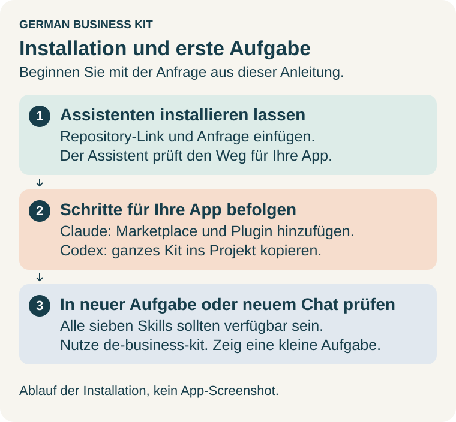
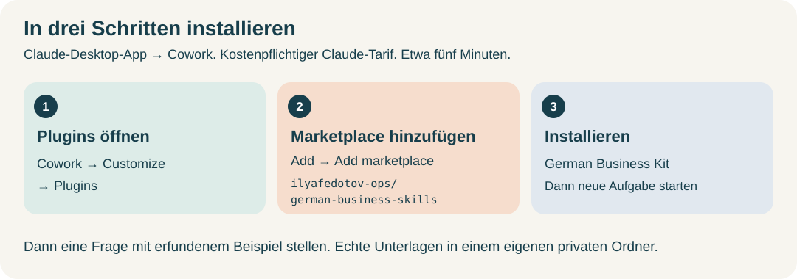
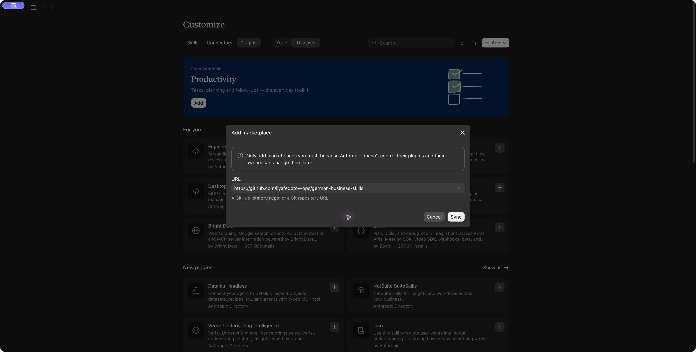

# German Business Kit installieren

[English](install.en.md) · [Русский](install.ru.md) · **Deutsch**

Diese Anleitung führt Sie in etwa fünf Minuten von der Installation des Kits zur ersten nützlichen Antwort. Sie brauchen weder Programmierkenntnisse noch ein Terminal, Python oder Buchhaltungssoftware. Verwenden Sie für den ersten Versuch erfundene Angaben.

> **KI-Unterstützung, keine professionelle Steuerberatung.** German Business Kit ist
> Selbsthilfe-Software, kein Steuerberater und keine professionelle Steuerberatung.
> KI kann Fehler machen, auch bei Berechnungen und Fristen. Inhalte, die Codex oder
> Claude lesen, können von OpenAI oder Anthropic verarbeitet werden; ein lokaler
> Ordner bedeutet keine rein lokale KI. [Lesen Sie die Hinweise zu Risiken und Datenverarbeitung](user-guide.de.md#ki-grenzen-und-ihre-daten), bevor Sie echte Dokumente teilen.



[Assistenten fragen](#den-assistenten-um-hilfe-bei-der-installation-bitten) · Manuell: [Claude-App](#in-claude-installieren) · [Claude Code](#in-claude-code-installieren) · [Codex](#in-codex-installieren) · [Erste Aufgabe](#erste-aufgabe-ausprobieren) · [Privater Ordner](#arbeit-in-einem-privaten-ordner-aufbewahren) · [Updates](#updates) · [Hilfe](#wenn-sie-nicht-weiterkommen)

**Lieber Schritt für Schritt per Klick?** Eine geführte Einrichtungsseite auf Deutsch, Englisch und Russisch führt Sie von der Wahl zwischen Claude und ChatGPT/Codex über Konto und App-Installation auf den offiziellen Seiten bis zum Kit und zu ersten Aufgaben mit erfundenen Daten. Wählen Sie auf der [Projektseite](https://github.com/ilyafedotov-ops/german-business-skills) **Code → Download ZIP**, entpacken Sie die ZIP-Datei und öffnen Sie `installer/index.html` im Browser. Diese Kopie zeigt nur die Anleitung; installieren Sie das Kit mit den Schritten auf der Seite. Die Seite selbst sendet nichts und fragt nie nach Passwörtern, Zahlungsdaten oder Codes.

## Den Assistenten um Hilfe bei der Installation bitten

Am schnellsten: Fügen Sie in Claude Code, der Claude-App oder Codex ein:

> Installiere German Business Kit von https://github.com/ilyafedotov-ops/german-business-skills. Folge den Installationsanweisungen des Repositorys für meine App und verwende die veröffentlichte Version, keine Kopie der aktuellen Repository-Dateien. Prüfe, ob alle sieben Skills installiert sind, und sag mir dann, wie ich eine neue Sitzung starte und die Willkommens-Einrichtung beginne.

Der Assistent soll die Anweisungen des Repositorys und Ihre tatsächliche App bzw.
Ihre Werkzeuge prüfen und dann den unterstützten Installationsweg unten nutzen. Wo
Sie einen Ordner wählen oder eine Plugin-Installation anklicken müssen, soll er
diesen nächsten Schritt erklären. Er soll vorhandene Installationen und Ihre
Geschäftsdateien erhalten, alle sieben Skills zusammen installieren und
unterscheiden, ob Dateien nur kopiert wurden oder die Skills in einer neuen Sitzung
erkannt werden. Die Anfrage erfordert weder eine zusätzliche Anwendung noch einen
neuen Unternehmensordner. Kann der Assistent nicht auf das Repository oder die
Installationssteuerung zugreifen, nutzen Sie die Schritte unten; er soll Ihnen
genau sagen, was noch zu tun ist.

Was in jeder App passiert:

- **Claude Code** kann die beiden Plugin-Befehle aus [In Claude Code installieren](#in-claude-code-installieren) für Sie ausführen; bestätigen Sie sie, wenn Sie gefragt werden. Beenden Sie dann `claude` und starten Sie es neu, am besten in Ihrem privaten Unternehmensordner.
- **Die Claude-App (Cowork)** kann nicht für Sie klicken: Sie führt Sie durch **Customize → Plugins** wie unter [In Claude installieren](#in-claude-installieren).
- **Codex** kopiert die sieben veröffentlichten Skills in Ihr Projekt wie unter [In Codex installieren](#in-codex-installieren).

Die Abschnitte unten sind die manuellen Wege, wenn Sie es lieber selbst erledigen.

Starten Sie nach der Installation eine neue Aufgabe bzw. einen neuen Chat und schreiben Sie:

> Nutze de-business-kit. Ich habe das Kit gerade installiert. Starte die Willkommens-Einrichtung: Prüfe, ob alles funktioniert, und führe mich Schritt für Schritt.

Die Einrichtung prüft Kit, Hilfsprogramm und Ordner und führt Sie dann in kurzen Schritten zu einem privaten Ordner und einer ersten Aufgabe. Sie können jederzeit anhalten oder einen Schritt überspringen.

Vor der Installation liest Ihr vorhandener Assistent diese Anleitung; das Kit kann
sich nicht selbst installieren, bevor seine Anweisungen verfügbar sind. Danach kann
sein allgemeiner Skill passende Aufgaben, den Aufruf und das Fortsetzen in einem
gespeicherten Ordner erklären.

## Was Sie brauchen

- Einen Windows-PC oder Mac mit Internetzugang.
- Die **Claude-Desktop-App** mit kostenpflichtigem Tarif: Pro, Max, Ultra, Team oder Enterprise. Der kostenlose Tarif enthält weder Cowork noch Plugins.
- Sie nutzen stattdessen **Codex** (OpenAI)? Lesen Sie [In Codex installieren](#in-codex-installieren).

**Cowork** ist der Teil der Claude-App, der Aufgaben mit Dateien in einem von Ihnen gewählten Ordner bearbeitet. Ein **Plugin** ergänzt Claude um fertige Anweisungen. German Business Kit ist ein Plugin mit sieben verbundenen Skills: einem allgemeinen Helfer und Fach-Skills für Gründung, laufende Arbeit, Buchhaltung, Steuern, Dienstleistungen und Änderungen.

## Modell wählen

Für anspruchsvolle Geschäftsarbeit empfehlen wir als Ausgangspunkt ein
leistungsfähiges Reasoning-Modell mit **hohem** Denkaufwand:

| App | Empfohlene Wahl, sofern verfügbar |
| --- | --- |
| Claude Desktop / Cowork | **Claude Opus 5.5**; wählen Sie **High**, wenn der aktuelle Modus eine Einstellung für den Denkaufwand anbietet. |
| Codex | **GPT-6 Astra** mit Denkaufwand **High**. |

Öffnen Sie in Claude das Modellmenü neben **Send** und dann **Effort → High**.
Nutzen Sie in Codex die Modell- bzw. Reasoning-Einstellung unter dem Eingabefeld;
neuere Layouts zeigen eventuell **Power → Advanced**. Wählen Sie sowohl **Astra**
als auch **High**: Die allgemeine Option GPT-6 High im Chat kann ein anderes Modell
verwenden. Bezeichnungen und Zugang können abweichen.

Das Kit wählt oder wechselt das Modell nicht, und eine Anfrage allein ändert die
Einstellung nicht. Fehlen diese Namen oder Einstellungen, nutzen Sie ein
leistungsfähiges Reasoning-Modell Ihres Kontos; bitten Sie den Assistenten, die in
Ihrer App tatsächlich sichtbaren Optionen zu erklären. Für eine einfache erste
Aufgabe müssen Sie weder den Anbieter wechseln noch ein Upgrade kaufen.

Nutzen Sie die empfohlene Einstellung für Recherche, mehrdeutige Fragen, Formulare,
mehrere Dokumente, Buchhaltung, Steuerschätzungen und Prüfungen vor externen
Schritten. Ein schnelleres oder leichteres Modell genügt für einfache Erklärungen,
Umformulierungen und Formatierung. Hoher Denkaufwand kann länger dauern und mehr
Nutzungskontingent oder Budget verbrauchen; prüfen Sie Grenzen und Kosten Ihres
Tarifs. Dies ist eine Empfehlung des Projekts, kein Benchmark-Ergebnis und keine
Garantie für steuerliche Richtigkeit. Jedes Modell braucht weiterhin die nötigen
Angaben, aktuelle Quellen und unabhängige Rechenprüfungen.

Modellnamen, Einstellungen und Zugang unterscheiden sich nach App, Tarif und
Arbeitsbereich. Anbieterquellen geprüft am **26. Oktober 2026**: [Claude-Modell und Denkaufwand](https://support.claude.com/en/articles/8664678-change-the-model-effort-and-thinking-settings),
[Codex-Modelleinstellungen](https://learn.chatgpt.com/docs/models),
[Verfügbarkeit von GPT-6](https://help.openai.com/en/articles/20001354-gpt-6-and-other-models-in-chatgpt)
und [Reasoning-Stufen von Astra](https://developers.openai.com/api/docs/models/gpt-6-astra).
Unterstützung in der API allein belegt nicht, welche Einstellungen Ihre Desktop-App bietet.

## In Claude installieren

Falls Sie die App noch nicht haben, laden Sie sie von der [offiziellen Claude-Downloadseite](https://claude.com/download) herunter, installieren Sie sie und melden Sie sich an. Blockiert Ihr Computer oder Ihre Organisation die Installation, nutzen Sie den dort freigegebenen Weg; schalten Sie keine Sicherheitseinstellungen ab.



*Schematische Darstellung der Schritte; App-Bildschirme sind nicht abgebildet.*

### 1. Plugins öffnen

Wechseln Sie in der Claude-Desktop-App zu **Cowork**, wenn Ihre Version eine eigene Auswahl dafür zeigt. Manche Versionen fassen Chat und Cowork zusammen. Öffnen Sie in der Seitenleiste **Customize** und wählen Sie **Plugins**.

### 2. Den Marketplace von German Business Kit hinzufügen

Wählen Sie **Add → Add marketplace**. Wenn angeboten, wählen Sie **Add from a repository**. Geben Sie diese Adresse (oder die vollständige GitHub-URL) ein, wählen Sie das passende Repository oder **Use …** und dann **Sync**:

```text
ilyafedotov-ops/german-business-skills
```

Das ist die Projektseite auf GitHub; ein GitHub-Konto brauchen Sie nicht. In manchen App-Versionen heißt die Schaltfläche einfach **Add marketplace**.



*Tatsächliches Claude Desktop 3.6556.2 unter macOS, aufgenommen am 26. Oktober 2026 vor dem Klick auf Sync. Das Bild zeigt, wo die Adresse eingegeben wird; es zeigt keine abgeschlossene Installation. [Bildschirmfoto in voller Größe öffnen](images/claude-marketplace.jpg). Bezeichnungen können in Ihrer Version abweichen.*

### 3. German Business Kit installieren

Suchen Sie **German Business Kit** in der Plugin-Liste (unter **Discover**, falls es nicht sofort erscheint) und wählen Sie **Install**. Manche Versionen zeigen **Add**.

**Fertig, wenn:** **Customize → Plugins** German Business Kit anzeigt und der Reiter **Skills** diese sieben Skills enthält:

| Skill | Hilft bei |
| --- | --- |
| `de-business-kit` | Beginnen, Fortsetzen, Wahl der nächsten Aufgabe |
| `de-business-start` | Vorbereitung und Aufnahme einer Tätigkeit |
| `de-business-operations` | Angebote, Rechnungen und laufender Schriftverkehr |
| `de-business-accounting` | Dokumente und Buchhaltungsunterlagen |
| `de-business-tax` | Steuerfragen, Erklärungen und Schreiben des Finanzamts |
| `de-business-services` | Bank, Versicherung, Software und Zugang zu Diensten |
| `de-business-changes` | Änderungen, Einstellungen, Pause und Beendigung |

Das Plugin wird in Ihrem Claude-Konto gespeichert und funktioniert daher auch im Claude-Chat und in Claude Code, wenn Sie sich mit demselben Konto anmelden. Die sieben Skills teilen einen gemeinsamen Geschäftskontext; Sie richten sie nie einzeln ein.

Anthropic prüft Plugins, die im eigenen Verzeichnis gelistet sind, nicht Plugins, die über eine Adresse hinzugefügt werden. Diese Adresse installiert die geprüfte Version, die der Marketplace dieses Projekts festlegt. Die Festlegung wird erst nach Veröffentlichung und Prüfung der Dateien weitergeschaltet.

## In Claude Code installieren

Führen Sie in einem Terminal aus:

```bash
claude plugin marketplace add ilyafedotov-ops/german-business-skills
claude plugin install de-business-kit@german-business-kit
```

In einer laufenden Claude-Code-Sitzung geben Sie dasselbe als `/plugin marketplace add ilyafedotov-ops/german-business-skills` und `/plugin install de-business-kit@german-business-kit` ein. Haben Sie das Plugin in der Claude-App installiert, erhält Claude Code es bereits, wenn Sie mit demselben Claude-Konto angemeldet sind (nicht mit einem API-Schlüssel); installieren Sie es nicht doppelt.

**Fertig, wenn:** eine neue `claude`-Sitzung die sieben Skills anzeigt, zum Beispiel `/de-business-kit:de-business-kit`. Starten Sie sie in Ihrem privaten Unternehmensordner, nicht in einem Git-Repository oder im heruntergeladenen Kit.

## Erste Aufgabe ausprobieren

Plugins werden beim Start einer Aufgabe geladen; starten Sie daher in Claude eine **neue Aufgabe** (in älteren App-Versionen in Cowork). Senden Sie dieses erfundene Beispiel:

> Nutze de-business-kit. Ich teste den Assistenten mit einem erfundenen Beispiel: Ich bin Programmierer und möchte in Deutschland freiberuflich Websites und Apps für kleine Firmen entwickeln. Ich weiß nicht, wo ich anfangen soll. Hilf mir, einen kleinen ersten Schritt zu wählen. Frag nur, was du für diesen Schritt brauchst.

Tippen Sie vor dem Senden **/** oder öffnen Sie **+** und wählen Sie **de-business-kit** aus **German Business Kit**. Claude kann Skills auch automatisch wählen. In Codex nennen Sie den installierten Skill mit **„Nutze de-business-kit“** oder **`$de-business-kit`**. [Weitere Beispiele zum Aufruf](user-guide.de.md#einen-skill-aufrufen).

Ein nützliches Ergebnis ist ein verständlicher Schritt, mit Fragen nur dort, wo Angaben fehlen. Für diese Frage müssen Sie weder Buchhaltungssoftware wählen noch einen Unternehmensordner anlegen oder private Dokumente hochladen. Die Antwort belegt keine abgeschlossene Anmeldung und keine steuerliche Prüfung.

**Fertig, wenn:** Sie die Antwort verstehen und den nächsten Schritt kennen. Ist sie zu technisch, sagen Sie: **„Erkläre das in einfachen Worten und nenne mir nur den nächsten Schritt.“**

Sie können auf Deutsch, Englisch oder Russisch weiterarbeiten. Um eine eigene Aufgabe auszuprobieren, beschreiben Sie das gewünschte Ergebnis: ein Schreiben verstehen, ein Formular vorbereiten, Dokumente ordnen, Dienste vergleichen oder eine Änderung planen. Siehe [weitere Beispielanfragen](user-guide.de.md#erste-aufgabe).

## Optionaler Browser- und Computerzugriff

Schalten Sie eine Browser- oder Computer-Funktion nur ein bzw. wählen Sie sie nur,
wenn die Aufgabe die Bedienung einer unterstützten Website oder App erfordert. Bietet
Ihr Host einen Hilfs-Skill an, wählen Sie ihn zusätzlich zum Geschäfts-Skill; er
ersetzt nicht das eigentliche Werkzeug oder die Berechtigung. Für das erste Gespräch
brauchen Sie das nicht. Der Assistent soll vorhandenen Zugriff prüfen, bevor er Sie
bittet, etwas zu installieren oder einzuschalten.
[Einrichtung je App, eine Übungsanfrage und Einschränkungen der Dienste](assisted-services.de.md#wann-browser--oder-computer-werkzeuge-einschalten).

## Arbeit in einem privaten Ordner aufbewahren

Eine einfache Frage braucht keinen Ordner. Für laufende Arbeit wie Belege, Schreiben oder einen gespeicherten Plan legen Sie einen getrennten privaten Ordner an, zum Beispiel **Mein Unternehmen**, und geben Cowork beim Start der Aufgabe Zugriff darauf. Fragen Sie dann:

> Nutze de-business-kit. Verwende meinen gewählten Unternehmensordner. Speichere dort ein lesbares Ergebnis, bestätigte Angaben, offene Fragen und den nächsten Schritt. Erkläre mir vor der Nutzung echter persönlicher Dokumente, welche Inhalte an den KI-Dienst gesendet werden.

- Claude verarbeitet den Inhalt der Dateien, die es liest. Entscheiden Sie vor der Nutzung echter Dokumente, was Sie teilen.
- Wenn der Assistent Dateien speichert oder importiert, kann die App fragen, ob ein Befehl wie `python3 …/workspace.py` oder unter Windows `windows.ps1` laufen darf. Das ist das lokale Hilfsprogramm des Kits: Es arbeitet nur in Ihrem gewählten Ordner und kontaktiert keinen Dienst. Erlauben Sie es für diese Aufgabe; lehnen Sie alles ab, was Software installiert oder Sicherheitseinstellungen ändert.
- Ein mit der Cloud synchronisierter Dokumente- oder Schreibtischordner kann weniger privat sein, als Sie erwarten.
- Nutzen Sie bereits Buchhaltungssoftware, bleibt sie Ihre maßgebliche Aufzeichnung. Eine Frage erzwingt diese Wahl nicht.

Starten Sie beim nächsten Mal eine neue Aufgabe mit demselben Ordner und sagen Sie: **„Nutze de-business-kit. Lies die gespeicherten Angaben und den Stand in meinem Unternehmensordner und zeig dann den nächsten Schritt.“**

## Updates

Öffnen Sie **Customize → Plugins**, wählen Sie den Marketplace von German Business Kit und dann **Check for updates**, oder schalten Sie **Sync automatically** ein. Der Marketplace bietet nur veröffentlichte Versionen an, nie unfertige Arbeit. Ein Plugin-Update ändert Ihren Unternehmensordner nicht.

## In Codex installieren

In der Codex-Desktop-App kommen Plugins aus dem Verzeichnis von OpenAI oder aus Ihrem Arbeitsbereich; für dieses Kit kopiert Codex die Skills deshalb für Sie in einen Projektordner.

### 1. Ein Projekt öffnen

1. Installieren Sie die App von der [offiziellen Download- und Einrichtungsseite von OpenAI](https://learn.chatgpt.com/docs/app) und melden Sie sich an. Die aktuelle Dokumentation nennt sie **ChatGPT desktop**; manche Versionen zeigen **Codex**. Der Zugang zu Codex hängt von Ihrem Konto und den Richtlinien des Arbeitsbereichs ab.
2. Legen Sie im Explorer (Windows) oder Finder (Mac) an einem privaten Ort einen Ordner **Business Assistant** an. Er enthält nur die Skills, nicht Ihre Unterlagen.
3. Öffnen Sie diesen Ordner in Codex als Projekt und starten Sie einen **New chat**. Prüfen Sie, dass **Business Assistant** als Projekt gewählt ist. Werden Sie gefragt, ob Sie einem Ordner vertrauen, bestätigen Sie nur diesen.

### 2. Das Kit herunterladen

Öffnen Sie die [Version 0.14.0-preview.1](https://github.com/ilyafedotov-ops/german-business-skills/releases/tag/v0.14.0-preview.1), klappen Sie bei Bedarf **Assets** auf und laden Sie zwei Dateien in denselben Ordner herunter:

- **`de-business-kit-0.14.0-preview.1-codex.zip`**
- **`SHA256SUMS`**, die Prüfsummenliste, die einen beschädigten oder veränderten Download erkennt

### 3. Codex die Skills installieren lassen

Geben Sie Codex mit seiner Dateizugriffs-Steuerung Zugriff auf die beiden Dateien oder kopieren Sie ihre vollständigen Pfade: unter Windows Rechtsklick auf eine Datei → **Als Pfad kopieren**; auf dem Mac die Datei im Finder auswählen, **Option** gedrückt halten und **Bearbeiten → „…“ als Pfadname kopieren** wählen. Senden Sie dann:

> Ich richte German Business Kit in diesem lokalen Projekt Business Assistant in Codex ein. Meine ZIP-Datei liegt unter [vollständiger ZIP-Pfad] und SHA256SUMS unter [vollständiger Pfad der Prüfsummendatei]. Prüfe die ZIP-Datei gegen ihre Prüfsumme und brich ab, wenn sie nicht passt. Entpacke sie in einen neuen Ordner und kopiere dann alle sieben vollständigen Skill-Ordner in .agents/skills dieses Projekts. Nutze native Dateiwerkzeuge, erhalte vorhandene Dateien und brich ab, wenn ein Ziel bereits existiert. Installiere keine Laufzeitumgebungen, ändere keine Sicherheitseinstellungen und keine globale App-Konfiguration. Nenne mir die sieben installierten Namen und wie ich eine neue Sitzung starte.

Prüfen Sie, dass jede Anfrage zum Dateizugriff Ihren Download und das Projekt **Business Assistant** nennt. Eine passende Prüfsumme zeigt, dass die Datei unbeschädigt ist; wer sie veröffentlicht hat, prüft ein eigener Schritt, beschrieben unter [Download prüfen](https://github.com/ilyafedotov-ops/german-business-skills/blob/v0.14.0-preview.1/docs/releases.md#download-and-verify).

### 4. Einen neuen Chat starten

Starten Sie einen **neuen Chat im selben Projekt**; fehlen die Skills, schließen und öffnen Sie die App erneut. Öffnen Sie **Skills** in der Seitenleiste oder fragen Sie: **„Prüfe, welche Skills von German Business Kit in diesem Projekt verfügbar sind.“**

**Fertig, wenn:** Codex die sieben Skills aus der [Tabelle oben](#3-german-business-kit-installieren) zeigt. Dann [probieren Sie Ihre erste Aufgabe](#erste-aufgabe-ausprobieren) und beginnen Ihre Nachricht mit **„Nutze de-business-kit“** oder **`$de-business-kit`**. Geben Sie für laufende Arbeit Zugriff auf Ihren getrennten privaten Unternehmensordner und lassen Sie dieses Projekt ausgewählt, damit seine installierten Skills verfügbar bleiben.

### Manuelle Installation

Nutzen Sie das nur, wenn Codex die Dateien nach der Prüfsummenkontrolle nicht kopieren kann.

1. Entpacken Sie die ZIP-Datei in einen neuen Ordner: Windows → Rechtsklick → **Alle extrahieren…**; Mac → Doppelklick auf die ZIP-Datei.
2. Öffnen Sie `codex/plugins/de-business-kit/skills` im entpackten Inhalt. Ihr Dateimanager kann einen äußeren Ordner mit dem Namen der ZIP-Datei hinzufügen.
3. Legen Sie in **Business Assistant** den Ordner `.agents` und darin `skills` an. Schalten Sie unter Windows **Ansicht → Anzeigen → Ausgeblendete Elemente** ein; drücken Sie auf dem Mac **Befehl+Umschalt+.**, um versteckte Elemente zu zeigen. Lehnt der Finder einen Namen mit Punkt am Anfang ab, bitten Sie Codex, genau diesen Ordner anzulegen. Lassen Sie den führenden Punkt nicht weg.
4. Kopieren Sie **alle sieben `de-business-*`-Ordner zusammen** mit ihrem Inhalt nach `.agents/skills`. Existiert bereits ein Ordner mit demselben Namen, brechen Sie ab; nicht zusammenführen oder überschreiben.
5. Prüfen Sie die Struktur unten und fahren Sie mit [Schritt 4](#4-einen-neuen-chat-starten) fort.

```text
Business Assistant/
└── .agents/
    └── skills/
        ├── de-business-kit/
        │   ├── SKILL.md
        │   ├── assets/
        │   ├── guides/
        │   ├── references/
        │   └── scripts/
        ├── de-business-start/SKILL.md
        ├── de-business-operations/SKILL.md
        ├── de-business-accounting/SKILL.md
        ├── de-business-tax/SKILL.md
        ├── de-business-services/SKILL.md
        └── de-business-changes/SKILL.md
```

## Weitere Installationswege

- **Entwickler und technische Helfer:** Builds aus dem Quellcode, lokale Marketplaces und die Prüfung von Archiven beschreibt die [Anleitung zur Verteilung](https://github.com/ilyafedotov-ops/german-business-skills/blob/main/docs/distribution.md) (Englisch).
- Installieren Sie das Kit je App nur einmal. Plugin und manuell kopierte Skills gleichzeitig führen zu Dubletten.

## Wenn Sie nicht weiterkommen

| Was Sie sehen | Nächster Schritt |
| --- | --- |
| Keine eigene Auswahl für **Cowork** | Manche Versionen fassen Chat und Cowork zusammen. Suchen Sie **Customize → Plugins** und prüfen Sie den Zugriff auf Ihren gewählten Ordner. |
| Kein **Customize** | Prüfen Sie App-Version, kostenpflichtigen Tarif und Richtlinien der Organisation. |
| Keine Option **Add marketplace** | Bei einem Team- oder Enterprise-Tarif hat Ihre Organisation das Hinzufügen eigener Plugins eventuell abgeschaltet. Fragen Sie den Owner Ihrer Organisation. |
| Der Marketplace lässt sich nicht hinzufügen | Prüfen Sie die Adresse `ilyafedotov-ops/german-business-skills` und Ihre Internetverbindung und versuchen Sie es erneut. |
| Installiert, aber Claude nutzt es nicht | Starten Sie eine neue Aufgabe. Prüfen Sie, dass das Plugin unter **Customize → Plugins** eingeschaltet ist, oder tippen Sie **/** und wählen Sie **de-business-kit**. |
| Skills erscheinen doppelt | Eventuell ist zusätzlich eine ältere manuelle Kopie installiert. Behalten Sie eine Installation; löschen Sie nie Ihren Unternehmensordner. |
| Der Assistent will Python installieren oder Sicherheitseinstellungen ändern | Brechen Sie diesen Schritt ab. Installation und Nutzung des Kits brauchen beides nicht. |
| Die App fragt, ob `workspace.py`, `desk.py` oder `windows.ps1` laufen darf | Das ist das lokale Hilfsprogramm des Kits für Ihren gewählten Ordner. Erlauben Sie es für diese Aufgabe. |
| Kein Zugriff auf Bank, E-Mail oder Lexware | Die Installation des Kits verbindet keine Dienste. Arbeiten Sie mit einem erfundenen Beispiel oder einer exportierten Datei weiter und verbinden Sie jeden Dienst gesondert. |
| Codex: keine Skills nach der Installation | Prüfen Sie das gewählte Projekt, den versteckten Ordner `.agents/skills`, alle sieben Ordner und einen neuen Chat. Vermeiden Sie ein verschachteltes `skills/skills`. |
| Etwas anderes schlägt fehl | Notieren Sie Meldung, App-Version, Betriebssystem und Schrittnummer. Entfernen Sie persönliche Angaben, bevor Sie öffentlich um Hilfe bitten. |

**Als Nächstes:** [Wählen Sie Ihre erste Aufgabe und arbeiten Sie im Alltag weiter](user-guide.de.md#erste-aufgabe).

## Quellen und Prüfungen

Der Weg für Claude folgt Anthropics [Cowork-Plugin-Anleitung](https://claude.com/docs/cowork/guide/plugins) und der [Plugin-Übersicht](https://claude.com/docs/plugins/overview), geprüft am **26.10.2026**. An diesem Tag installierte derselbe Marketplace die genaue Version 0.9.0-preview.1 mit allen sieben Skills über Claude Code 2.1.310; eine Installation direkt in der Cowork-App wurde noch nicht beobachtet. Die Tarifnamen von Claude und die Anbieterlinks der geführten Einrichtungsseite wurden am **20.11.2026** erneut geprüft. Der Weg für Codex folgt den [App-Anweisungen von OpenAI](https://learn.chatgpt.com/docs/app) und den [lokalen Skills von OpenAI](https://learn.chatgpt.com/docs/build-skills). Menünamen können sich zwischen App-Versionen ändern. Siehe den [Validierungsnachweis](https://github.com/ilyafedotov-ops/german-business-skills/blob/main/docs/validation.md) (Englisch).
