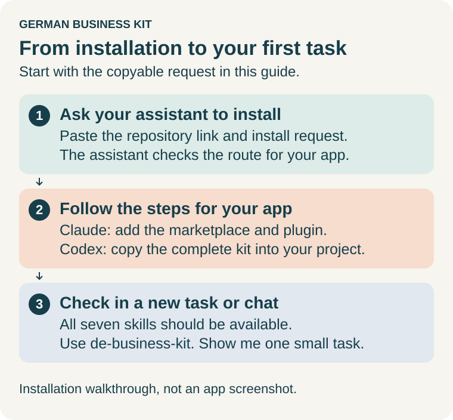
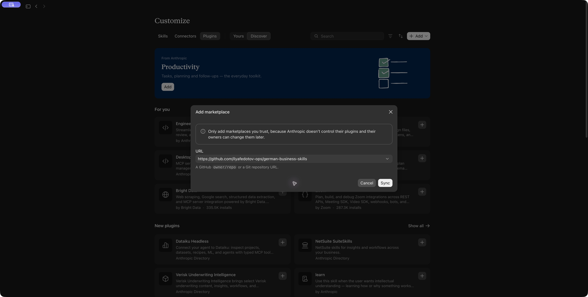

# Install German Business Kit

**English** · [Русский](install.ru.md)

This guide takes you from installing the kit to your first useful answer in about five minutes. You do not need programming, a terminal, Python or accounting software. Use fictional details for your first try.

> **AI assistance, not professional tax advice.** German Business Kit is self-help
> software, not a Steuerberater or a professional tax-advisory service. AI can
> make mistakes, including in calculations and deadlines. Content read by Codex
> or Claude can be processed by OpenAI or Anthropic; a local folder does not mean
> local-only AI. [Read the risks and data-processing guidance](user-guide.en.md#ai-limits-and-your-data) before sharing real documents.



[Install in Claude](#install-in-claude) · [First task](#try-your-first-task) · [Private folder](#keep-your-work-in-a-private-folder) · [Updates](#updates) · [Codex](#install-in-codex) · [Help](#if-you-get-stuck)

## Ask your assistant to help install

In Codex or Claude, paste:

> Install German Business Kit from https://github.com/ilyafedotov-ops/german-business-skills and show me how to use it. Follow the repository's installation instructions for my app, check that the complete kit is available, and help me try one small example.

The assistant should inspect the repository instructions and your actual app/tools,
then use the supported installation route below. Where a folder choice or plugin
installation click is yours to make, it should explain that next step. It should
preserve existing installations and your business files, install the complete
seven-skill set together, and distinguish files copied from skills discovered in
a fresh session. The request does not require a separate records app or a new
business workspace. If the assistant cannot access the repository or installation
controls, use the steps below; it should tell you exactly what remains.

After installation, start a new task/chat and ask:

> Use de-business-kit. Show me how to use this for my situation. Give me three requests I can copy and help me choose one small first task.

Before installation, your existing assistant reads this guide; the kit cannot
install itself before its instructions are available. Once available, its general
skill can explain relevant tasks, invocation and saved-folder continuation.

## What you need

- A Windows PC or Mac with internet access.
- The **Claude desktop app** with a paid plan: Pro, Max, Team or Enterprise. The free plan does not include Cowork or plugins.
- Using **Codex** (OpenAI) instead? Go to [Install in Codex](#install-in-codex).

**Cowork** is the part of the Claude app that works on tasks with files in a folder you choose. A **plugin** adds ready-made instructions to Claude. German Business Kit is one plugin with seven connected skills: a general helper plus specialists for starting, daily work, accounting, tax, services and changes.

## Choose a model

Our recommended starting point for substantive business work is a capable
reasoning model with **High** effort:

| App | Recommended choice, when available |
| --- | --- |
| Claude Desktop / Cowork | **Claude Opus 5.5**; choose **High** effort if the current mode exposes an effort control. |
| Codex | **GPT-6 Astra** with **High** reasoning effort. |

In Claude, open the model menu beside **Send**, then **Effort → High**.
In Codex, use the model/reasoning control below the composer; newer layouts may
show **Power → Advanced**. Select both **Astra** and **High**: Chat's generic
GPT-6 High option can use a different model. Labels and access can vary.

The kit does not select or switch the model, and a prompt alone does not change
the setting. If these names
or controls are missing, use a capable reasoning model offered by your account;
ask the assistant to explain the options actually visible in your app. You do
not need to change provider or buy an upgrade to try a simple first task.

Prefer the recommended setup for research, ambiguous questions, forms, several
documents, accounting, tax estimates and checks before external actions. A faster
or lighter model can handle simple explanations, rewriting and formatting.
High effort can take longer and consume more usage allowance or metered budget;
check your plan's limits and charges. This is a project recommendation, not a
benchmark result or guarantee of tax accuracy. Every model still needs the
required facts, current sources and independent calculation checks.

Model names, controls and access vary by app, plan and workspace. Provider
sources checked **26 October 2026**: [Claude model/effort controls](https://support.claude.com/en/articles/8664678-change-the-model-effort-and-thinking-settings),
[Codex model controls](https://learn.chatgpt.com/docs/models),
[GPT-6 availability](https://help.openai.com/en/articles/20001354-gpt-6-and-other-models-in-chatgpt)
and [Astra reasoning levels](https://developers.openai.com/api/docs/models/gpt-6-astra).
API support alone does not establish the controls available in your desktop app.

## Install in Claude

If you do not have the app yet, download it from the [official Claude download page](https://claude.com/download), install it and sign in. If your computer or organization blocks the installation, use its approved route; do not disable security settings.


*Diagram of the steps; app screens are not depicted.*

### 1. Open Plugins

In the Claude desktop app, switch to **Cowork** if your version shows a separate selector. Some versions combine Chat and Cowork. Open **Customize** in the sidebar, then select **Plugins**.

### 2. Add the German Business Kit marketplace

Select **Add → Add marketplace**. If offered, choose **Add from a repository**. Enter this address (or its full GitHub URL), select the matching repository or **Use …**, then choose **Sync**:

```text
ilyafedotov-ops/german-business-skills
```

This is the project's page on GitHub; you do not need a GitHub account. On some app versions the button is simply **Add marketplace**.



*Actual Claude Desktop 3.6556.2 on macOS, captured 26 October 2026 before pressing Sync. This shows where to enter the address; it does not show a completed installation. [Open the full-size screenshot](images/claude-marketplace.jpg). Labels may differ in your version.*

### 3. Install German Business Kit

Find **German Business Kit** in the plugin list (look under **Discover** if it is not shown at once) and select **Install**. Some versions say **Add**.

**Done when:** **Customize → Plugins** lists German Business Kit and its **Skills** tab shows these seven skills:

| Skill | Helps with |
| --- | --- |
| `de-business-kit` | Starting, continuing, choosing the next task |
| `de-business-start` | Preparing and opening an activity |
| `de-business-operations` | Proposals, invoices and everyday correspondence |
| `de-business-accounting` | Documents and accounting records |
| `de-business-tax` | Tax questions, reports and Finanzamt letters |
| `de-business-services` | Banking, insurance, software and service access |
| `de-business-changes` | Changes, hiring, pausing and closing |

The plugin is saved to your Claude account, so it also works in Claude chat and in Claude Code when you sign in with the same account. The seven skills share one business context; you never set them up separately.

Anthropic reviews plugins listed in its own directory, not plugins added by address. This address installs the verified release pinned by this project’s marketplace. The marketplace pin advances only after publication and asset verification.

## Try your first task

Plugins load when a task starts, so start a **new task** in Cowork. Send this fictional example:

> Use de-business-kit. I am just trying the assistant with a fictional example: I want to start working as a translator in Germany. I do not know where to begin. Help me choose one small first step.

Before sending, type **/** or open **+** and select **de-business-kit** from **German Business Kit**. Claude can also select skills automatically. In Codex, name the installed skill with **“Use de-business-kit”** or **`$de-business-kit`**. [More invocation examples](user-guide.en.md#call-a-skill).

A useful result is one understandable action, with questions only where facts are needed. You should not have to pick accounting software, create a business folder or upload private documents for this question. The answer is not proof of a completed registration or tax check.

**Done when:** you understand the answer and know the next step. If it is too technical, say: **“Explain this in plain language and give me only the next step.”**

You can continue in English or Russian. To try your own task, describe the result you want: understand a letter, prepare a form, organize documents, compare services or plan a change. See [more example requests](user-guide.en.md#first-task).

## Optional browser and computer access

Enable or select a browser/computer-use capability only when the task needs
interaction with a supported website or app. If your host exposes a helper skill,
select it alongside the business skill; it does not replace the actual tool or
permission. You do not need this to try the first conversation. The assistant
should check existing access before asking you to install or enable anything.
[App-specific setup, a practice request and service restrictions](assisted-services.en.md#when-to-enable-browser-or-computer-tools).

## Keep your work in a private folder

A simple question needs no folder. For ongoing work such as receipts, letters or a saved plan, create a separate private folder, for example **My business**, and give Cowork access to it when you start the task. Then ask:

> Use de-business-kit. Use my selected business folder. Save a readable result, confirmed facts, open questions and the next action there. Before using real personal documents, explain what content will be sent to the AI service.

- Claude processes the content of the files it reads. Decide what to share before you use real documents.
- A cloud-synced Documents or Desktop folder may be less private than you expect.
- If you already use accounting software, it stays your main record. A question does not force that choice.

Next time, start a new task with the same folder and say: **“Use de-business-kit. Read the saved facts and progress in my business folder, then show the next action.”**

## Updates

Open **Customize → Plugins**, select the German Business Kit marketplace and choose **Check for updates**, or turn on **Sync automatically**. The marketplace offers only published releases, never unfinished work. Updating the plugin does not change your business folder.

## Install in Codex

In the Codex desktop app, plugins come from OpenAI's directory or your workspace, so for this kit Codex copies the skills into a project folder for you.

### 1. Open a project

1. Install the app from the [official OpenAI download and setup page](https://learn.chatgpt.com/docs/app) and sign in. Current documentation calls it **ChatGPT desktop**; some versions say **Codex**. Codex access depends on your account and workspace policy.
2. In File Explorer (Windows) or Finder (Mac), create a folder called **Business Assistant** in a private location. It holds only the skills, not your records.
3. In Codex, open that folder as your project and start a **New chat**. Check that the selected project is **Business Assistant**. If asked to trust a folder, confirm only this one.

### 2. Download the kit

Open the [0.11.0-preview.1 release](https://github.com/ilyafedotov-ops/german-business-skills/releases/tag/v0.11.0-preview.1), expand **Assets** if needed, and download two files into the same folder:

- **`de-business-kit-0.11.0-preview.1-codex.zip`**
- **`SHA256SUMS`**, the checksum list that detects a damaged or changed download

The `-gui-` archives are a separate optional application; you do not need them.

### 3. Ask Codex to install the skills

Give Codex access to the two files with its file-access control, or copy their full paths: on Windows right-click a file → **Copy as path**; on Mac select it in Finder, hold **Option** and choose **Edit → Copy … as Pathname**. Then send:

> I am setting up German Business Kit in this local Business Assistant project in Codex. My ZIP is at [full ZIP path] and SHA256SUMS is at [full checksum-file path]. Check the ZIP against its checksum and stop if it does not match. Extract it into a new folder, then copy all seven complete skill folders into this project's .agents/skills. Use native file tools, preserve existing files and stop if a destination already exists. Do not install runtimes, change security settings or change global app configuration. Tell me the seven installed names and how to start a fresh session.

Review that any file-access request names your download and the **Business Assistant** project. A matching checksum shows the file is undamaged; checking who published it is a separate step described in [download verification](https://github.com/ilyafedotov-ops/german-business-skills/blob/v0.11.0-preview.1/docs/releases.md#download-and-verify).

### 4. Start a fresh chat

Start a **new chat in the same project**; if the skills are missing, close and reopen the app. Open **Skills** in the sidebar, or ask: **“Check which German Business Kit skills are available in this project.”**

**Done when:** Codex shows the seven skills from the [table above](#3-install-german-business-kit). Then [try your first task](#try-your-first-task), starting your message with **“Use de-business-kit”** or **`$de-business-kit`**. For ongoing work, grant access to your separate private business folder while keeping this project selected, so its installed skills remain available.

### Manual fallback

Use this only if Codex cannot copy the files after the checksum check.

1. Extract the ZIP into a new folder: Windows → right-click → **Extract All…**; Mac → double-click the ZIP.
2. Open `codex/plugins/de-business-kit/skills` inside the extracted contents. Your file manager may add an outer folder with the ZIP's name.
3. In **Business Assistant**, create the folder `.agents`, and inside it `skills`. On Windows, turn on **View → Show → Hidden items**; on Mac, press **Command+Shift+.** to show hidden items. If Finder refuses a name starting with a dot, ask Codex to create exactly this folder. Do not leave out the leading dot.
4. Copy **all seven `de-business-*` folders together**, with their contents, into `.agents/skills`. If a folder with the same name already exists, stop; do not merge or overwrite it.
5. Check the structure below, then continue with [step 4](#4-start-a-fresh-chat).

```text
Business Assistant/
└── .agents/
    └── skills/
        ├── de-business-kit/
        │   ├── SKILL.md
        │   ├── assets/
        │   ├── guides/
        │   ├── references/
        │   └── scripts/
        ├── de-business-start/SKILL.md
        ├── de-business-operations/SKILL.md
        ├── de-business-accounting/SKILL.md
        ├── de-business-tax/SKILL.md
        ├── de-business-services/SKILL.md
        └── de-business-changes/SKILL.md
```

## Other ways to install

- **Claude Code in a terminal:** run `claude plugin marketplace add ilyafedotov-ops/german-business-skills`, then `claude plugin install de-business-kit@german-business-kit`. If you installed the plugin in the desktop app, Claude Code already receives it when signed in with the same Claude account (not an API key).
- **Developers and technical helpers:** source builds, local marketplaces and archive verification are covered in the [distribution guide](https://github.com/ilyafedotov-ops/german-business-skills/blob/main/docs/distribution.md).
- Install the kit only once per app. Having both the plugin and a manually copied set of the same skills causes duplicates.

## If you get stuck

| What you see | Next action |
| --- | --- |
| No separate **Cowork** selector | Some versions combine Chat and Cowork. Look for **Customize → Plugins** and check access to your selected folder. |
| No **Customize** | Check the app version, paid plan and organization policy. |
| No **Add marketplace** option | On a Team or Enterprise plan, your organization may have turned off adding your own plugins. Ask your organization's Owner. |
| The marketplace cannot be added | Check the address `ilyafedotov-ops/german-business-skills` and your internet connection, then try again. |
| Installed, but Claude does not use it | Start a new task. Check that the plugin is turned on in **Customize → Plugins**, or type **/** and select **de-business-kit**. |
| Skills appear twice | An older manual copy may also be installed. Keep one installation; never delete your business folder. |
| The assistant wants to install Python or change security settings | Stop that step. Installing and using the kit needs neither. |
| No access to bank, email or Lexware | Installing the kit does not connect services. Continue with a fictional example or an exported file, and connect each service separately. |
| Codex: no skills after installation | Check the selected project, the hidden `.agents/skills` folder, all seven folders and a fresh chat. Avoid a nested `skills/skills`. |
| Something else fails | Note the message, app version, operating system and step number. Remove personal details before asking for help publicly. |

**Next:** [choose your first task and continue everyday work](user-guide.en.md#first-task).

## Sources and checks

The Claude route follows Anthropic's [Cowork plugin guide](https://claude.com/docs/cowork/guide/plugins) and [plugins overview](https://claude.com/docs/plugins/overview), checked **2026-10-26**. On that date the same marketplace installed the exact 0.9.0-preview.1 release with all seven skills through Claude Code 2.1.310; installation inside the Cowork app itself has not been observed yet. The Codex route follows [OpenAI app instructions](https://learn.chatgpt.com/docs/app) and [OpenAI local skills](https://learn.chatgpt.com/docs/build-skills). Menu names can change between app versions. See the [validation record](https://github.com/ilyafedotov-ops/german-business-skills/blob/main/docs/validation.md).
