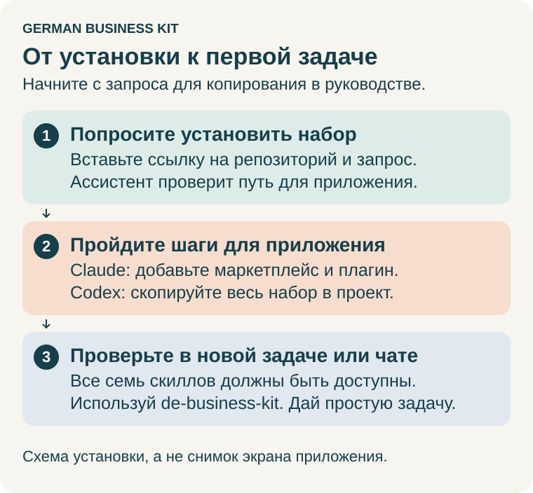

# Установка German Business Kit

[English](install.en.md) · **Русский**

Это руководство проведёт вас от установки набора до первого полезного ответа примерно за пять минут. Не нужны программирование, терминал, Python и бухгалтерская программа. Для первой пробы используйте вымышленные данные.

> **Помощь AI, а не профессиональная налоговая консультация.** German Business Kit —
> инструмент для самостоятельной работы, а не Steuerberater и не сервис
> профессионального налогового консультирования. AI может ошибаться, в том числе
> в расчётах и сроках. Содержимое, которое читает Codex или Claude, может
> обрабатываться OpenAI или Anthropic; локальная папка не означает локальный AI.
> [Риски и обработка данных](user-guide.ru.md#ограничения-ai-и-ваши-данные) — перед передачей настоящих документов.



[Установка в Claude](#установка-в-claude) · [Первая задача](#попробуйте-первую-задачу) · [Приватная папка](#храните-работу-в-приватной-папке) · [Обновления](#обновления) · [Codex](#установка-в-codex) · [Помощь](#если-что-то-не-получается)

## Попросите ассистента помочь с установкой

В Codex или Claude вставьте:

> Установи German Business Kit из https://github.com/ilyafedotov-ops/german-business-skills и покажи, как им пользоваться. Следуй инструкции репозитория для моего приложения, проверь доступность полного набора и помоги попробовать один небольшой пример.

Ассистент должен прочитать инструкции репозитория, проверить своё приложение и
инструменты, затем использовать подходящий путь установки ниже. Если папку или
кнопку установки плагина нужно выбрать вам, он должен объяснить следующий шаг.
Он должен сохранить существующие установки и документы бизнеса, установить все
семь скиллов вместе и отличать копирование файлов от обнаружения скиллов в новом
сеансе. Запрос не требует отдельного приложения для записей или новой папки
бизнеса. Если у ассистента нет доступа к репозиторию или настройкам установки,
используйте шаги ниже; он должен точно назвать незавершённое действие.

После установки начните новую задачу/чат и попросите:

> Используй de-business-kit. Покажи, как пользоваться набором в моей ситуации. Дай три запроса для копирования и помоги выбрать одну небольшую первую задачу.

До установки это руководство читает ваш существующий ассистент: набор не может
установить сам себя до получения доступа к его инструкциям. После установки
общий скилл объяснит подходящие задачи, вызов и продолжение в сохранённой папке.

## Что понадобится

- Компьютер с Windows или Mac и доступ в интернет.
- **Приложение Claude** с платным тарифом: Pro, Max, Team или Enterprise. Бесплатный тариф не включает Cowork и плагины.
- Пользуетесь **Codex** (OpenAI)? Перейдите к разделу [Установка в Codex](#установка-в-codex).

**Cowork** — часть приложения Claude, которая выполняет задачи с файлами в выбранной вами папке. **Плагин** добавляет в Claude готовые инструкции. German Business Kit — один плагин с семью связанными скиллами: общий помощник и специалисты по открытию бизнеса, текущей работе, учёту, налогам, сервисам и изменениям.

Интерфейс Claude на английском, поэтому названия кнопок ниже даны так, как они выглядят в приложении.

## Выберите модель

Для содержательной работы с бизнесом рекомендуем мощную модель рассуждения
с уровнем **High**:

| Приложение | Рекомендуемый выбор, если доступен |
| --- | --- |
| Claude Desktop / Cowork | **Claude Opus 5.5**; выберите **High**, если текущий режим показывает настройку уровня рассуждения. |
| Codex | **GPT-6 Astra** с уровнем рассуждения **High**. |

В Claude откройте меню модели рядом с **Send**, затем **Effort → High**.
В Codex используйте выбор модели/уровня под полем ввода; в новом интерфейсе
он может находиться в **Power → Advanced**. Выберите и **Astra**, и **High**:
обычный пункт GPT-6 High в Chat может использовать другую модель. Названия и
доступ могут различаться.

Набор скиллов
не выбирает и не переключает модель, а один запрос не меняет настройку. Если
таких названий или переключателей нет, используйте доступную вашему аккаунту
мощную модель рассуждения; попросите ассистента объяснить реально видимые варианты.
Для простой первой задачи не нужно менять провайдера или покупать более дорогой тариф.

Рекомендуемая настройка особенно полезна для исследования, неоднозначных вопросов,
форм, нескольких документов, учёта, налоговых оценок и проверок перед внешними
действиями. Для простых объяснений, переписывания и оформления подойдёт более
быстрая или лёгкая модель. High может занять больше времени и расходовать больше
лимита или бюджета при оплате по использованию; проверьте ограничения и стоимость
своего тарифа. Это рекомендация проекта, а не результат сравнительного теста или
гарантия налоговой точности. Любой модели нужны исходные данные, актуальные
источники и независимые проверки расчётов.

Названия, настройки и доступ зависят от приложения, тарифа и рабочего пространства.
Источники провайдеров проверены **26 октября 2026**:
[настройки Claude](https://support.claude.com/en/articles/8664678-change-the-model-effort-and-thinking-settings),
[настройки модели Codex](https://learn.chatgpt.com/docs/models),
[доступ к GPT-6](https://help.openai.com/en/articles/20001354-gpt-6-and-other-models-in-chatgpt)
и [уровни рассуждения Astra](https://developers.openai.com/api/docs/models/gpt-6-astra).
Поддержка в API сама по себе не подтверждает наличие настройки в desktop-приложении.

## Установка в Claude

Если приложения ещё нет, скачайте его с [официальной страницы загрузки Claude](https://claude.com/download), установите и войдите в аккаунт. Если компьютер или организация блокирует установку, используйте разрешённый способ; не отключайте защиту.


*Схема шагов; экраны приложения здесь не изображены.*

### 1. Откройте Plugins

В приложении Claude переключитесь на **Cowork**, если ваша версия показывает отдельный раздел. В некоторых версиях Chat и Cowork объединены. Откройте **Customize** в боковой панели, затем выберите **Plugins**.

### 2. Добавьте маркетплейс German Business Kit

Выберите **Add → Add marketplace**. Если появится выбор, нажмите **Add from a repository**. Введите адрес ниже (или полный URL GitHub), выберите найденный репозиторий либо **Use …**, затем нажмите **Sync**:

```text
ilyafedotov-ops/german-business-skills
```

Это страница проекта на GitHub; аккаунт GitHub не нужен. В некоторых версиях приложения кнопка называется просто **Add marketplace**.


*Настоящий снимок Claude Desktop 3.6556.2 на macOS от 26 октября 2026, до нажатия Sync. Он показывает, куда ввести адрес, а не завершённую установку. [Откройте снимок в полном размере](images/claude-marketplace.jpg). Названия кнопок в вашей версии могут отличаться.*

### 3. Установите German Business Kit

Найдите **German Business Kit** в списке плагинов (если его не видно сразу, загляните в **Discover**) и нажмите **Install**. В некоторых версиях кнопка называется **Add**.

**Шаг завершён, когда:** в **Customize → Plugins** есть German Business Kit, а на его вкладке **Skills** видны семь скиллов:

| Скилл | С чем помогает |
| --- | --- |
| `de-business-kit` | Начать, продолжить, выбрать следующую задачу |
| `de-business-start` | Подготовить и открыть деятельность |
| `de-business-operations` | Предложения, счета и текущая переписка |
| `de-business-accounting` | Документы и учётные записи |
| `de-business-tax` | Налоговые вопросы, отчётность и письма Finanzamt |
| `de-business-services` | Банки, страхование, программы и доступ к сервисам |
| `de-business-changes` | Изменения, найм, приостановка и закрытие |

Плагин сохраняется в вашем аккаунте Claude, поэтому он работает и в обычном чате Claude, и в Claude Code при входе с тем же аккаунтом. Семь скиллов используют один общий контекст бизнеса; настраивать их по отдельности не нужно.

Anthropic проверяет плагины из своего каталога, но не плагины, добавленные по адресу. Этот адрес устанавливает точный опубликованный выпуск этого открытого проекта, сейчас 0.9.0-preview.1.

## Попробуйте первую задачу

Плагины загружаются при запуске задачи, поэтому начните **новую задачу** в Cowork. Отправьте вымышленный пример:

> Используй de-business-kit. Я просто пробую помощника на вымышленном примере: хочу начать работать переводчиком в Германии. Не знаю, с чего начать. Помоги выбрать один небольшой первый шаг.

Перед отправкой введите **/** или откройте **+** и выберите **de-business-kit** из **German Business Kit**. Claude также может выбирать скиллы автоматически. В Codex назовите установленный скилл: **«Используй de-business-kit»** или **`$de-business-kit`**. [Другие примеры вызова](user-guide.ru.md#как-вызвать-скилл).

Полезный результат — одно понятное действие и вопросы только там, где нужны факты. Для такого вопроса не нужно выбирать бухгалтерскую программу, создавать папку бизнеса или загружать личные документы. Ответ не подтверждает завершённую регистрацию или налоговую проверку.

**Шаг завершён, когда:** ответ понятен и вы знаете следующий шаг. Если ответ слишком технический, скажите: **«Объясни простыми словами и дай только следующий шаг»**.

Можно продолжать по-русски или по-английски. Чтобы попробовать свою задачу, опишите нужный результат: понять письмо, подготовить форму, разобрать документы, сравнить сервисы или спланировать изменение. [Больше примеров запросов](user-guide.ru.md#первая-задача).

## Необязательный доступ к браузеру и компьютеру

Включайте или выбирайте управление браузером/компьютером, когда задача требует
взаимодействия с поддерживаемым сайтом или приложением. Если хост предоставляет
вспомогательный скилл, выберите его вместе с бизнес-скиллом; он не заменяет
инструмент и разрешение. Для первого разговора это не требуется. Ассистент должен
проверить имеющийся доступ до предложения что-либо устанавливать или включать.
[Настройка приложений, учебный запрос и ограничения сервисов](assisted-services.ru.md#когда-включать-браузер-или-управление-компьютером).

## Храните работу в приватной папке

Для простого вопроса папка не нужна. Для постоянной работы — чеков, писем или сохранённого плана — создайте отдельную приватную папку, например **Мой бизнес**, и дайте Cowork доступ к ней при запуске задачи. Затем попросите:

> Используй de-business-kit. Используй выбранную папку моего бизнеса. Сохрани туда понятный результат, подтверждённые сведения, открытые вопросы и следующий шаг. Прежде чем работать с настоящими личными документами, объясни, какое содержимое будет отправлено в ИИ-сервис.

- Claude обрабатывает содержимое файлов, которые читает. Решите, чем делиться, до работы с настоящими документами.
- Папки «Документы» или «Рабочий стол» с облачной синхронизацией могут оказаться менее приватными, чем вы ожидаете.
- Если вы уже ведёте учёт в бухгалтерской программе, она остаётся основным местом учёта. Простой вопрос не заставляет делать этот выбор.

В следующий раз начните новую задачу с той же папкой и скажите: **«Используй de-business-kit. Прочитай сохранённые сведения и ход работы в папке бизнеса, затем покажи следующий шаг»**.

## Обновления

Откройте **Customize → Plugins**, выберите маркетплейс German Business Kit и нажмите **Check for updates** или включите **Sync automatically**. Маркетплейс предлагает только опубликованные выпуски, а не незавершённую работу. Обновление плагина не меняет папку вашего бизнеса.

## Установка в Codex

В настольном приложении Codex плагины берутся из каталога OpenAI или вашего рабочего пространства, поэтому для этого набора Codex сам скопирует скиллы в папку проекта.

### 1. Откройте проект

1. Установите приложение с [официальной страницы загрузки и настройки OpenAI](https://learn.chatgpt.com/docs/app) и войдите. Текущая документация называет его **ChatGPT desktop**; в некоторых версиях оно называется **Codex**. Доступ к Codex зависит от аккаунта и политики рабочего пространства.
2. В Проводнике (Windows) или Finder (Mac) создайте папку **Business Assistant** в приватном месте. В ней будут только скиллы, а не ваши записи.
3. В Codex откройте эту папку как проект и начните **New chat**. Убедитесь, что выбран проект **Business Assistant**. Если приложение просит доверить папку, подтвердите только эту.

### 2. Скачайте набор

Откройте [выпуск 0.9.0-preview.1](https://github.com/ilyafedotov-ops/german-business-skills/releases/tag/v0.9.0-preview.1), при необходимости раскройте **Assets** и скачайте в одну папку два файла:

- **`de-business-kit-0.9.0-preview.1-codex.zip`**
- **`SHA256SUMS`** — список контрольных сумм, по которому видно, что файл не повреждён и не изменён

Архивы с `-gui-` — отдельное необязательное приложение; они не нужны.

### 3. Попросите Codex установить скиллы

Дайте Codex доступ к двум файлам через элемент доступа к файлам или скопируйте их полные пути: на Windows щёлкните файл правой кнопкой → **Копировать как путь**; на Mac выберите его в Finder, удерживайте **Option** и выберите **Правка → Скопировать … как путь**. Затем отправьте:

> Я устанавливаю German Business Kit в этот локальный проект Business Assistant в Codex. ZIP находится по пути [полный путь к ZIP], а SHA256SUMS — по пути [полный путь к файлу контрольных сумм]. Проверь ZIP по контрольной сумме и остановись, если она не совпадает. Распакуй архив в новую папку, затем скопируй все семь полных папок скиллов в .agents/skills этого проекта. Используй обычные файловые инструменты, сохраняй существующие файлы и остановись, если папка назначения уже существует. Не устанавливай среды выполнения, не меняй настройки безопасности и глобальную конфигурацию приложения. Назови семь установленных скиллов и объясни, как начать новый разговор.

Проверьте, что запрос доступа к файлам относится к вашей загрузке и проекту **Business Assistant**. Совпадение контрольной суммы показывает, что файл не повреждён; проверка того, кто его опубликовал, — отдельный шаг, описанный в [проверке загрузки](https://github.com/ilyafedotov-ops/german-business-skills/blob/v0.9.0-preview.1/docs/releases.ru.md#скачать-и-проверить).

### 4. Начните новый разговор

Начните **новый разговор в том же проекте**; если скиллов не видно, закройте и снова откройте приложение. Откройте **Skills** в боковой панели или спросите: **«Проверь, какие скиллы German Business Kit доступны в этом проекте»**.

**Шаг завершён, когда:** Codex показывает семь скиллов из [таблицы выше](#3-установите-german-business-kit). Затем [попробуйте первую задачу](#попробуйте-первую-задачу) и начните сообщение со слов **«Используй de-business-kit»** или **`$de-business-kit`**. Для постоянной работы дайте доступ к отдельной папке бизнеса, сохранив выбранным этот проект: так установленные скиллы останутся доступны.

### Ручная установка

Используйте этот способ, только если после проверки контрольной суммы Codex не может скопировать файлы.

1. Распакуйте ZIP в новую папку: Windows → правая кнопка → **Извлечь все…**; Mac → двойной щелчок по ZIP.
2. Откройте `codex/plugins/de-business-kit/skills` внутри распакованного содержимого. Файловый менеджер может добавить внешнюю папку с именем ZIP.
3. В **Business Assistant** создайте папку `.agents`, а в ней — `skills`. На Windows включите **Вид → Показать → Скрытые элементы**; на Mac нажмите **Command+Shift+.**, чтобы увидеть скрытые объекты. Если Finder не разрешает имя с точкой в начале, попросите Codex создать именно эту папку. Не убирайте точку в начале имени.
4. Скопируйте **все семь папок `de-business-*` вместе** с содержимым в `.agents/skills`. Если папка с таким именем уже существует, остановитесь; не объединяйте и не перезаписывайте её.
5. Проверьте структуру ниже и вернитесь к [шагу 4](#4-начните-новый-разговор).

```text
Business Assistant/
└── .agents/
    └── skills/
        ├── de-business-kit/
        │   ├── SKILL.md
        │   ├── assets/
        │   ├── guides/
        │   ├── references/
        │   └── scripts/
        ├── de-business-start/SKILL.md
        ├── de-business-operations/SKILL.md
        ├── de-business-accounting/SKILL.md
        ├── de-business-tax/SKILL.md
        ├── de-business-services/SKILL.md
        └── de-business-changes/SKILL.md
```

## Другие способы установки

- **Claude Code в терминале:** выполните `claude plugin marketplace add ilyafedotov-ops/german-business-skills`, затем `claude plugin install de-business-kit@german-business-kit`. Если плагин установлен в приложении, Claude Code получит его сам при входе с тем же аккаунтом Claude (не с API-ключом).
- **Разработчикам и техническим помощникам:** сборка из исходников, локальные маркетплейсы и проверка архивов описаны в [руководстве по распространению](https://github.com/ilyafedotov-ops/german-business-skills/blob/main/docs/distribution.ru.md).
- Устанавливайте набор в одно приложение только один раз. Плагин вместе с вручную скопированными теми же скиллами даёт дубликаты.

## Если что-то не получается

| Что вы видите | Что сделать |
| --- | --- |
| Нет отдельного раздела **Cowork** | В некоторых версиях Chat и Cowork объединены. Найдите **Customize → Plugins** и проверьте доступ к выбранной папке. |
| Нет **Customize** | Проверьте версию приложения, платный тариф и правила организации. |
| Нет пункта **Add marketplace** | В тарифе Team или Enterprise организация могла запретить добавлять собственные плагины. Обратитесь к владельцу (Owner) организации. |
| Маркетплейс не добавляется | Проверьте адрес `ilyafedotov-ops/german-business-skills` и подключение к интернету, затем повторите. |
| Плагин установлен, но Claude его не использует | Начните новую задачу. Проверьте, что плагин включён в **Customize → Plugins**, или введите **/** и выберите **de-business-kit**. |
| Скиллы видны дважды | Возможно, установлена и старая ручная копия. Оставьте одну установку; никогда не удаляйте папку бизнеса. |
| Помощник хочет установить Python или изменить настройки безопасности | Остановите этот шаг. Для установки и работы набора это не нужно. |
| Нет доступа к банку, почте или Lexware | Установка набора не подключает сервисы. Продолжите с вымышленным примером или выгруженным файлом и подключайте каждый сервис отдельно. |
| Codex: скиллов нет после установки | Проверьте выбранный проект, скрытую папку `.agents/skills`, все семь папок и новый разговор. Избегайте вложенной папки `skills/skills`. |
| Что-то другое не работает | Запишите сообщение, версию приложения, операционную систему и номер шага. Перед публичным вопросом удалите личные данные. |

**Дальше:** [выберите первую задачу и продолжайте повседневную работу](user-guide.ru.md#первая-задача).

## Источники и проверки

Путь для Claude основан на [руководстве Anthropic по плагинам в Cowork](https://claude.com/docs/cowork/guide/plugins) и [обзоре плагинов](https://claude.com/docs/plugins/overview), проверено **26.10.2026**. В тот же день этот маркетплейс установил точный выпуск 0.9.0-preview.1 со всеми семью скиллами через Claude Code 2.1.310; установка в самом приложении Cowork пока не наблюдалась. Путь для Codex основан на [инструкциях OpenAI по приложению](https://learn.chatgpt.com/docs/app) и [локальных скиллах OpenAI](https://learn.chatgpt.com/docs/build-skills). Названия меню могут меняться между версиями приложений. См. [журнал проверок](https://github.com/ilyafedotov-ops/german-business-skills/blob/main/docs/validation.ru.md).
