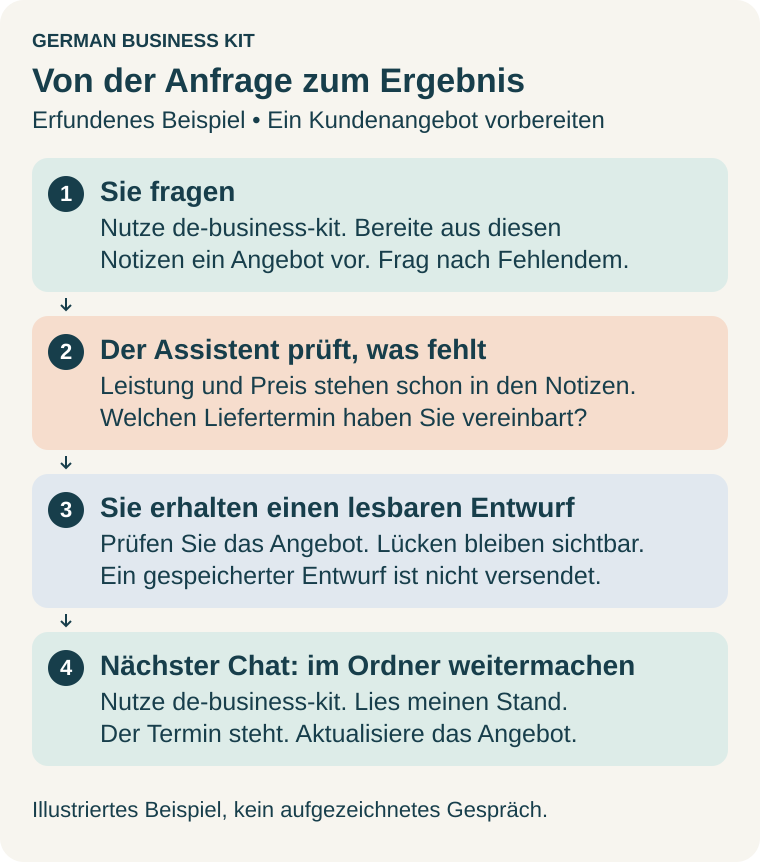

# Benutzerhandbuch

[English](user-guide.en.md) · [Русский](user-guide.ru.md) · **Deutsch**

**Arbeiten Sie in Claude oder Codex. Bewahren Sie Unterlagen und Arbeitsstand in einem privaten Ordner auf.** German Business Kit hilft Ihnen, Ihr eigenes Einzelunternehmen in Deutschland zu führen: von der ersten Idee über die laufende Arbeit und Berichte bis zu Änderungen und zur Beendigung. Eine zusätzliche Anwendung ist nicht nötig. Fachliche Hilfe ist eine Option für eine konkrete Frage, kein verpflichtender letzter Schritt.

Neu hier? [Installieren Sie das vollständige Kit](install.de.md). Probieren Sie dann eine kleine Aufgabe von unten aus.

Für anspruchsvolle Arbeit nutzen Sie, sofern verfügbar, **Claude Opus 5.5 / High**
oder **GPT-6 Astra / High**. Wählen Sie das in den Modell- und Denkaufwand-Einstellungen
der App; der Skill kann das nicht für Sie umstellen. Einfache Erklärungen gelingen
auch mit einem leichteren Modell.
[Modellwahl, Nutzungsgrenzen und Alternativen](install.de.md#modell-wählen).

**Vor echten Dokumenten:** lesen Sie [KI-Grenzen und Ihre Daten](#ki-grenzen-und-ihre-daten).
Das Kit ist KI-gestützte Selbsthilfe, keine professionelle Steuerberatung; ein lokaler
Unternehmensordner macht die Verarbeitung durch das Modell nicht rein lokal.

## Einen Skill aufrufen

- **Claude Desktop / Cowork:** Starten Sie eine neue Aufgabe, tippen Sie **/** oder öffnen Sie **+** und wählen Sie **de-business-kit** aus **German Business Kit**. Schreiben Sie dann Ihre Anfrage. Einen Fach-Skill wählen Sie auf dieselbe Weise.
- **Codex-App:** Öffnen Sie das Projekt, in dem das Kit installiert ist, und starten Sie einen neuen Chat. Schreiben Sie **„Nutze de-business-kit“** und danach Ihre Anfrage. Codex unterstützt auch ausdrückliche Skill-Verweise wie **`$de-business-kit`**; die Auswahlliste hängt von der App-Version ab. Unter **Skills** sehen Sie, ob das Kit verfügbar ist.
- **Claude Code:** Mit installiertem Plugin schreiben Sie **`/de-business-kit:de-business-kit`** und danach Ihre Anfrage.

Die Beispiele unten nennen den Skill in normaler Sprache, damit Sie die ganze Anfrage in beide Assistenten kopieren können. Den Skill vorher auszuwählen ist ein weiterer Weg. Fehlt der Skill, folgen Sie der [Hilfe zur Installation](install.de.md#wenn-sie-nicht-weiterkommen); den Namen zu tippen installiert nichts. Merken müssen Sie sich nur `de-business-kit`: Er wählt den passenden Fach-Skill für Sie.

Für Arbeit innerhalb einer Website oder einer installierten App kann der Assistent
empfehlen, ein verfügbares Browser- oder Computer-Werkzeug und dessen Hilfs-Skill
einzuschalten. Vorhandene passende Verbindungen haben Vorrang; normale Fragen und
Arbeit mit Dateien brauchen keinen Bildschirmzugriff.
[Den richtigen Zugriff wählen und einschalten](assisted-services.de.md#wann-browser--oder-computer-werkzeuge-einschalten).

## Erste Aufgabe

Probieren Sie das ohne private Dokumente und ohne Unternehmensordner:

> Nutze de-business-kit. Ich teste den Assistenten mit einem erfundenen Beispiel: Ich bin Programmierer und möchte in Deutschland freiberuflich Websites und Apps für kleine Firmen entwickeln. Ich weiß nicht, wo ich anfangen soll. Hilf mir, einen kleinen ersten Schritt zu wählen. Frag nur, was du für diesen Schritt brauchst.

**Sie erhalten:** einen verständlichen Schritt und die Angaben, die dafür nötig sind. Sie können „Weiß ich nicht“ oder „Erklär das einfacher“ sagen.

Wählen Sie einen anderen Einstieg, wenn Sie so weit sind:

| Sie möchten … | Kopieren Sie diese Anfrage | Sie erhalten |
| --- | --- | --- |
| Eine Tätigkeit beginnen | Nutze de-business-start. Ich möchte in Deutschland [Leistung] anbieten. Hilf mir beim nächsten Schritt und berücksichtige, was du über meine anderen Tätigkeiten schon weißt. | Einen praktischen nächsten Schritt oder Gründungsplan mit benannten fehlenden Angaben. |
| Kundenarbeit vorbereiten | Nutze de-business-operations. Bereite aus diesen vereinbarten Bedingungen eine Rechnung vor. Prüfe, was fehlt, und zeig mir den Entwurf vor der Ausstellung. | Einen lesbaren Entwurf und Fragen zu fehlenden Angaben. |
| Belege ordnen | Nutze de-business-accounting. Prüfe die Dateien in meinem gewählten Unternehmensordner für Oktober 2026. Zeig, was vorhanden ist, was zu prüfen ist und was fehlt. | Eine Übersicht der Dokumente und eine überschaubare Prüfliste. |
| Ein Schreiben verstehen | Nutze de-business-tax. Erkläre mir dieses Schreiben des Finanzamts auf Deutsch in einfachen Worten, prüfe die Frist und hilf mir bei einer Antwort. | Eine Erklärung, eine belegte Einschätzung der Frist und einen Antwortentwurf. |
| Einen Betrag schätzen | Nutze de-business-tax. Hilf mir, meine Einkommensteuer für 2026 zu schätzen. Prüfe zuerst, welche Angaben du brauchst und was du schon weißt. Recherchiere die maßgeblichen Regeln, rechne, wenn die Eingaben reichen, und prüfe das Ergebnis unabhängig. | Gezielte Fragen und danach eine belegte Schätzung oder eine genaue Erklärung, was noch fehlt. |
| Einen Dienst wählen | Nutze de-business-services. Vergleiche Geschäftskonten für meinen Bedarf und meine vorhandenen Dienste. Erkläre normale Kosten und Einschränkungen, bevor ich wähle. | Einen belegten Vergleich und die Entscheidungen, auf die es ankommt. |
| Ändern oder beenden | Nutze de-business-changes. Ich möchte [ändern, jemanden einstellen, pausieren oder beenden]. Prüfe, was das betrifft, auch meine anderen Tätigkeiten, und bereite die nächsten Schritte vor. | Einen Plan mit Abhängigkeiten und offenen Pflichten. |
| Fortsetzen | Nutze de-business-kit. Setze die Arbeit in meinem gewählten Unternehmensordner fort. Lies den gespeicherten Stand und zeig den nächsten sinnvollen Schritt. | Eine Zusammenfassung von Erledigtem, offenen Punkten und dem nächsten Schritt. |

Ersetzen Sie Text in eckigen Klammern durch Ihre Angaben. Sie müssen vorher keinen vollständigen Fragebogen ausfüllen. Der Assistent soll eine unklare Anfrage klären, passende bestätigte Angaben wiederverwenden und nur nach fehlenden oder veralteten Angaben fragen. Unabhängige Arbeit kann weiterlaufen, während eine Frage offen ist.

## Eine Zahlungsfrage eines Kunden fortsetzen

> Nutze de-business-operations. Lies den gespeicherten Kundenfall, die Rechnung und die Zahlungsnachweise. Bereite eine deutsche Antwort und eine getrennte Prüfung des noch offenen Betrags vor. Speichere den nächsten Schritt. Versende und buche nichts.

Der Assistent vergleicht Bruttobetrag, erfasste Anzahlung, Rundung und fälligen
Betrag der Rechnung mit den tatsächlich verknüpften Zahlungseingängen. Eine bereits
in der Rechnung berücksichtigte Zahlung darf nicht doppelt abgezogen werden. Fehlende
Nachweise zu Zuordnung oder Korrektur bleiben offen. Wenn neue Nachweise eintreffen,
bitten Sie ihn, denselben Fall fortzusetzen: Er speichert eine neue Antwort- und
Prüfungsversion, behält frühere Dateien und Ihr gewähltes Rechnungssystem. Eine
vorbereitete Antwort stellt keine Korrektur aus und versendet keine Nachricht.

## Umsatzsteuer vor einem Wareneinkauf in der EU prüfen

> Nutze de-business-operations. Ich möchte für mein deutsches Unternehmen [Ware] aus [Land] bestellen. Die Ware wird von [Land] nach Deutschland geliefert. Meine umsatzsteuerliche Behandlung ist [Regelbesteuerung / Kleinunternehmer / unbekannt]. Prüfe, was ich vor der Bestellung klären sollte, auch ob ich meine USt-IdNr. angeben soll. Kaufe nichts und kontaktiere den Verkäufer nicht.

Wenn die Rechnung schon da ist:

> Nutze de-business-accounting. Diese Rechnung über Waren aus der EU enthält Umsatzsteuer, und ich habe meine USt-IdNr. nicht angegeben. Prüfe, wessen Umsatzsteuer das ist, ob ich sie abziehen kann und was ich als Nächstes tun sollte. Bereite bei Bedarf eine Bitte an den Verkäufer vor, eine Korrektur zu prüfen. Versende und buche nichts.

Der Assistent soll ausländische Umsatzsteuer auf der Rechnung, deutsche
Erwerbsteuer und die Berechtigung zum Vorsteuerabzug unterscheiden. Für
Kleinunternehmer kann die Verwendung einer USt-IdNr. Folgen haben, auch wenn ihr
bloßer Besitz keine hat. Eine Bitte um Korrektur garantiert keine Erstattung.
Bringen Sie Rechnung, Lieferweg und bekannte Angaben zur umsatzsteuerlichen
Behandlung mit; der Assistent fragt nur nach Fehlendem. Siehe die
[gemeinsamen Prüfungen für Waren aus der EU](../references/international.md#before-ordering-goods-from-another-eu-country).

## Ausstellen, korrigieren und Zustellung bestätigen

> Nutze de-business-operations. Setze diese Rechnung in meinem gewählten Rechnungssystem fort. Bereite genau die Rechnung oder Korrektur vor, zeig mir die endgültigen Dateien und den Empfänger und halte Ausstellung, Versand und Zustellbestätigung getrennt. Speichere den aktuellen Stand und den nächsten Schritt.

Der Assistent kann den unterstützten Vorgang im Dienst vorbereiten und das
beobachtete Ergebnis in Ihrem privaten Ordner festhalten. Er bewahrt Original und
Korrektur, den geprüften Entwurf, die tatsächlich ausgestellte Datei und jeden
Versandversuch auf. Ein Versandprotokoll bedeutet „versendet“; für „zugestellt“
braucht es einen Empfangsnachweis oder eine Bestätigung des Kunden. Nach einer
Zeitüberschreitung prüft er das vorhandene Ergebnis, bevor er es erneut versucht.
Haben Sie ein Dokument bereits ausgestellt oder versendet, liefern Sie die
tatsächliche Datei und den Statusnachweis: Das wird als vergangenes Ereignis
erfasst, ohne eine frühere Freigabe zu erfinden. Versand, Stornierung und andere
externe Änderungen brauchen eine Freigabe für den konkreten Vorgang und seine Folgen.

Vor einer kostenpflichtigen Einrichtung prüft der Assistent, was Ihr aktueller
Tarif enthält, und erklärt zusätzliche Kosten, Abrechnungs- und Testbedingungen
sowie unbekannte Kosten. Er bietet eine nutzbare Alternative mit dem aktuellen
Tarif oder per Datei bzw. manuell an, bevor er ein Upgrade vorschlägt. „Teste die
Verbindung“ erlaubt keine Ausgaben. Lehnen Sie ein Upgrade ab, bleibt es dabei, und
er setzt die verfügbare Arbeit ohne wiederholte Upgrade-Fragen fort.

Für Lexware Office können Sie fragen: „Bereite diesen Entwurf in meiner vorhandenen
Lexware-Firma vor, lies ihn zurück und speichere das Ergebnis. Halte Fertigstellen
und Versand getrennt.“ Ein optionaler Adapter kann den Entwurf mit vorhandenem
API-Zugang anlegen und lesen; schon das Anlegen verbraucht eine Rechnungsnummer.
Danach hilft er, dieselbe Rechnung im Browser fertigzustellen und zu versenden. Für
den geführten Browserweg ist kein API-Zugang nötig. Fügen Sie niemals einen
API-Schlüssel in einen Chat oder ein Geschäftsdokument ein.

Die geschützten lokalen Befehle und der optionale API-Adapter brauchen eine
verfügbare Python-Umgebung. Die eigenständigen nativen Windows-Werkzeuge haben keine
Steuerung für den Rechnungsablauf; ohne den Schreiber speichert der Assistent eine
lesbare Fortsetzung und hilft mit dem gewählten Dienst. Ein freigegebener Browsertest
mit Nullbetrag hat in einer vorhandenen Firma Anlegen, Rücklesen, Fertigstellen,
Versand und bestätigten Empfang abgeschlossen. Der API-Adapter ist weiterhin nur
synthetisch getestet; eine echte API-Abnahme sowie gewöhnliche Rechnungen und
Korrekturen mit Betrag sind offen. Er vergibt selbst keine Nummern und bietet keine
API zum E-Mail-Versand.

Ein getrennter Test mit dem aktuellen Tarif hat außerdem Textkorrektur im Entwurf,
Speichern und erneutes Öffnen sowie die Vorschau geprüft; die Rechnung mit Nullbetrag
blieb dabei unausgestellt und unversendet. Auch der Download eines Entwurfs-PDFs wurde
geprüft: Wählen Sie im Druckdialog **Als Entwurf drucken** und prüfen Sie, dass die
Schaltfläche dazu passt. Die Voreinstellung **Fertigstellen + drucken** würde die
Rechnung ausstellen.

Der Korrekturtest umfasste zusätzlich einen getrennten manuellen Korrekturentwurf
mit Nullbetrag: Speichern und erneutes Öffnen, Textkorrektur mit unabhängiger
Rücklesung, Vorschau und Entwurfs-PDF. Nach ausdrücklicher Freigabe wurde dieselbe
Korrektur ausgestellt, unabhängig zurückgelesen und ihr endgültiges PDF geprüft; sie
ist unversendet. Das Original wurde nicht storniert. Der Bezug auf das Original wurde
als Text eingetragen; das beweist weder eine beim Anbieter verknüpfte Korrektur noch
eine Erstattung. Siehe den [Korrekturweg](../references/lexware.md#prepare-and-verify-a-correction)
für Status- und Menüprüfungen und die Grenze vor dem Ausstellen oder Stornieren.

Für eine Zahlungsnachverfolgung fragen Sie: **„Vergleiche diese ausgestellte Rechnung mit den zugeordneten Bankeingängen und speichere einen privaten Zahlungsbericht.“** Der optionale Python-Ablauf bewahrt Nachweise, zieht in der Rechnung bereits berücksichtigte Anzahlungen nicht erneut ab und prüft Teilzahlungen und Erstattungen über Zeiträume hinweg. Unsichere Vollständigkeit, Währung oder Korrekturen lassen den Abgleich offen. Er ändert keinen Zahlungsstatus beim Anbieter und versendet nichts. Bevor ein Bericht wiederverwendet wird, prüft der Assistent die Aktualität von Quellen und Rechnung. Siehe den [Ablauf für Zahlungseingänge](../references/invoicing-workflow.md#compare-an-issued-invoice-with-customer-receipts).

Nach dem Abgleich fragen Sie: **„Bereite eine deutsche Nachricht mit einer Frage zur verbleibenden Differenz vor, mit einer getrennten privaten Prüfung. Versende sie nicht.“** Der optionale Ablauf erstellt den tatsächlichen Text für den Kunden und die Prüfung. Ist der Abgleich offen, kann er eine Klärungsanfrage ohne Betrag vorbereiten; veraltete Quellen müssen zuerst aktualisiert werden. Texte für Empfänger gibt es auf DE/EN/RU, private Prüfungen auf EN/RU/DE. Siehe [Nachfrage beim Kunden](../references/invoicing-workflow.md#prepare-a-customer-payment-follow-up).

## Arbeit in einem Ordner aufbewahren

Wählen Sie für laufende Arbeit einen dauerhaften privaten Ordner wie **Mein Unternehmen**, getrennt vom heruntergeladenen Kit, den installierten Skills und jedem Git-Repository. Geben Sie Ihrem Assistenten Zugriff auf diesen Ordner. Bleiben Sie in Codex in dem Projekt, in dem die Skills installiert sind, und geben Sie zusätzlich Zugriff auf den Unternehmensordner; ein anderes Projekt kann projektlokale Skills verbergen.

> Nutze de-business-kit. Verwende meinen gewählten Unternehmensordner für die laufende Arbeit. Prüfe, was schon vorhanden ist. Speichere lesbare Ergebnisse, bestätigte Angaben zum Unternehmen, offene Fragen und den nächsten Schritt, damit wir später weitermachen können. Erkläre mir vor dem Lesen echter persönlicher Dokumente, welche Inhalte der KI-Dienst erhält.

Der Assistent verwaltet die unterstützenden Aufzeichnungen. Bitten Sie ihn, das gespeicherte Ergebnis zu verlinken; technische Dateien müssen Sie nicht bearbeiten und interne IDs nicht kennen. Er soll Ihre Angaben, geprüfte Angaben und Annahmen unterscheiden und fragen, bevor er eine unsichere Auslegung als dauerhafte Tatsache übernimmt. Wenn sich eine Angabe ändert, nennen Sie das Datum, ab dem sie gilt, sofern Sie es kennen.

## Ihre Ordner

Ein neuer Ordner hat auf Deutsch, Englisch oder Russisch dieselbe Struktur. Die Ordnersprache wird einmal gewählt; ein Wechsel der Gesprächssprache benennt keine Ordner um.

| Ordner | Inhalt |
| --- | --- |
| `HIER-STARTEN.md` | Wie Sie beginnen und später weitermachen. |
| `ÜBERSICHT.html` | Die zuletzt gespeicherte Übersicht zu Aufgaben, Dokumenten und Buchhaltung. Bitten Sie den Assistenten, sie zu aktualisieren; sie entsteht mit der ersten Übersicht. |
| `01 Eingang/` | Ihre unsortierten Dateien. Der Assistent zeigt sie vor dem Import. Nach dem Import wandert die Datei nach `Importiert/<Jahr>-<Monat>/`, damit im Eingang nur Unerledigtes bleibt. |
| `02 Dokumente/<Jahr>/<Monat>/` | `Originale/`: unveränderte Kopien mit laufender Nummer je Jahr, etwa `2026-00007_Rechnung.pdf`. `Ausgangsrechnungen/`: Kopien Ihrer ausgestellten Rechnungen nach Ausstellungsmonat. `Aufbereitet/`: ausgelesener Text oder Daten bei Bedarf. |
| `03 Buchhaltung/` | `Bank/<Jahr>/`: Kontoauszüge und aufbereitete Bankdaten. `Unterlagen/`: Notizen zu Ihrem Buchhaltungssystem und Vereinbarungen. `Berichte/`: Abgleiche und Berichte. `Verfahrensdokumentation/`: der Entwurf, der beschreibt, wie Ihre Unterlagen geführt werden. |
| `04 Steuern/<Jahr>/` | Steuerfragen, Schätzungen, Formulare und tatsächliche Übermittlungsnachweise. |
| `05 Unternehmen/` | `Anmeldung/`: Gründungs- und Änderungspläne. `Schriftverkehr/<Jahr>/`: Kundenfälle, Schreiben und Dienstleistungsvergleiche. |
| `.business-kit/` | Interne Aufzeichnungen: Profil, Aufgaben, Fragen, Entscheidungen, Verlauf und Arbeitsdateien des Assistenten. In Sicherungen aufnehmen; nicht von Hand bearbeiten. |

Warum nummerierte Originale? Eine laufende Nummer macht Lücken sichtbar und lässt Sie, eine Beratung oder eine Betriebsprüfung jedes Dokument auch ohne das Kit finden; der Index bewahrt den ursprünglichen Dateinamen und einen SHA-256-Fingerabdruck der genauen Bytes. Jahres- und Monatsordner sind Ablagezeiträume, keine steuerlichen Entscheidungen.

Der Entwurf der Verfahrensdokumentation in `03 Buchhaltung` beschreibt, wie Dokumente eingehen, abgelegt, geschützt und aufbewahrt werden. Die GoBD erwarten eine solche Beschreibung. Ergänzen Sie die markierten Teile, bewahren Sie datierte Fassungen auf und behandeln Sie sie als Ihr eigenes Dokument, nicht als Zertifizierung. Aufbewahrungsfristen laufen ab dem Ende des Kalenderjahres: 10 Jahre für Bücher und Aufzeichnungen, 8 Jahre für Buchungsbelege einschließlich Rechnungen, 6 Jahre für Geschäftsbriefe und länger, solange eine Steuerfestsetzung noch offen ist. Löschen Sie keine Unterlagen ungeprüft.

Der Eingang ist nur für Ihre Dateien: Vorschauen und vorbereitete Eingaben legt der Assistent in `.business-kit` ab. Bitten Sie den Assistenten, Dokumente nach Name, Datum oder Zweck zu finden. Ordner aus einer früheren Vorschauversion des Kits öffnet diese Version nicht und ändert darin nichts; legen Sie einen neuen Ordner an und importieren Sie die Originale erneut.

## Wo Ergebnisse gespeichert werden

Der Assistent ermittelt vor dem Speichern die Ordner in Ihrem tatsächlichen
Unternehmensordner. Das ist eine Ablagekonvention für lesbare Dateien, kein neues
Buchhaltungssystem und kein Versprechen, dass jede Anfrage automatisch eine Datei
erzeugt. Vorhandene Dokumente behalten ihren Ort; der Assistent verlinkt sie,
statt sie umzuordnen.

| Anfrage | Übliches Ziel in einem deutschen Ordner |
| --- | --- |
| Eine allgemeine Frage stellen | Antwort im Chat. Wenn Sie das Speichern wünschen, liegt die Notiz beim passenden Thema unten. |
| Ein Unternehmen planen oder Anmeldeformulare ausfüllen | `05 Unternehmen/Anmeldung/`, nur bei Bedarf mit einem kleinen Fallordner. |
| Angebot, Vertrag, Rechnungsentwurf oder Antwort an Kunden vorbereiten | `05 Unternehmen/Schriftverkehr/<Jahr>/<Fall>/`; Dateien für Empfänger und private Prüfnotizen sind getrennt. Ausgestellte Dokumente bleiben im gewählten Rechnungssystem; eine aufbewahrte Kopie jeder ausgestellten Rechnung liegt in `02 Dokumente/<Jahr>/<Monat>/Ausgangsrechnungen/`. |
| Belege oder gelieferte Originale importieren | `01 Eingang/` zur ersten Auswahl, dann nummerierte aufbewahrte Kopien in `02 Dokumente/<Jahr>/<Monat>/Originale/` über den Importablauf; die importierte Datei wandert nach `01 Eingang/Importiert/<Jahr>-<Monat>/`. Aufbereitete Kopien entstehen bei Bedarf getrennt. |
| Banken vergleichen oder mit Kontoauszügen arbeiten | `03 Buchhaltung/Bank/`; Vergleiche von Buchhaltungssystemen und Arbeitsnotizen in `03 Buchhaltung/Unterlagen/`. |
| Versicherungen oder Software außerhalb der Buchhaltung vergleichen oder eine Anbindung planen | `05 Unternehmen/Schriftverkehr/<Jahr>/Dienstleistungen/<Fall>/`; nur lesbare Ergebnisse, nie Passwörter oder API-Schlüssel. Vorhandene Aufzeichnungen zu Diensten und Quellen werden wiederverwendet. |
| Eine Steuerfrage stellen, schätzen, eine Erklärung vorbereiten oder dem Finanzamt antworten | `04 Steuern/<Jahr>/`; mit Verweis auf das maßgebliche Original, Quellen, Entwurf und beobachteten Beleg, soweit vorhanden. |
| Abgleichen oder Buchhaltungsberichte/-exporte vorbereiten | `03 Buchhaltung/Berichte/`; diese Berichte ersetzen weder die gewählten Bücher noch eine vollständige Sicherung. |
| Ändern, jemanden einstellen, pausieren oder beenden | Ein Plan in `05 Unternehmen/Anmeldung/<Fall>/`, zugehörige Schreiben im Schriftverkehr und steuerliches Material im betreffenden Steuerjahr. Die Teile werden von einer vorhandenen Aufgabe aus verknüpft. |

`<Fall>`, `<Jahr>` und `<Monat>` sind Platzhalter, keine Ordnernamen zum Abtippen.
Fallnamen dürfen Ihre Sprache verwenden. Der Assistent folgt der gespeicherten
Ordnerzuordnung, nicht der Sprache der letzten Nachricht. Monate sind
Ablagezeiträume, kein Nachweis für Steuerzeitraum oder Zahlungsdatum.

Aufgaben, offene Fragen, bestätigte Angaben und Verlauf bleiben in den gemeinsamen
internen Aufzeichnungen. Eine Fallnotiz verknüpft diese Aufzeichnungen und Dateien;
sie ist keine zweite Checkliste und kein zweites Profil. Mehrere Tätigkeiten nutzen
dasselbe Profil der Person; die Tätigkeit wird in Aufgabe oder Datei benannt. Bitten
Sie um einen Link zum Ergebnis und zum nächsten Schritt; benennen Sie verwaltete
Ordner nicht von Hand um, verschieben Sie keine aufbewahrten Originale und
bearbeiten Sie kein internes JSON.

> Nutze de-business-kit. Speichere dieses Ergebnis mit seinem Thema, nutze einen vorhandenen Fall, falls es einen gibt, behalte frühere Versionen und zeig mir die Datei und den nächsten Schritt.

Nehmen Sie für eine Sicherung den gesamten Ordner auf, einschließlich `.business-kit`
und `.workspace-layout.json`, und wählen Sie ein getrenntes geschütztes Ziel. Ein
Wechsel der Chatsprache oder ein Skill-Update darf vorhandene Ordner nicht umordnen.

## Dokumente

> Nutze de-business-accounting. Sieh dir die ausgewählten Dokumente an, zeig, welche zu dieser Aufgabe gehören, und ordne sie. Bewahre die Originale auf und zeig mir ausgelesene Beträge und Daten zur Prüfung.

**Sie erhalten:** Links zu aufbewahrten Dokumenten, eine Zusammenfassung des Verarbeiteten und Fragen zu Unklarem. Bei E-Mail oder einem Dienst nennen Sie Quelle und Zeitraum. Der Assistent prüft den tatsächlichen Zugriff und kann mit ausgewählten Exporten arbeiten, wenn keine Verbindung verfügbar ist.

Für eine Korrektur oder Teilzahlung liefern Sie die frühere Rechnung und die zugehörigen Zahlungs- oder Korrekturdokumente. Bitten Sie darum, denselben Fall fortzusetzen, damit frühere Versionen und offene Differenzen sichtbar bleiben.

## Konten und Zahlungen

> Nutze de-business-accounting. Bereite Oktober 2026 in meinem vorhandenen Buchhaltungssystem vor. Zeig fehlende Belege, nicht zugeordnete Zahlungen, Gebühren und Erstattungen. Frag, bevor du änderst, wo ich meine Bücher führe.

**Sie erhalten:** eine lesbare Prüfung des Zeitraums auf Grundlage der tatsächlich geprüften Unterlagen. Ihre gewählte Buchhaltungssoftware bleibt die maßgebliche Aufzeichnung. Wenn Sie lokale Aufzeichnungen bevorzugen, hat das Kit ein begrenztes Kassenbuch; der Assistent erklärt, was es erfassen kann und was Ihre konkrete Berichtsaufgabe noch braucht.

Bitten Sie bei Berechnungen darum, erfasste Beträge von der steuerlichen Behandlung zu trennen, maßgebliche Regeln und Eingaben zu prüfen, die Rechnung auszuführen und die Prüfungen zu zeigen. Eine Geldsumme allein begründet weder steuerpflichtigen Gewinn noch eine vollständige Erklärung. [Ausführlicher Monatsablauf](../references/monthly-workflow.md).

Wählen Sie **de-business-accounting** und fragen Sie: „Bereite Oktober aus diesen
Belegen in meinem Unternehmensordner vor. Speichere, was zu diesem Zeitraum gehört,
was woanders hingehört und was noch fehlt.“ Sie erhalten aufbewahrte Originale,
Vorschlagsentwürfe und eine lesbare Prüfung, die zeitliche Zuordnung von Zahlung
bzw. Gewinn und Umsatzsteuer trennt. Unbekannte Privatnutzung oder Behandlung von
Wirtschaftsgütern bleibt offen. Ihre gewählte Buchhaltungssoftware bleibt
maßgeblich; die Vorbereitung bucht selbst nichts und schließt den Monat nicht ab.

## Steuern und Schreiben

> Nutze de-business-tax. Prüfe für diese Frage zuerst den maßgeblichen Zeitraum und die bereits gespeicherten Angaben. Frag mich nach Fehlendem, recherchiere die maßgeblichen amtlichen Regeln und erkläre Ergebnis und nächsten Schritt in einfachen Worten.

**Sie erhalten:** eine Antwort mit Quellen, eine geprüfte Berechnung, wo unterstützt, oder einen Entwurf für ein Schreiben bzw. Formular. Berechnungen können ein passendes amtliches Werkzeug, Ihre gewählte Software oder eine begrenzte Berechnung auf Grundlage recherchierter Regeln nutzen. Der Assistent zeigt Annahmen, tatsächliche Ausführung und eine getrennte Prüfung; er sagt, wenn eine Regel, Eingabe oder Prüfung offen ist.

Für Arbeit in ELSTER oder in Buchhaltungssoftware siehe [Unterstützung bei Formularen und Diensten](assisted-services.de.md). Anmeldung und jeden abschließenden Schritt, den Sie sich vorbehalten, erledigen Sie selbst. Der Assistent zeigt vor einem externen Schritt das konkrete Material und bewahrt danach das beobachtete Ergebnis auf.

Bei einem möglichen Fehler in einer übermittelten Erklärung fragen Sie: **„Prüfe,
was tatsächlich übermittelt wurde, unterscheide fehlende Nachweise von einem
bestätigten Fehler und erkläre, was zuerst geprüft oder korrigiert werden sollte.“**
Der Assistent prüft Zeitraum, Stand der Erklärung und Fristen. Er unterscheidet einen
möglichen Fehler von einer festgestellten Pflicht zur Mitteilung an das Finanzamt;
besteht diese Pflicht, darf das Fertigstellen aller Berechnungen die Mitteilung nicht
verzögern. Die Vorbereitung versendet weder eine Mitteilung noch eine berichtigte
Erklärung. [Details zum Ablauf](../references/tax-consultant.md#check-a-possible-error-in-a-filed-return).

Um eine Anpassung der Vorauszahlungen vorzubereiten, wählen Sie **de-business-tax** und fragen Sie:

> Hilf mir, meine Einkommensteuer-Vorauszahlungen anhand dieses Bescheids und dieser Prognose zu senken. Speichere den deutschen Antrag und eine Prüfung auf Deutsch in meinem Unternehmensordner, damit wir später weitermachen können.

**Sie erhalten:** einen gespeicherten Entwurf, den vorgeschlagenen Betrag neben dem
nach dem aktuellen Bescheid noch fälligen Betrag, Berechnungs- und Quellennachweise
und einen nächsten Schritt. Der Assistent fragt nur nach fehlenden Angaben, die diese
Arbeit beeinflussen. Geben Sie in einem neuen Chat Zugriff auf denselben Ordner und
bitten Sie, mit Ihrer korrigierten Prognose fortzufahren. Er speichert eine verknüpfte
Überarbeitung und bewahrt den früheren Entwurf. Ein vorbereiteter oder versendeter
Antrag ändert den Bescheid des Finanzamts nicht von selbst.
[Details zum Ablauf](../references/tax-consultant.md#prepare-or-revise-an-income-tax-prepayment-request).

## Berichte

> Nutze de-business-kit. Speichere ein lesbares Ergebnis mit Antwort, offenen Fragen und nächstem Schritt. Verlinke die Datei. Halte ein Dokument für einen Empfänger getrennt von meinen privaten Notizen.

**Sie erhalten:** ein gewöhnliches lesbares Dokument. HTML lässt sich im Browser öffnen; PDF, Word oder Tabellen hängen von den verfügbaren Werkzeugen ab. Berichtsvorlagen gibt es auf Deutsch, Englisch und Russisch. Ein deutsches Dokument für einen Empfänger kann eine getrennte Erläuterung in Ihrer Sprache haben.

## Fortsetzen

Für eine gespeicherte Erklärung wählen Sie **de-business-tax** und fragen: „Setze
diese Erklärung aus meinem Unternehmensordner fort. Prüfe die gespeicherte Version
und geänderte Nachweise und bereite den nächsten Schritt vor, ohne zu übermitteln.“
Der Assistent liest den tatsächlichen Stand der Erklärung und zeigt, was sie
blockiert. Freigegebene Korrekturen erzeugen verknüpfte Versionen; eine unsichere
Übermittlung braucht vor jedem neuen Versuch einen Nachweis des Ergebnisses.
Vorbereitungsberichte behalten ihre zugrunde liegenden Nachweise, wenn sie in eine
Erklärung übernommen werden; ein Arbeitsblatt ist unterstützendes Material, keine
fertige amtliche Erklärung.

Bevor Sie eine größere Aufgabe beenden, fragen Sie:

> Nutze de-business-kit. Speichere Ergebnis, bestätigte Entscheidungen, offene Fragen und nächsten Schritt in meinem Unternehmensordner. Zeig mir, was gespeichert wurde und was noch offen ist.

Geben Sie dem Assistenten beim nächsten Mal Zugriff auf **denselben Ordner**, wählen Sie den installierten Skill und senden Sie:

> Nutze de-business-kit. Setze die Arbeit in [meinem Unternehmensordner] fort. Lies zuerst die gespeicherten Angaben und den Stand. Prüfe, was sich geändert hat, frag nur nach Fehlendem und hilf beim nächsten Schritt.

Verlassen Sie sich für die Fortsetzung nicht nur auf den alten Chat. Skill-Updates und ein Wechsel der Gesprächssprache sollen Ihre Unterlagen unverändert lassen. Teilen Sie dem Assistenten geänderte Umstände mit; frühere Entwürfe und Entscheidungen bleiben im Verlauf. Eine gespeicherte Frist ist keine automatische Erinnerung.

## Sicherungen

> Nutze de-business-kit. Erstelle und prüfe eine vollständige Sicherung meines Unternehmensordners in [getrennter geschützter Ort]. Zeig mir das Ergebnis.

Um die Wiederherstellung zu testen:

> Nutze de-business-kit. Stelle diese Sicherung in einem neuen Ordner wieder her und prüfe sie. Lass den vorhandenen Ordner und die Sicherung unverändert.

Eine vollständige Sicherung umfasst Originaldokumente, gespeicherten Stand und internen Verlauf. Behalten Sie beide Kopien, bis Sie den wiederhergestellten Ordner geprüft haben. [Details zu Sicherung und Wiederherstellung](../references/recovery.md).

## Hilfe

| Problem | Was Sie fragen können |
| --- | --- |
| Zu viel Fachsprache | Nutze de-business-kit. Erkläre das einfach und nenne mir nur den nächsten sinnvollen Schritt. |
| Wiederholte Fragen | Nutze de-business-kit. Lies zuerst die gespeicherten Angaben in meinem Unternehmensordner. Sag mir, welche Angabe fehlt oder aktualisiert werden muss. |
| Kein Zugriff auf eine Datei | Nutze de-business-kit. Prüfe den Zugriff auf diesen ausgewählten Ordner und erkläre die kleinste nötige Änderung. |
| Ein Werkzeug oder eine Laufzeitumgebung fehlt | Nutze de-business-kit. Nutze die verfügbaren Werkzeuge und setze fort, was möglich ist. Erkläre den konkret blockierten Schritt, bevor du eine Installation vorschlägst. |
| Eine Datei oder ein Status wirkt falsch | Nutze de-business-kit. Prüfe den gespeicherten Datensatz und die Originaldateien. Erkläre die Abweichung, bevor du korrigierst; bewahre frühere Versionen. |

## Ihre eigene Umgebung prüfen

Der Weg ist Ihr Assistent plus Ihr Unternehmensordner; eine zusätzliche Anwendung müssen Sie nicht installieren. Bitten Sie um einen kleinen erfundenen Versuch, um zu prüfen, was Ihr tatsächlicher Assistent kann. Die Installation allein verbindet weder E-Mail noch Bank oder Steuerdienste.

> Nutze de-business-kit. Führe die Einrichtungsprüfung für diesen Ordner aus und erkläre, was Aufmerksamkeit braucht.

Die Prüfung liest nur: die Kit-Version und ihre sieben Skills, eine zweite installierte Kopie, das lokale Hilfsprogramm und ob der Ordner für Geschäftsunterlagen sicher ist. Sie ändert nichts.

Technische Hilfe zu den eigenständigen Windows-Werkzeugen finden Sie unter [native Windows-Funktionen](../references/native-windows.md). Einige geschützte Buchhaltungs- und Erklärungsvorgänge brauchen eine bereits verfügbare unterstützte Laufzeitumgebung. Der Assistent soll den konkret nicht verfügbaren Vorgang erklären, statt für jede Aufgabe eine weitere Anwendung zu verlangen.

## KI-Grenzen und Ihre Daten

### Das ist Unterstützung, keine Steuerberatung

German Business Kit ist KI-gestützte Selbsthilfe-Software. Es ist kein Steuerberater,
keine professionelle Steuer- oder Rechtsberatung, und seine Nutzung begründet kein
Mandatsverhältnis. Antworten, Entwürfe und Schätzungen bereiten Ihre Entscheidungen
vor; sie sind keine verbindliche fachliche Beratung und keine Entscheidung einer Behörde.

KI kann Dokumente falsch lesen, wichtige Angaben übersehen, Quellen erfinden oder
die Regeln des falschen Jahres anwenden. Berechnungen, Übersetzungen und Einschätzungen
von Fristen können auch mit einem leistungsfähigen Modell und hohem Denkaufwand falsch
sein. Prüfen Sie Originaldokumente, maßgebliche Quellen, Eingaben und Rechenprüfungen,
bevor Sie sich auf ein Ergebnis verlassen. Prüfen Sie jedes Formular, jedes Schreiben
und jede Zahlung vor einem externen Schritt; ein ansprechender Entwurf ist kein
Nachweis für Übermittlung oder Annahme. Holen Sie bei einer wesentlichen Entscheidung
oder offenen steuerlichen bzw. rechtlichen Unsicherheit qualifizierte Hilfe für genau
diese Frage. Ihre Unterlagen ordnen und Fragen oder Entwürfe vorbereiten können Sie
weiterhin selbstständig.

### Ein privater Ordner ist keine rein lokale KI

Wenn Ihr Assistent Dateien liest, können relevante Texte, Bilder, Bildschirmfotos und
Werkzeugergebnisse in Anfragen an den Modellanbieter einfließen. Bei OpenAI gehostetes
Codex nutzt Dienste von OpenAI; bei Anthropic gehostetes Claude nutzt Dienste von
Anthropic. Cloud-Sitzungen, Chats und Protokolle können Inhalte getrennt von Ihrem
lokalen Ordner aufbewahren. Verbundene Banken, E-Mail, Speicher, OCR oder andere
Werkzeuge bringen eigene Verarbeitungswege und Bedingungen mit. Zugriff auf einen
Ordner beweist nicht, dass jede Datei hochgeladen wurde; gehen Sie aber nicht davon
aus, dass bereits vom Assistenten gelesene Inhalte auf Ihrem Computer geblieben sind.

Die Installation dieses statischen Kits gibt seinem Autor für sich genommen keinen
Zugriff auf Ihre Geschäftsdokumente. Davon getrennt ist die Verarbeitung durch Ihren
KI-Anbieter oder einen Dienst, den Sie verbinden. Das Löschen einer lokalen Datei
löscht keine Chats, Kopien oder Protokolle beim Anbieter; prüfen Sie die Aufbewahrungs-
und Löschfunktionen des tatsächlichen Dienstes.

### Prüfen Sie das Konto, das Sie tatsächlich nutzen

Regeln zum Training unterscheiden sich nach Produkt und Tarif. **Kein Training heißt
nicht keine Verarbeitung, Speicherung, Sicherheitsprüfung oder Aufbewahrung.** Ein
bezahlter privater Tarif ist nicht automatisch ein Auftragsverarbeitungsvertrag für
Unternehmen. Prüfen Sie vor Kunden- oder Beschäftigtendaten Zweck, zulässige
Verarbeitung, Verschwiegenheitspflichten, Anbietervertrag bzw. AVV, wo zutreffend,
Aufbewahrung, Ort/Übermittlungen und Einstellungen für den tatsächlichen Weg. Ein
Häkchen oder dieses Handbuch ist kein DSGVO-Konformitätsnachweis.

Zusammenfassung der Anbieterrichtlinien geprüft am **26. Oktober 2026**; prüfen Sie
die verlinkten Bedingungen für Ihr tatsächliches Konto, bevor Sie echte Unterlagen teilen.

| Dienst/Konto | Zu prüfendes Training und Einstellungen |
| --- | --- |
| OpenAI privat: ChatGPT/Codex | In privaten Free/Plus/Pro-Arbeitsbereichen ist das Teilen zur Modellverbesserung standardmäßig an. Prüfen Sie **Settings → Data controls → Improve the model for everyone**; das Ausschalten gilt für neue ChatGPT-Gespräche und Codex-Aufgaben. **Include environments** in Codex ist eine eigene Einstellung. [OpenAI-Datenkontrollen](https://help.openai.com/en/articles/7730893-data-controls-in-chatgpt). |
| OpenAI Business/Enterprise/API | Standardmäßig kein Modelltraining; ausdrückliches Einwilligen ins Teilen kann das ändern. Speicherung, Sicherheitsüberwachung und Aufbewahrung hängen weiter von Dienst/Funktion und Vertrag ab. [Geschäftsdaten](https://openai.com/business-data/), [API-Einstellungen](https://developers.openai.com/api/docs/guides/your-data), [AVV](https://openai.com/policies/data-processing-addendum/). |
| Anthropic privat: Claude Free/Pro/Max, auch Code mit diesen Konten | Training hängt von der Wahl zur Modellverbesserung in den **Privacy**-Einstellungen ab; Sicherheitsprüfung, Feedback und andere Einwilligungen spielen ebenfalls eine Rolle. Gehen Sie nicht davon aus, dass ein bezahlter privater Tarif jedes Training oder jede Prüfung ausschließt. [Richtlinie für Privatkunden](https://privacy.claude.com/en/articles/10023580-is-my-data-used-for-model-training). |
| Anthropic kommerziell: Claude / API | Standardmäßig kein Training, mit Ausnahmen bei ausdrücklichem Feedback, Meldungen und anderen Einwilligungen. Bestätigen Sie den tatsächlichen kommerziellen Vertrag und Verarbeitungsweg, besonders beim Zugang über eine andere Plattform. [Kommerzielle Richtlinie](https://privacy.claude.com/en/articles/7996868-is-my-data-used-for-model-training), [AVV](https://support.claude.com/en/articles/7996862-how-do-i-view-and-sign-your-data-processing-addendum-dpa). |

Durch das Lesen dieses Handbuchs werden Ihre Einstellungen weder geprüft noch
geändert. Produktnamen, Einstellungen und Richtlinien können sich ändern. Einzelheiten
zu Cloud- bzw. lokaler Ausführung und getrennten Protokollen finden Sie in der
[Cowork-Architektur](https://support.claude.com/en/articles/14479288-claude-cowork-architecture-overview)
und unter [Datennutzung in Claude Code](https://code.claude.com/docs/en/data-usage).

### Teilen Sie nur, was die Aufgabe braucht

1. Probieren Sie zuerst erfundene Angaben. Geben Sie für echte Arbeit nur Zugriff auf
   die nötigen Dateien oder den nötigen Ordner und prüfen Sie die Datenkontrollen des
   Kontos, bevor der Assistent sie liest.
2. Entfernen Sie unnötige Kennungen und sensible Angaben in einer **lokalen Kopie vor
   dem Zugriff des Modells**. Wer die KI ein vollständiges Dokument lesen und dann
   schwärzen lässt, hat den Originalinhalt bereits geteilt. Bewahren Sie das Original
   unverändert in geschützter Ablage auf.
3. Fügen Sie keine Passwörter, API-Schlüssel, Zertifikate für Steuerportale, TANs oder
   Wiederherstellungscodes ein. Melden Sie sich über den amtlichen Dienst an.
   Medizinische Unterlagen, Personalakten und andere sensible Dokumente brauchen
   besondere Sorgfalt; eine Aufgabe braucht oft nur wenige Felder.
4. Behandeln Sie verbundene Werkzeuge, Feedback, geteilte Chatlinks und Uploads an den
   Support als zusätzliche Offenlegungen. Prüfen Sie Ziel und Inhalt.

Sie können vor dem Bereitstellen von Dokumenten fragen:

> Nutze de-business-kit. Erkläre mir vor dem Lesen meiner echten Dokumente, welche Daten an welchen Anbieter oder verbundenen Dienst gehen würden, welche Kontoeinstellungen wichtig sind und was ich lokal entfernen kann. Wenn du eine Einstellung nicht prüfen kannst, sag es. Beginne mit einem erfundenen Beispiel.

Der Assistent soll relevante Grenzen erklären, wenn Sie sie zum ersten Mal brauchen
und wenn sich der Verarbeitungsweg ändert, ohne bei jeder Anfrage eine lange Warnung
zu wiederholen.

## Bildschirmfotos und private Nachweise

Der Assistent soll Ergebnisse normalerweise als Text berichten. Bevor er ein
Bildschirmfoto im Chat, in einem Bericht oder einem Anhang teilt, prüft er das ganze
Bild und entfernt persönliche und vertrauliche Angaben in einer getrennten Kopie. Er
prüft die exportierte Kopie erneut, einschließlich Dateiname und Metadaten;
Weichzeichnen allein reicht nicht. Eine Testrechnung kann rund um die Testdaten
trotzdem Ihre echten Kontodaten zeigen.

Nötige Originale bleiben in Ihrem privaten Ordner außerhalb von Git. Die Erlaubnis,
Ihr Konto zu bedienen, erlaubt nicht das Einbetten unbearbeiteter Bildschirmfotos.
Lässt sich eine sichere Schwärzung nicht prüfen, hält der Assistent das Bild zurück
und gibt eine Zusammenfassung als Text. Er sendet das Original nicht ohne passenden
freigegebenen Verarbeitungsweg an einen neuen Cloud-Dienst zum Schwärzen. Das ändert
nichts an vollständigen Rechnungen oder amtlichen Dokumenten, die für einen
ausdrücklich freigegebenen Empfänger vorbereitet werden.

## Was Sie beachten sollten

- **Sie führen Ihre Arbeit selbst.** Das Kit unterstützt die eigenständige Verwaltung Ihres Unternehmens; eine Fachperson kann bei einer konkreten offenen Frage helfen. Es verleiht keinen Status als zugelassene Beratung.
- **Berechnungen haben einen Umfang.** Eine recherchierte und geprüfte Schätzung ist keine vollständige gesetzliche Erklärung und keine Steuerfestsetzung. Das Kit enthält keine vollständige Steuer-Engine und keine direkte ELSTER-Übermittlung.
- **Entwurf und erledigter Schritt sind verschieden.** Prüfen Sie das Material, bevor es ausgestellt, gebucht oder versendet wird; bewahren Sie tatsächliche Belege und Antworten auf. Unklare Ergebnisse müssen vor einem neuen Versuch geprüft werden.
- **Lokale Dateien können von einem KI-Dienst verarbeitet werden.** Teilen Sie nur passende Inhalte und nutzen Sie für Passwörter, Zertifikate und TANs amtliche Anmeldeseiten.
- **Dies ist eine Vorschauversion.** Unterstützte Werkzeuge unterscheiden sich je nach Host. Der Assistent muss Unerledigtes benennen und Ihre Originale bewahren, statt aus einem ansprechenden Bericht Erfolg abzuleiten.

Die Hinweise zum Aufruf wurden am **26.10.2026** mit der [Plugin-Hilfe von Anthropic](https://support.claude.com/en/articles/13837440-use-plugins-in-claude), den [Plugin-Befehlen](https://claude.com/docs/plugins/overview) und der [Skills-Dokumentation von OpenAI](https://learn.chatgpt.com/docs/build-skills) abgeglichen. Diese Quellenprüfung ist kein Test der Bedienbarkeit der Desktop-App.
