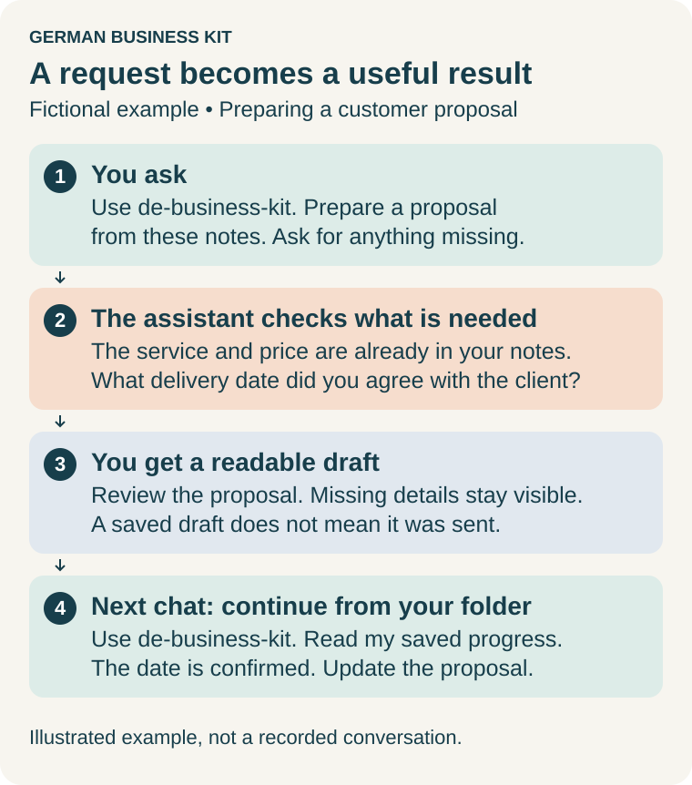

# User guide

**English** · [Русский](user-guide.ru.md) · [Deutsch: kurzer Einstieg](start.de.md)

**Work in Claude or Codex. Keep your business records and progress in one private folder.** German Business Kit helps you manage your own sole-trader business in Germany, from the first idea to everyday work, reporting, changes and closure. A separate records application is optional. Professional help is an option for a specific issue, not a required final step.

New here? [Install the complete kit](install.en.md). Then try one small task below.

For substantive work, use **Claude Opus 5.5 / High** or **GPT-6 Astra / High**
where available. Select this in the app's model/effort controls; the skill cannot
switch it for you. Simple explanations can use a lighter model.
[Choosing a model, usage limits and alternatives](install.en.md#choose-a-model).

**Before using real documents:** read [AI limits and your data](#ai-limits-and-your-data).
The kit is AI-assisted self-help, not professional tax advice; a local business
folder does not make model processing local-only.

## Call a skill

- **Claude Desktop / Cowork:** start a new task, type **/** or open **+**, and select **de-business-kit** from **German Business Kit**. Then write your request. You can select a specialist the same way.
- **Codex app:** open the project where the kit is installed and start a new chat. Write **“Use de-business-kit”** followed by your request. Codex also supports explicit skill references such as **`$de-business-kit`**; picker details vary by app version. Use **Skills** to check availability.
- **Claude Code:** with the plugin installed, use **`/de-business-kit:de-business-kit`** followed by your request.

The examples below name the skill in ordinary language so you can copy the whole request into either assistant. Selecting the skill first is another way to invoke it. If the skill is missing, follow [installation help](install.en.md#if-you-get-stuck); typing its name does not install it. You only need to remember `de-business-kit`: it can choose the specialist for you.

For work inside a website or installed app, the assistant may recommend enabling
an available browser/computer-use tool and its helper skill. Existing suitable
connections come first; ordinary questions and file work do not need screen access.
[Choose the right access and enable it](assisted-services.en.md#when-to-enable-browser-or-computer-tools).

## First task

Try this without private documents or a business folder:

> Use de-business-kit. This is a fictional example: I want to start working as a translator in Germany. Help me choose one small first step. Ask only what you need for that step.

**You get:** one understandable action and the facts needed to take it. You can say “I don't know” or “Explain that more simply.”

Choose another starting point when you are ready:

| You want to… | Copy this request | You get |
| --- | --- | --- |
| Start an activity | Use de-business-start. I want to offer [service] in Germany. Help me work out the next step, using what you already know about my other activities. | A practical next step or launch plan, with missing facts identified. |
| Prepare customer work | Use de-business-operations. Prepare an invoice from these agreed terms. Check what is missing and show me the draft before it is issued. | A readable draft and questions about missing details. |
| Organize receipts | Use de-business-accounting. Inspect the files in my selected business folder for October 2026. Show what is present, what needs checking and what is missing. | A document summary and a manageable review list. |
| Understand a letter | Use de-business-tax. Explain this Finanzamt letter in English, check the deadline and help me prepare a German reply. | An explanation, sourced deadline assessment and reply draft. |
| Estimate an amount | Use de-business-tax. Help estimate my income tax for 2026. First check what facts you need and what you already know. Research the applicable rules, calculate when the inputs are sufficient, and check the result independently. | Targeted questions followed by a sourced estimate, or a precise explanation of what is still missing. |
| Choose a service | Use de-business-services. Compare business accounts for my needs and existing services. Explain normal costs and restrictions before I choose. | A sourced comparison and the decisions that matter. |
| Change or close | Use de-business-changes. I want to [change, hire, pause or close]. Check what this affects, including my other activities, and prepare the next steps. | A plan with dependencies and outstanding obligations. |
| Continue | Use de-business-kit. Continue from my selected business folder. Read the saved progress and show the next useful action. | A summary of completed work, open issues and the next step. |

Replace bracketed text with your own details. You do not have to fill out a full questionnaire first. The assistant should clarify an ambiguous request, reuse relevant confirmed information and ask only for missing or outdated facts. Unrelated work can continue while a question is open.

## Continue a customer payment question

> Use de-business-operations. Read the saved customer case, invoice and payment evidence. Prepare a German reply and a separate English review of the amount still payable. Save the next action. Do not send or post anything.

The assistant compares the invoice’s gross, recorded prepayment, rounding and
amount due with the actual linked receipts. A payment already included in the
invoice must not be deducted twice. Missing allocation or correction evidence
stays open. When new evidence arrives, ask it to continue the same case: it should
save a new reply and review version while retaining earlier files and your chosen
invoicing system. Preparing a reply does not issue a correction or send a message.

## Check VAT before an EU goods purchase

> Use de-business-operations. I want to order [goods] from [country] for my German business. The goods will travel from [country] to Germany. My VAT regime is [Regelbesteuerung / Kleinunternehmer / unknown]. Check what I should clarify before ordering, including whether to use my USt-IdNr. Do not buy or contact the seller.

If the invoice has already arrived:

> Use de-business-accounting. This EU goods invoice includes VAT, and I did not provide my USt-IdNr. Check whose VAT it is, whether it can be deducted, and what I should do next. If appropriate, prepare a request for the seller to check a correction. Do not send or post anything.

The assistant should distinguish foreign invoice VAT, German acquisition tax and
deduction eligibility. For Kleinunternehmer, using an ID can have consequences
even when merely possessing it does not. A correction request is not a guaranteed
refund. Bring the invoice, goods route and known VAT-regime facts; the assistant
should ask only for missing details. See the [shared EU goods checks](../references/international.md#before-ordering-goods-from-another-eu-country).

## Issue, correct and confirm delivery

> Use de-business-operations. Continue this invoice in my chosen invoicing system. Prepare the exact invoice or correction, show its final files and recipient, and keep issue, sending and delivery confirmation separate. Save the current status and next step.

The assistant can prepare the supported service operation and retain its observed
result in your private folder. It keeps the original and correction, the reviewed
draft and actual issued file, and each sending attempt. A send log means sent;
delivery needs a receipt or customer acknowledgement. After a timeout it checks
the existing result before retrying. If you already issued or sent a document,
provide its actual file and status evidence: this is recorded as a past event,
without inventing earlier authorization. Sending, cancellation and other external
changes need authorization covering the concrete action and its effects.

For Lexware Office you can ask: “Prepare this draft in my existing Lexware company,
read it back and save the result. Keep finalization and sending separate.” An
opt-in adapter can create/read the draft with existing API access; creation already
uses an invoice number. It then helps continue the same invoice in the browser
for finalization and sending. No API access is required for the guided browser
route. Never paste an API key into chat or a business document.

The protected local commands and optional API adapter need an available Python runtime. The current GUI
and standalone native Windows tools have no invoice lifecycle controls; without
the writer, the assistant saves a readable continuation and helps with the chosen
service. One authorized zero-value browser test completed creation, readback,
finalization, sending and acknowledged receipt in an existing company. The API
adapter still has synthetic coverage only; live API acceptance and ordinary
nonzero invoices/corrections remain open. It does not assign numbers itself or
provide an email-send API.

## Keep your work in one folder

For ongoing work, choose a private permanent folder such as **My business**, separate from the downloaded kit, installed skills and any Git repository. Give your assistant access to that folder. In Codex, keep using the project where the skills are installed and also grant access to the business folder; opening a different project may hide project-local skills.

> Use de-business-kit. Use my selected business folder for ongoing work. Check what is already there. Save readable results, confirmed business facts, open questions and the next action so we can continue later. Before reading real personal documents, explain what content the AI service will receive.

The assistant manages the supporting records. Ask it to link the saved result; you should not have to edit technical files or remember internal IDs. It should distinguish facts you supplied, checked facts and assumptions, and ask before treating an uncertain interpretation as a lasting fact. When a fact changes, give the effective date if you know it.

A new folder has everyday areas for **Inbox, Documents, Accounts, Taxes and Business**. Folder names can be English, Russian or German. Keep an existing folder layout and its original files intact; ask the assistant to find documents by name, date or purpose. Changing conversation language does not rename folders.

## Where results are saved

The assistant resolves the folders in your actual workspace before saving. This
is a routing convention for readable files, not a new accounting system or a
promise that every request automatically produces a file. Existing documents keep
their location; the assistant should link them rather than reorganize them.

| Request | Usual destination in an English workspace |
| --- | --- |
| Ask a general question | Answer in chat. If you ask to save it, keep the note with the related topic below. |
| Plan a business or fill registration forms | `05 Business/Registration/`, with a small case folder only when needed. |
| Prepare a proposal, contract, invoice draft or customer reply | `05 Business/Correspondence/<case>/`; recipient files and private review notes are separate. Issued documents remain in the chosen invoicing system and preserved evidence. |
| Import receipts or supplied originals | `01 Inbox/` for initial selection, then preserved copies in `02 Documents/<year>/<month>/Originals/` through the import workflow. Processed copies appear separately when needed. |
| Compare banks or work with statements | `03 Accounts/Bank/`; accounting-system comparisons/working notes use `03 Accounts/Records/`. |
| Compare insurance/software other than accounting, or plan a connection | `05 Business/Correspondence/Services/<case>/`; readable findings only, never passwords or API keys. Existing service/source records are reused. |
| Ask a tax question, estimate, prepare a return or answer Finanzamt | `04 Taxes/<year>/`; link the relevant original, sources, draft and observed receipt where available. |
| Reconcile or prepare accounting reports/exports | `03 Accounts/Reports/`; these reports do not replace the chosen ledger or a full backup. |
| Change, hire, pause or close | Keep a plan in `05 Business/Registration/<case>/`, related letters in Correspondence and tax material in the relevant tax year. Link the parts from one existing task. |

`<case>`, `<year>` and `<month>` are placeholders, not folder names to type.
Case names can use your language. Standard folders also support Russian/German;
older workspaces may retain technical names. The assistant follows the saved
mapping, not the language of the latest message. Months are storage periods,
not evidence of the tax period or payment date.

Tasks, open questions, confirmed facts and history remain in the shared internal
records. A case note links these records and files; it is not a second checklist
or profile. Several activities use the same entrepreneur profile, with the activity
identified in the task/file. Ask for a link to the result and next action; do not
manually rename managed folders, move preserved originals or edit internal JSON.

> Use de-business-kit. Save this result with its topic, reuse the existing case if there is one, keep earlier versions, and show me the file and next action.

For a backup, include the entire workspace, including `.business-kit` and
`.workspace-layout.json`, and choose a separate protected destination. A change
of chat language or a skill update must not reorganize existing folders.

## Documents

> Use de-business-accounting. Look at the selected documents, show which ones belong to this task, and organize them. Keep the originals and show extracted amounts and dates for my review.

**You get:** links to preserved documents, a summary of what was processed and questions about unclear items. For email or a service, name the source and period. The assistant checks actual access and can work from selected exports when a connection is unavailable.

For a correction or partial payment, supply the earlier invoice and relevant payment/correction documents. Ask to continue the same case so earlier versions and unsettled differences stay visible.

## Accounts and payments

> Use de-business-accounting. Prepare October 2026 in my existing accounting system. Show missing receipts, unmatched payments, fees and refunds. Ask before changing where I keep my accounts.

**You get:** a readable period review based on the records actually checked. Your chosen accounting software remains the main record. If you prefer local records, the kit has a limited cash journal; the assistant should explain what it can record and what your particular reporting task still needs.

For calculations, ask it to distinguish recorded amounts from tax treatment, verify applicable rules and inputs, run the arithmetic and show its checks. A cash total alone does not establish taxable profit or a complete return. [Detailed monthly workflow](../references/monthly-workflow.md).

Select **de-business-accounting** and ask: “Prepare October from these receipts
in my business folder. Save what belongs to this period, what belongs elsewhere
and what is still missing.” You get preserved originals, draft proposals and a
readable review separating payment/profit timing from VAT timing. Unknown private
use or asset treatment stays open. Your selected accounting software remains
authoritative; preparation does not itself post entries or complete the month.

## Taxes and letters

> Use de-business-tax. For this question, first check the relevant period and facts already saved. Ask me for what is missing, research the applicable official rules, and explain the result and next step in plain language.

**You get:** an answer with sources, a reviewed calculation where supported, or a draft letter/form. Calculations can use an appropriate official tool, your selected software, or a bounded calculation based on researched rules. The assistant should show assumptions, actual execution and a separate check; it must say when a rule, input or check is unresolved.

For work inside ELSTER or accounting software, see [assisted forms and services](assisted-services.en.md). You handle login and any final action you reserve for yourself. The assistant shows the concrete material before an external action and preserves the observed outcome afterwards.

To prepare a prepayment adjustment, select **de-business-tax** and ask:

> Help me reduce my income-tax prepayments using this notice and forecast. Save the German request and an English review in my business folder so we can continue later.

**You get:** a saved draft, the proposed amount alongside the amount still due under
the current notice, calculation/source evidence and a next step. The assistant asks
only for missing facts that affect this work. In a new chat, give access to the same
folder and ask it to continue with your corrected forecast. It should save a linked
revision and preserve the earlier draft. A prepared or sent request does not itself
change the Finanzamt's notice. [Workflow details](../references/tax-consultant.md#prepare-or-revise-an-income-tax-prepayment-request).

## Reports

> Use de-business-kit. Save a readable result with the answer, open questions and next action. Link the file. Keep a document for a recipient separate from my private notes.

**You get:** an ordinary readable document. HTML can open in your browser; PDF, Word or spreadsheet output depends on available tools. English and Russian report templates are included. German recipient documents can have a separate explanation in your language.

## Continue

For a saved return, select **de-business-tax** and ask: “Continue this filing from
my business folder. Check the saved version and changed evidence, and prepare the
next step without submitting.” The assistant reads the actual filing state and
shows its blockers. Authorized corrections create linked versions; an uncertain
submission needs outcome evidence before any retry. Preparation reports retain
their underlying evidence when frozen into a filing; a worksheet is supporting
material, not a completed official return.

Before finishing a substantial task, ask:

> Use de-business-kit. Save the result, confirmed decisions, open questions and next step in my business folder. Show me what was saved and what is still unfinished.

Next time, give the assistant access to **the same folder**, select the installed skill and send:

> Use de-business-kit. Continue from [my business folder]. Read the saved facts and progress first. Check what changed, ask only for missing information, and help with the next step.

Do not rely on the old chat alone for continuity. Updates to skills and changes of conversation language should leave your business records intact. Tell the assistant about changed circumstances; earlier drafts and decisions stay in history. A saved deadline is not an automatic reminder.

## Backups

> Use de-business-kit. Create and verify a complete backup of my business folder at [separate protected location]. Show the result.

To test recovery:

> Use de-business-kit. Restore this backup into a new folder and verify it. Keep the existing folder and backup intact.

A complete backup includes original documents, saved progress and internal history. Keep both copies until you have checked the restored folder. [Backup and recovery details](../references/recovery.md).

## Help

| Problem | What to ask |
| --- | --- |
| Too much jargon | Use de-business-kit. Explain this simply and give me only the next useful step. |
| Repeated questions | Use de-business-kit. Read the saved information in my business folder first. Tell me which fact is missing or needs updating. |
| No access to a file | Use de-business-kit. Check access to this selected folder and explain the smallest access change needed. |
| A tool or runtime is missing | Use de-business-kit. Use available tools and continue the parts you can. Explain the specific blocked step before proposing any installation. |
| A file or status seems wrong | Use de-business-kit. Inspect the saved record and original files. Explain the discrepancy before making a correction; preserve previous versions. |

## Check your own environment

The normal route is your assistant plus your business folder. The optional records app offers forms for some local operations; you can use the skills without it. Ask for one small fictional trial to check what your actual assistant can do. Installation alone does not connect email, banking or tax services.

For technical help with standalone Windows tools, see [native Windows capabilities](../references/native-windows.md). Some protected accounting/filing operations need an already available supported runtime. The assistant should explain a specific unavailable operation instead of requiring another application for every task.

## AI limits and your data

### This is assistance, not a tax-advisory service

German Business Kit is AI-assisted self-help software. It is not a Steuerberater,
a professional tax-advisory or legal service, and using it does not create an
adviser–client relationship. Answers, drafts and estimates are preparation for
your decisions, not binding professional advice or an authority's decision.

AI can misread documents, miss relevant facts, invent sources or apply the wrong
year's rules. Calculations, translations and deadline assessments can be wrong
even with a capable model and High effort. Check original documents, applicable
sources, inputs and calculation checks before relying on a result. Review any
form, letter or payment before an external action; a polished draft is not proof
of submission or acceptance. For a material decision or unresolved tax/legal
uncertainty, seek qualified help for that specific issue. You can still organize
your own records and prepare questions or drafts independently.

### A private folder is not local-only AI

When your assistant reads files, relevant text, images, screenshots and tool
results can be included in requests to its model provider. OpenAI-hosted Codex
uses OpenAI services; Anthropic-hosted Claude uses Anthropic services. Cloud
sessions, chats and logs may retain content separately from your local folder.
Connected banks, email, storage, OCR or other tools add their own processing routes
and terms. Access to a folder is not evidence that every file has been uploaded,
but do not assume content already read by the assistant stayed on your computer.

Installing this static kit does not by itself give its author access to your
business documents. That is separate from processing by your AI provider or any
service you connect. Deleting a local file does not delete provider chats, copies
or logs; review the actual service's retention and deletion controls.

### Check the account you actually use

Training rules differ between products and plans. **No training does not mean
no processing, storage, security review or retention.** A paid personal plan is
not automatically a business data-processing agreement. Before customer or
employee data, check the purpose, permitted processing, confidentiality duties,
provider contract/DPA where applicable, retention, location/transfers and settings
for the actual route. A checkbox or this guide is not a GDPR compliance certificate.

Provider policy summary checked **26 October 2026**; revisit the linked terms
for your actual account before sharing real records.

| Service/account | Training and controls to check |
| --- | --- |
| OpenAI personal ChatGPT/Codex | Personal Free/Plus/Pro workspaces have model-improvement sharing on by default. Inspect **Settings → Data controls → Improve the model for everyone**; switching it off covers new ChatGPT conversations and Codex tasks. Codex **Include environments** is a separate control to inspect. [OpenAI data controls](https://help.openai.com/en/articles/7730893-data-controls-in-chatgpt). |
| OpenAI Business/Enterprise/API | No model training by default; explicit sharing opt-ins can change this. Storage, security monitoring and retention still depend on the service/feature and contract. [Business data](https://openai.com/business-data/), [API controls](https://developers.openai.com/api/docs/guides/your-data), [DPA](https://openai.com/policies/data-processing-addendum/). |
| Anthropic personal Claude Free/Pro/Max, including Code with these accounts | Training depends on the model-improvement choice in **Privacy** settings; safety-review, feedback and other opt-in provisions also matter. Do not assume a paid personal plan excludes all training or review. [Consumer policy](https://privacy.claude.com/en/articles/10023580-is-my-data-used-for-model-training). |
| Anthropic commercial Claude / API | No training by default, with explicit feedback/reporting and other opt-in exceptions. Confirm the actual commercial agreement and processing route, especially access through another platform. [Commercial policy](https://privacy.claude.com/en/articles/7996868-is-my-data-used-for-model-training), [DPA](https://support.claude.com/en/articles/7996862-how-do-i-view-and-sign-your-data-processing-addendum-dpa). |

Your settings are not inspected or changed by reading this guide. Product names,
controls and policies can change. For details about cloud/local execution and
separate logs, see [Cowork architecture](https://support.claude.com/en/articles/14479288-claude-cowork-architecture-overview)
and [Claude Code data usage](https://code.claude.com/docs/en/data-usage).

### Share only what the task needs

1. Try fictional details first. For real work, give access only to the needed files
   or folder and check the account's data controls before the assistant reads them.
2. Remove unnecessary identifiers and sensitive details in a **local copy before
   model access**. Asking AI to read a full document and then redact it has already
   shared the original content. Keep the original intact in protected storage.
3. Do not paste passwords, API keys, tax-portal certificates, TANs or recovery codes.
   Sign in through the official service. Medical records, employee files and other
   sensitive documents need particular care; a task may only need a few fields.
4. Treat connected tools, feedback submissions, shared chat links and support
   uploads as additional disclosures. Review their destination and content.

You can ask before providing documents:

> Use de-business-kit. Before reading my real documents, explain which data would go to which provider or connected service, what account settings matter, and what I can remove locally. If you cannot verify a setting, say so. Start with a fictional example.

The assistant should explain relevant limits when you first need them and when
the processing route changes, without repeating a long warning on every request.

## What to keep in mind

- **You manage your own work.** The kit supports independent business administration; a specialist can help with a particular unresolved issue. It does not confer licensed-adviser status.
- **Calculations have a scope.** A researched and checked estimate is not a complete statutory return or a tax assessment. The kit has no bundled complete tax engine or direct ELSTER transmission.
- **A draft and a completed action differ.** Review the material before it is issued, posted or sent; keep actual receipts and responses. Unclear outcomes need checking before a retry.
- **Local files can be processed by an AI service.** Share only appropriate content and use official login screens for passwords, certificates and TANs.
- **This is a preview.** Supported tools vary by host. The assistant must name unfinished work and preserve your originals rather than claim success from a polished report.

Invocation guidance checked against [Anthropic plugin help](https://support.claude.com/en/articles/13837440-use-plugins-in-claude), [plugin commands](https://claude.com/docs/plugins/overview) and [OpenAI skills documentation](https://learn.chatgpt.com/docs/build-skills) on **2026-10-26**. This source check is not a desktop usability trial.
