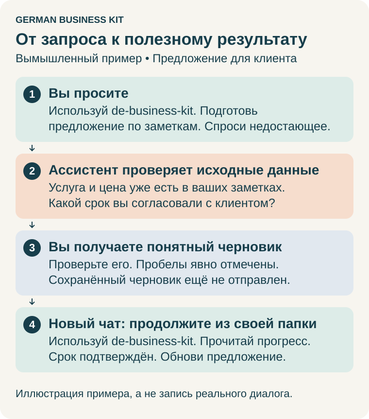

# Руководство пользователя

[English](user-guide.en.md) · **Русский** · [Deutsch: kurzer Einstieg](start.de.md)

**Работайте в Claude или Codex. Храните документы и ход работы в одной личной папке.** German Business Kit помогает самостоятельно вести индивидуальный бизнес в Германии: от первой идеи до повседневных задач, отчётности, изменений и закрытия. Отдельное приложение для записей необязательно. Специалист может помочь с конкретным вопросом, но обращение к нему не является обязательным последним шагом.

Впервые здесь? [Установите полный набор](install.ru.md), затем попробуйте одну небольшую задачу.

Для содержательной работы используйте **Claude Opus 5.5 / High** или
**GPT-6 Astra / High**, если они доступны. Выберите модель и уровень в настройках
приложения; скилл не переключает их за вас. Для простых объяснений подойдёт более
лёгкая модель. [Выбор модели, лимиты и альтернативы](install.ru.md#выберите-модель).

**Перед работой с настоящими документами:** прочитайте
[об ограничениях AI и данных](#ограничения-ai-и-ваши-данные). Набор помогает работать
самостоятельно с AI и не предоставляет профессиональные налоговые консультации;
личная папка на компьютере не означает, что модель обрабатывает данные локально.

## Как вызвать скилл

- **Claude Desktop / Cowork:** начните новую задачу, введите **/** или откройте **+** и выберите **de-business-kit** из **German Business Kit**. Затем напишите запрос. Так же можно выбрать профильный скилл.
- **Приложение Codex:** откройте проект с установленным набором и начните новый чат. Напишите **«Используй de-business-kit»**, затем свой запрос. Codex также поддерживает явные ссылки на скиллы, например **`$de-business-kit`**; меню выбора зависит от версии приложения. Наличие скиллов можно проверить через **Skills**.
- **Claude Code:** если установлен плагин, используйте **`/de-business-kit:de-business-kit`**, затем свой запрос.

В примерах ниже скилл назван обычными словами: запрос целиком можно скопировать в любой из двух ассистентов. Другой вариант — сначала выбрать скилл в меню. Если его нет, откройте [помощь с установкой](install.ru.md#если-что-то-не-получается): ввод названия не устанавливает скилл. Достаточно запомнить `de-business-kit`: он поможет выбрать нужный профильный скилл.

Для работы внутри сайта или приложения ассистент может предложить включить
доступный инструмент браузера/компьютера и его вспомогательный скилл. Сначала
проверяются подходящие существующие подключения; обычным вопросам и файлам
доступ к экрану не нужен. [Как выбрать и включить доступ](assisted-services.ru.md#когда-включать-браузер-или-управление-компьютером).

## Первая задача

Попробуйте без личных документов и рабочей папки:

> Используй de-business-kit. Это вымышленный пример: я хочу начать работать переводчиком в Германии. Помоги выбрать один небольшой первый шаг. Спрашивай только то, что нужно для этого шага.

**Результат:** одно понятное действие и сведения, нужные для него. Можно ответить «Не знаю» или «Объясни проще».

Когда будете готовы, выберите другую задачу:

| Вы хотите… | Скопируйте запрос | Что получите |
| --- | --- | --- |
| Открыть деятельность | Используй de-business-start. Я хочу предлагать [услугу] в Германии. Помоги определить следующий шаг с учётом того, что уже известно о других моих видах деятельности. | Практический следующий шаг или план открытия с недостающими сведениями. |
| Подготовить документ клиенту | Используй de-business-operations. Подготовь счёт по этим согласованным условиям. Проверь, чего не хватает, и покажи черновик до выставления. | Понятный черновик и вопросы о недостающих деталях. |
| Разобрать чеки | Используй de-business-accounting. Посмотри файлы за октябрь 2026 в выбранной папке бизнеса. Покажи, что есть, что нужно проверить и чего не хватает. | Обзор документов и понятный список для проверки. |
| Понять письмо | Используй de-business-tax. Объясни это письмо из Finanzamt по-русски, проверь срок и помоги подготовить ответ на немецком. | Объяснение, проверка срока по источникам и черновик ответа. |
| Оценить сумму | Используй de-business-tax. Помоги оценить мой подоходный налог за 2026 год. Сначала проверь, какие сведения нужны и что уже известно. Найди применимые правила, рассчитай при достаточных данных и независимо проверь результат. | Уточняющие вопросы, затем расчёт с источниками или точное объяснение, чего ещё не хватает. |
| Выбрать сервис | Используй de-business-services. Сравни бизнес-счета с учётом моих потребностей и существующих сервисов. До выбора объясни обычную стоимость и ограничения. | Сравнение по источникам и важные для выбора вопросы. |
| Изменить или закрыть | Используй de-business-changes. Я хочу [изменить деятельность, нанять сотрудника, приостановить или закрыть бизнес]. Проверь последствия, включая другие мои виды деятельности, и подготовь следующие шаги. | План с зависимостями и незавершёнными обязательствами. |
| Продолжить | Используй de-business-kit. Продолжи работу в выбранной папке бизнеса. Прочитай сохранённый ход работы и покажи следующее полезное действие. | Что выполнено, что осталось открытым и следующий шаг. |

Замените текст в скобках своими сведениями. Заполнять полную анкету заранее не нужно. Ассистент должен уточнить неоднозначный запрос, использовать подтверждённые сведения и спрашивать только о недостающих или устаревших фактах. Независимая работа может продолжаться, пока вопрос открыт.

## Продолжить вопрос об оплате клиента

> Используй de-business-operations. Прочитай сохранённое дело клиента, счёт и подтверждения оплаты. Подготовь ответ на немецком и отдельное русское пояснение о сумме к оплате. Сохрани следующий шаг. Ничего не отправляй и не проводи в учёте.

Ассистент сопоставляет брутто, указанную предоплату, округление и сумму к оплате
в счёте с фактически связанными поступлениями. Уже учтённый платёж нельзя вычитать
дважды. Неясное распределение или неподтверждённое исправление остаётся открытым.
Когда появятся новые сведения, попросите продолжить то же дело: новая версия
ответа и пояснения сохраняет прежние файлы и выбранную систему выставления счетов.
Подготовка ответа не означает выставление исправления или отправку сообщения.

## Проверьте НДС перед покупкой товара из ЕС

> Используй de-business-operations. Хочу заказать [товар] у продавца из [страны] для немецкого бизнеса. Товар доставят из [страны] в Германию. Мой режим НДС — [Regelbesteuerung / Kleinunternehmer / не знаю]. Проверь, что уточнить до заказа, в том числе нужно ли использовать USt-IdNr. Ничего не покупай и не связывайся с продавцом.

Если счёт уже пришёл:

> Используй de-business-accounting. В этом счёте за товар из ЕС есть НДС, а USt-IdNr. я не сообщил. Проверь, чей это НДС, можно ли его вычесть и что делать дальше. Если применимо, подготовь запрос продавцу о проверке возможности исправления счёта. Ничего не отправляй и не проводи.

Ассистент должен разделять иностранный НДС в счёте, немецкий налог на приобретение
и право на вычет. Для Kleinunternehmer использование номера может иметь
последствия, даже если само его наличие их не вызывает. Запрос об исправлении
не гарантирует возврат денег. Передайте счёт, маршрут товара и известный режим
НДС; ассистент должен спросить только недостающие детали. См. [общие проверки покупок из ЕС](../references/international.md#before-ordering-goods-from-another-eu-country).

## Выставить, исправить и подтвердить доставку

> Используй de-business-operations. Продолжи работу со счётом в выбранной системе. Подготовь конкретный счёт или исправление, покажи итоговые файлы и получателя. Разделяй выставление, отправку и подтверждение доставки. Сохрани текущий статус и следующий шаг.

Ассистент готовит поддерживаемую операцию сервиса и сохраняет наблюдаемый результат
в личной папке. Оригинал и исправление, проверенный черновик и итоговый файл,
а также каждая попытка отправки остаются отдельно. Журнал отправки означает
«отправлено»; для доставки нужно подтверждение получения или ответ клиента.
После тайм-аута проверяется существующий результат до повтора. Если вы уже
выставили или отправили документ, предоставьте фактический файл и подтверждение
статуса: прошлое событие записывается без выдуманного прежнего разрешения.
Отправка, отмена и другие внешние изменения требуют разрешения на конкретное
действие и его последствия.

До платной настройки ассистент проверяет возможности текущего тарифа и объясняет
дополнительные расходы, условия оплаты/пробного периода и неизвестную стоимость.
Прежде чем предложить переход, он показывает доступный путь на текущем тарифе
либо через файлы/ручные действия. «Проверь подключение» не разрешает расходы.
Если вы отказались от перехода, решение сохраняется и доступная работа продолжается
без повторных предложений повысить тариф.

Для Lexware Office можно попросить: «Подготовь черновик в моей существующей
компании Lexware, прочитай его обратно и сохрани результат. Выставление и отправку
оставь отдельными действиями». Необязательный адаптер создаёт/читает черновик при
существующем API-доступе; создание уже расходует номер счёта. Затем ассистент
помогает продолжить тот же счёт в браузере для выставления и отправки. Для
пошаговой помощи через браузер API-доступ не требуется. Не вставляйте API-ключ
в чат или документ бизнеса.

Защищённые локальные команды и необязательный API-адаптер требуют доступного Python. В текущем GUI и отдельных
native-инструментах Windows нет контролов этого сценария; без writer ассистент
сохраняет понятное продолжение и помогает работать с выбранным сервисом. Один
разрешённый нулевой браузерный тест в существующей компании прошёл создание,
чтение, выставление, отправку и подтверждение получения. API-адаптер пока имеет
только синтетическое покрытие; живая приёмка API и обычные ненулевые счета/исправления
открыты. Сам он не назначает номера и не предоставляет API отправки email.

Отдельный тест на текущем тарифе также проверил исправление текста черновика,
сохранение/повторное открытие и предпросмотр; нулевой счёт не выставлен и не отправлен.
Также проверена выгрузка PDF-черновика: в диалоге печати выберите **Als Entwurf drucken**
и проверьте ту же подпись кнопки. **Fertigstellen + drucken** по умолчанию выставит счёт.

Также проверен отдельный нулевой черновик ручной Rechnungskorrektur: сохранение/
повторное открытие, правка текста с независимым чтением, предпросмотр и PDF-черновик.
После явного разрешения та же корректировка выставлена, независимо прочитана,
итоговый PDF проверен; она осталась неотправленной. Оригинал не отменён.
Ссылка на оригинал введена текстом; это не подтверждает связь у провайдера или возврат.
См. [маршрут исправления](../references/lexware.md#prepare-and-verify-a-correction):
проверку статуса/меню и границу перед выставлением или отменой.

## Одна папка для вашей работы

Для постоянной работы выберите личную папку, например **Мой бизнес**, отдельно от скачанного набора, установленных скиллов и Git-репозиториев. Дайте ассистенту доступ к этой папке. В Codex продолжайте использовать проект с установленными скиллами и отдельно предоставьте доступ к папке бизнеса: в другом проекте локальные скиллы могут не отображаться.

> Используй de-business-kit. Используй выбранную папку бизнеса для постоянной работы. Проверь, что уже есть. Сохраняй понятные результаты, подтверждённые сведения о бизнесе, открытые вопросы и следующий шаг, чтобы можно было продолжить позже. Перед чтением настоящих персональных документов объясни, какие данные получит AI-сервис.

Ассистент ведёт вспомогательные записи. Просите ссылку на сохранённый результат: редактировать технические файлы и помнить внутренние ID не требуется. Он должен отличать сообщённые вами сведения, проверенные факты и предположения, а перед сохранением неоднозначного вывода как постоянного факта — уточнить его. Если факт изменился, по возможности укажите дату изменения.

В новой папке есть повседневные разделы **Входящие, Документы, Учёт, Налоги и Бизнес**. Названия можно выбрать на русском, английском или немецком. Сохраняйте существующую структуру и оригиналы; просите ассистента найти документ по названию, дате или назначению. Смена языка разговора не переименовывает папки.

## Куда сохраняются результаты

Перед сохранением ассистент определяет пути в вашей фактической рабочей папке.
Это правило размещения читаемых файлов, а не новая система учёта или обещание
автоматически создавать файл для любого запроса. Существующие документы остаются
на месте; ассистент должен дать ссылки, а не начинать переорганизацию.

| Запрос | Обычное место в русской рабочей папке |
| --- | --- |
| Задать общий вопрос | Ответ в чате. Если попросите сохранить, заметка остаётся с соответствующей темой ниже. |
| Спланировать бизнес или заполнить регистрационную форму | `05 Бизнес/Регистрация/`; небольшая подпапка дела — только по необходимости. |
| Подготовить предложение, договор, черновик счёта или ответ клиенту | `05 Бизнес/Переписка/<дело>/`; документы получателю отделены от личных заметок проверки. Выставленные документы остаются в выбранной системе и сохранённых доказательствах. |
| Импортировать чеки или исходные документы | Сначала выбор в `01 Входящие/`, затем сохранённые копии в `02 Документы/<год>/<месяц>/Оригиналы/` через процедуру импорта. Обработанные копии появляются отдельно по необходимости. |
| Сравнить банки или разобрать выписки | `03 Учёт/Банк/`; сравнения бухгалтерских систем и рабочие заметки — в `03 Учёт/Записи/`. |
| Сравнить страховки/небухгалтерские программы или подготовить подключение | `05 Бизнес/Переписка/Услуги/<дело>/`; понятные выводы, без паролей и API-ключей. Существующие записи об услугах и источниках используются повторно. |
| Разобрать налоговый вопрос, оценить сумму, подготовить декларацию или ответ Finanzamt | `04 Налоги/<год>/`; ссылки на оригинал, источники, черновик и фактическую квитанцию, если она есть. |
| Выполнить сверку или подготовить учётный отчёт/выгрузку | `03 Учёт/Отчёты/`; отчёты не заменяют выбранную систему учёта или полную резервную копию. |
| Изменить деятельность, нанять, приостановить или закрыть | План в `05 Бизнес/Регистрация/<дело>/`, связанные письма — в Переписке, налоговые материалы — в нужном налоговом году. Части связаны одной существующей задачей. |

`<дело>`, `<год>` и `<месяц>` — обозначения, а не буквальные названия папок.
Названия дел могут быть на вашем языке. Стандартные папки поддерживают также
английский/немецкий; в старых пространствах могут остаться технические названия.
Ассистент использует сохранённую карту, а не язык последнего сообщения. Месяц
хранения сам по себе не определяет налоговый период или дату оплаты.

Задачи, открытые вопросы, подтверждённые факты и история остаются в общих внутренних
записях. Заметка по делу ссылается на них и файлы; это не второй список задач или
профиль. Разные деятельности используют один профиль предпринимателя; нужная
деятельность указана в задаче/файле. Просите ссылку на результат и следующий шаг;
не переименовывайте управляемые папки, не перемещайте сохранённые оригиналы
и не редактируйте внутренний JSON вручную.

> Используй de-business-kit. Сохрани результат рядом с его темой, используй существующее дело, если оно есть, сохрани прежние версии и покажи файл и следующий шаг.

В резервную копию включайте всё пространство, в том числе `.business-kit` и
`.workspace-layout.json`, и выбирайте отдельное защищённое место. Изменение языка
разговора или обновление скилла не должно переорганизовывать существующие папки.

## Документы

> Используй de-business-accounting. Посмотри выбранные документы, покажи, какие относятся к задаче, и разложи их. Сохрани оригиналы и покажи извлечённые суммы и даты для моей проверки.

**Результат:** ссылки на сохранённые документы, список обработанного и вопросы о неясных данных. Для почты или сервиса назовите источник и период. Ассистент проверит доступ и сможет работать с выбранными выгрузками, если подключения нет.

Для исправления или частичной оплаты предоставьте прежний счёт и документы оплаты или корректировки. Просите продолжить то же дело, чтобы прежние версии и неурегулированные расхождения оставались видны.

## Учёт и платежи

> Используй de-business-accounting. Подготовь октябрь 2026 в моей существующей бухгалтерской программе. Покажи недостающие чеки, несопоставленные платежи, комиссии и возвраты. Спроси перед сменой места ведения учёта.

**Результат:** понятный обзор периода на основе фактически проверенных записей. Выбранная бухгалтерская программа остаётся основным местом учёта. Если вы предпочитаете локальные записи, в наборе есть ограниченный денежный журнал; ассистент объяснит, что он позволяет записывать и что ещё нужно для вашей отчётности.

Для расчётов просите отличать записанные суммы от налоговой трактовки, проверять применимые правила и входные данные, выполнять арифметику и показывать проверки. Итог денежных операций сам по себе не определяет налогооблагаемую прибыль или полную декларацию. [Подробный порядок работы за месяц](../references/monthly-workflow.md).

Выберите **de-business-accounting** и попросите: «Подготовь октябрь по этим документам
в моей папке бизнеса. Сохрани, что относится к этому периоду, что — к другому и
чего ещё не хватает». Результат — сохранённые оригиналы, предложения для проверки
и понятный отчёт, разделяющий даты платежей/учёта прибыли и НДС. Неизвестная доля
личного использования или порядок учёта актива остаются открытыми. Выбранная
бухгалтерская программа остаётся основной; подготовка сама по себе не проводит
операции и не завершает месяц.

## Налоги и письма

> Используй de-business-tax. Для этого вопроса сначала проверь нужный период и уже сохранённые факты. Спроси, чего не хватает, найди применимые официальные правила и объясни результат и следующий шаг простыми словами.

**Результат:** ответ с источниками, проверенный расчёт в доступном объёме или черновик письма/формы. Можно использовать подходящий официальный инструмент, выбранную программу или ограниченный расчёт по исследованным правилам. Ассистент должен показать предположения, фактическое выполнение и отдельную проверку, а также назвать непроверенное правило, недостающие данные или невыполненную проверку.

Для работы в ELSTER или бухгалтерской программе откройте [помощь с формами и сервисами](assisted-services.ru.md). Вход и выбранное вами финальное действие остаются за вами. Перед внешним действием ассистент показывает конкретные материалы, а после сохраняет фактический результат.

Чтобы подготовить изменение авансов, выберите **de-business-tax** и попросите:

> Помоги уменьшить авансовые платежи по подоходному налогу на основании этого уведомления и прогноза. Сохрани немецкий запрос и русское пояснение в моей папке бизнеса, чтобы продолжить позже.

**Результат:** сохранённый черновик, предлагаемая сумма рядом с суммой к уплате по
действующему уведомлению, расчёт с источниками и следующий шаг. Ассистент уточняет
только недостающие сведения, влияющие на эту работу. В новом чате дайте доступ к той
же папке и попросите продолжить с исправленным прогнозом. Ассистент должен сохранить
связанную новую версию и оставить прежний черновик. Подготовка или отправка запроса
сама по себе не меняет уведомление Finanzamt. [Подробный порядок](../references/tax-consultant.md#prepare-or-revise-an-income-tax-prepayment-request).

## Отчёты

> Используй de-business-kit. Сохрани понятный результат с ответом, открытыми вопросами и следующим шагом. Дай ссылку на файл. Документ для получателя храни отдельно от моих личных заметок.

**Результат:** обычный читаемый документ. HTML открывается в браузере; PDF, Word или таблица зависят от доступных инструментов. В наборе есть русские и английские шаблоны отчётов. Документ для немецкого получателя может сопровождаться отдельным объяснением на вашем языке.

## Продолжение работы

Для сохранённой декларации выберите **de-business-tax** и попросите: «Продолжи эту
подачу из моей папки бизнеса. Проверь сохранённую версию и изменившиеся документы,
подготовь следующий шаг без отправки». Ассистент читает фактическое состояние и
показывает препятствия. Разрешённые исправления создают связанные версии; при
неопределённой отправке сначала нужно подтверждение результата, а затем решение
о повторе. При фиксации в версии подачи отчёты подготовки сохраняют исходные
доказательства; рабочий лист — вспомогательный материал, не готовая декларация.

Перед завершением существенной задачи попросите:

> Используй de-business-kit. Сохрани результат, подтверждённые решения, открытые вопросы и следующий шаг в моей папке бизнеса. Покажи, что сохранено и что ещё не закончено.

В следующий раз дайте доступ к **той же папке**, выберите установленный скилл и отправьте:

> Используй de-business-kit. Продолжи из [моей папки бизнеса]. Сначала прочитай сохранённые факты и ход работы. Проверь, что изменилось, спроси только недостающие сведения и помоги со следующим шагом.

Для продолжения не полагайтесь только на старый чат. Обновление скиллов и смена языка разговора должны сохранять документы бизнеса. Сообщайте об изменившихся обстоятельствах; прежние черновики и решения остаются в истории. Сохранённый срок не является автоматическим напоминанием.

## Резервные копии

> Используй de-business-kit. Создай и проверь полную резервную копию моей папки бизнеса в [отдельном защищённом месте]. Покажи результат.

Для проверки восстановления:

> Используй de-business-kit. Восстанови эту копию в новую папку и проверь её. Сохрани существующую папку и резервную копию.

Полная копия включает оригиналы, ход работы и внутреннюю историю. Храните обе копии, пока не проверите восстановленную папку. [Подробности копирования и восстановления](../references/recovery.md).

## Помощь

| Проблема | Что спросить |
| --- | --- |
| Слишком много терминов | Используй de-business-kit. Объясни проще и дай только следующий полезный шаг. |
| Повторные вопросы | Используй de-business-kit. Сначала прочитай сохранённые сведения в папке бизнеса. Скажи, какого факта не хватает или что нужно обновить. |
| Нет доступа к файлу | Используй de-business-kit. Проверь доступ к выбранной папке и объясни минимальное нужное изменение доступа. |
| Не хватает инструмента или среды | Используй de-business-kit. Используй доступные средства и продолжай возможную работу. Объясни конкретный недоступный шаг до предложения что-либо установить. |
| Файл или состояние выглядит неверно | Используй de-business-kit. Проверь сохранённую запись и оригиналы. Объясни расхождение до исправления; сохрани прежние версии. |

## Что проверить на своём компьютере

Обычный путь — ассистент и папка бизнеса. Необязательное приложение для записей предлагает формы для некоторых локальных операций; скиллы работают и без него. Попросите небольшой вымышленный пример, чтобы проверить возможности вашего ассистента. Установка сама по себе не подключает почту, банк или налоговые сервисы.

Технические подробности отдельных инструментов Windows — в [описании нативных возможностей](../references/native-windows.md). Некоторым защищённым операциям учёта и подач нужна уже доступная поддерживаемая среда. Ассистент должен объяснить конкретную недоступную операцию, а не требовать отдельное приложение для каждой задачи.

## Ограничения AI и ваши данные

### Помощь, а не сервис налогового консультирования

German Business Kit — инструмент самостоятельной работы с AI. Это не
Steuerberater, не профессиональный налоговый или юридический сервис;
использование набора не создаёт отношений консультанта и клиента. Ответы,
черновики и оценки помогают готовить ваши решения, но не являются обязательным
профессиональным заключением или решением ведомства.

AI может неверно прочитать документ, упустить факты, выдумать источник или
применить правила другого года. Расчёты, переводы и определение сроков могут
оказаться ошибочными даже с мощной моделью и уровнем High. Перед использованием
результата сверяйте оригиналы, применимые источники, исходные данные и проверки
расчётов. Проверьте форму, письмо или платёж до внешнего действия: аккуратный
черновик не подтверждает отправку или принятие. Для существенного решения или
неразрешённой налоговой/юридической неопределённости обратитесь к квалифицированному
специалисту по этому вопросу. Организовывать собственные записи и готовить вопросы
или черновики можно самостоятельно.

### Личная папка не означает локальный AI

Когда ассистент читает файлы, нужный текст, изображения, снимки экрана и результаты
инструментов могут включаться в запросы провайдеру модели. Codex на сервисах OpenAI
использует OpenAI; Claude на сервисах Anthropic — Anthropic. Облачные сеансы,
чаты и журналы могут хранить содержимое отдельно от вашей папки. Подключённые
банки, почта, хранилища, OCR и другие инструменты добавляют собственные маршруты
обработки и условия. Доступ к папке не доказывает загрузку каждого файла, но нельзя
считать, что уже прочитанное ассистентом осталось только на вашем компьютере.

Сама установка этого статического набора не даёт его автору доступ к документам
бизнеса. Обработка AI-провайдером и подключёнными сервисами — отдельный вопрос.
Удаление локального файла не удаляет чаты, копии или журналы провайдера;
проверьте правила хранения и удаления конкретного сервиса.

### Проверьте свой фактический аккаунт

Правила обучения различаются по продуктам и тарифам. **Отсутствие обучения не
означает отсутствие обработки, хранения или проверки безопасности.** Платный
личный тариф не равнозначен договору обработки данных для бизнеса. Перед передачей
данных клиентов или сотрудников проверьте цель, допустимость обработки,
обязанности конфиденциальности, договор/DPA при необходимости, хранение,
местонахождение/передачу данных и настройки конкретного маршрута. Галочка или это
руководство не являются сертификатом соответствия GDPR.

Сводка политик проверена **26 октября 2026**; перед реальными записями заново
сверьте условия по ссылкам для своего аккаунта.

| Сервис/аккаунт | Обучение и настройки для проверки |
| --- | --- |
| Личный ChatGPT/Codex от OpenAI | В личных пространствах Free/Plus/Pro передача для улучшения моделей включена по умолчанию. Проверьте **Settings → Data controls → Improve the model for everyone**: выключение распространяется на новые разговоры ChatGPT и задачи Codex. **Include environments** в Codex — отдельная настройка для проверки. [Настройки OpenAI](https://help.openai.com/en/articles/7730893-data-controls-in-chatgpt). |
| OpenAI Business/Enterprise/API | По умолчанию данные не используются для обучения; явное включение передачи может это изменить. Хранение, контроль безопасности и сроки зависят от сервиса/функции и договора. [Данные бизнеса](https://openai.com/business-data/), [настройки API](https://developers.openai.com/api/docs/guides/your-data), [DPA](https://openai.com/policies/data-processing-addendum/). |
| Личный Claude Free/Pro/Max от Anthropic, включая Code с этими аккаунтами | Обучение зависит от выбора улучшения моделей в настройках **Privacy**; также важны положения о проверке безопасности, отзывах и другой явно включённой передаче. Платный личный тариф не означает исключения любого обучения или проверки. [Политика для личных аккаунтов](https://privacy.claude.com/en/articles/10023580-is-my-data-used-for-model-training). |
| Коммерческий Claude / API от Anthropic | По умолчанию без обучения, с исключениями для явно отправленных отзывов/отчётов и другой включённой передачи. Проверьте действующий коммерческий договор и маршрут обработки, особенно при доступе через другую платформу. [Коммерческая политика](https://privacy.claude.com/en/articles/7996868-is-my-data-used-for-model-training), [DPA](https://support.claude.com/en/articles/7996862-how-do-i-view-and-sign-your-data-processing-addendum-dpa). |

Чтение руководства не проверяет и не меняет ваши настройки. Названия продуктов,
настройки и политики могут изменяться. Об облачной/локальной работе и отдельных
журналах см. [архитектуру Cowork](https://support.claude.com/en/articles/14479288-claude-cowork-architecture-overview)
и [использование данных Claude Code](https://code.claude.com/docs/en/data-usage).

### Передавайте только необходимое для задачи

1. Начните с вымышленных данных. Для реальной работы дайте доступ только к нужным
   файлам или папке и проверьте настройки данных до чтения ассистентом.
2. Удалите ненужные идентификаторы и чувствительные сведения в **локальной копии
   до доступа модели**. Если AI сначала прочитает полный документ, а затем скроет
   данные, исходное содержимое уже передано. Сохраните оригинал в защищённом месте.
3. Не вставляйте пароли, API-ключи, сертификаты налоговых порталов, TAN и коды
   восстановления. Входите через официальный сервис. Медицинские документы,
   файлы сотрудников и другие чувствительные записи требуют особой осторожности;
   для задачи может быть достаточно нескольких полей.
4. Подключённые инструменты, отправка отзыва, общие ссылки на чат и загрузка
   материалов в поддержку — дополнительная передача данных. Проверяйте адресата
   и содержимое.

До передачи документов можно спросить:

> Используй de-business-kit. Перед чтением настоящих документов объясни, какие данные получит какой провайдер или подключённый сервис, какие настройки аккаунта важны и что можно удалить локально. Если настройку нельзя проверить, скажи об этом. Начни с вымышленного примера.

Ассистент должен объяснить важные ограничения при первой необходимости и при
изменении маршрута обработки, без длинного повторного предупреждения на каждый запрос.

## Скриншоты и личные подтверждения

Обычно ассистент сообщает результат текстом. Перед передачей скриншота в чат,
отчёт или вложение он проверяет всё изображение и удаляет персональные и
конфиденциальные сведения в отдельной копии. Затем снова проверяет экспортированную
копию, включая имя файла и метаданные; одного размытия недостаточно. Даже тестовый
счёт может показывать настоящие данные аккаунта рядом с вымышленными данными.

Нужные оригиналы остаются в личной папке вне Git. Разрешение работать с аккаунтом
не разрешает вставлять исходные скриншоты. Если безопасное удаление данных нельзя
проверить, ассистент не передаёт изображение и даёт текстовый итог. Он не отправляет
оригинал в новый облачный сервис редактирования без подходящего разрешённого пути
обработки. Это не меняет полные счета и официальные документы, подготовленные
для конкретного разрешённого получателя.

## Что важно помнить

- **Вы ведёте собственные дела.** Набор поддерживает самостоятельную работу; специалист может помочь с конкретным неразрешённым вопросом. Набор не предоставляет статус лицензированного консультанта.
- **У расчёта есть границы.** Оценка по исследованным правилам с проверкой не является полной декларацией или решением Finanzamt. В наборе нет полного налогового движка и прямой отправки в ELSTER.
- **Черновик отличается от выполненного действия.** Проверяйте материалы до выставления, проводки или отправки; сохраняйте реальные квитанции и ответы. Неясный результат нужно проверить перед повторной попыткой.
- **Локальные файлы могут обрабатываться AI-сервисом.** Передавайте только подходящие данные, а пароли, сертификаты и TAN вводите в официальных окнах входа.
- **Это предварительная версия.** Возможности зависят от хоста. Ассистент должен называть незавершённую работу и сохранять оригиналы, а не объявлять успех по виду красивого отчёта.

Вызов скиллов сверен с [помощью Anthropic](https://support.claude.com/en/articles/13837440-use-plugins-in-claude), [командами плагинов](https://claude.com/docs/plugins/overview) и [документацией OpenAI](https://learn.chatgpt.com/docs/build-skills) **2026-10-26**. Проверка источников не является испытанием удобства настольного приложения.
